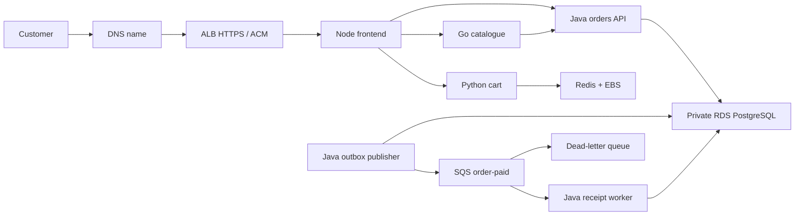

# Commerce AWS — learn to build, deliver and operate an AWS application

This is one application in one AWS **learning** environment. It reuses the Commerce
app so that your work focuses on infrastructure and operations. It does not depend
on your laptop Kubernetes cluster or the previous six-repository delivery system.

The code is prepared here; **AWS resources have not been created**. GitHub variables
`DELIVERY_ENABLED=false` and `INFRA_ENABLED=false` keep cloud jobs disabled.
`deploy/environment.yaml` also starts disabled. Do not claim the AWS end-to-end
deployment has passed until you have performed the activation exercises below.

## What you will learn

| Service/tool | Its actual responsibility here |
|---|---|
| VPC, subnets, routing, security groups | Public worker/ALB subnets, isolated database subnets, PostgreSQL access from nodes only |
| IAM, AWS SSO, GitHub OIDC | Human operator identity and short-lived workflow credentials |
| EKS, EC2 managed node group | Kubernetes control plane and one replaceable worker |
| ECR | Private, immutable application images and signed release evidence |
| EBS | Encrypted gp3 volumes for Redis and monitoring |
| RDS PostgreSQL | Private encrypted database, automated backups and manual restore exercises |
| SQS and dead-letter queue | Asynchronous order receipts, retries, duplicate handling and failed-message recovery |
| Secrets Manager and EKS Pod Identity | Scoped AWS workload identities; secrets never committed to Git |
| S3 | Versioned encrypted Terraform state, state locks and private saved plans |
| ALB and ACM | Public HTTPS endpoint and HTTP-to-HTTPS redirect |
| DNS / Route 53 | Point a domain you own to the ALB; existing external DNS is also fine |
| CloudWatch, SNS, KMS, Budgets | EKS audit logs, encrypted queue-alarm notifications, key policy and spending visibility |
| GitHub Actions | PR checks, parallel affected-image builds, signed publication, infrastructure plan/apply |
| Helm and Argo CD | Reconcile the reviewed deployment manifest into EKS |
| Prometheus, Grafana, Alertmanager, Slack | Kubernetes/application metrics, dashboards, actionable alerts and resolutions |
| CloudTrail event history | Investigate who performed AWS management operations |

We intentionally leave out service mesh, multiple accounts/clusters, multi-region,
multi-AZ data availability, Karpenter, complex progressive delivery and additional
databases. Learn reliable deployment and recovery before introducing those tools.

## Understand the traffic



Four application images run six processes. Orders, publisher and worker share the
same Java image with different `DELIVERY_ROLE` settings. The API writes an order
and outbox event in one database transaction. The publisher sends that event to
SQS; the worker records a receipt and acknowledges only after committing. The
inbox prevents a duplicate message from creating duplicate business effects.

The app contains accounts, administration, inventory, orders, refunds and an INR
storefront. Razorpay is **test mode only** and is not configured automatically in
AWS. Checkout needs test credentials before the payment exercise can pass. Do not
enable the local fake-payment mode on an internet-facing deployment.

## Repository map

```text
application/              Existing frontend, catalogue, orders and cart source/tests/Dockerfiles
infrastructure/bootstrap/ Retained S3 state bucket, ECR, publisher OIDC role and budget
infrastructure/session/   Destroyable VPC, EKS, RDS, queues, secrets and alarms
deploy/chart/             One small Helm application chart
deploy/platform/          Pinned platform versions, storage and Helm values
deploy/environment.yaml   Reviewed AWS environment settings; initially disabled
deploy/release.json       Four reviewed immutable image references
deploy/argocd.yaml        AppProject and the one application
.github/workflows/ci.yml  PR checks, required gate and release proposal
.github/workflows/image.yml Reusable affected-component build and publication
.github/workflows/infrastructure.yml Manual saved-plan apply/destroy
scripts/                  Small, documented automation helpers
tests/                    Delivery boundary tests
```

`application/SOURCES.md` records the reviewed source commits. Existing repositories
have not been deleted or replaced. Keep them until this project works independently.
Changes to the source repositories do **not** automatically appear in this snapshot.

## Cost choices and their tradeoffs

The default session uses one `t3.large` x86 worker and one `db.t4g.micro` RDS
instance. Check current regional prices before applying; these defaults are a
capacity starting point, not a cost estimate. The control plane, worker, public
IPv4, RDS, ALB/LCUs, EBS, logs, secrets, images, snapshots, DNS and data transfer can
all contribute to the bill. The alarm-notification KMS key and requests also have
charges. CPU credits can also matter for burstable instances.

* EKS requires two AZ subnets. Only the first AZ has a worker and database instance.
* The worker has a public IP but no SSH rule or internet-open application NodePort.
  ALB targets pod IPs. RDS is private. This avoids NAT Gateway charges; a hardened
  continuously running production system would normally use private workers.
* One worker is not highly available. Pod rescheduling does not survive an AZ loss.
  HPA can add frontend/catalogue pods but **does not add EC2 nodes**. The node group
  allows up to two nodes for manual scaling; no Cluster Autoscaler is installed.
* Monitoring keeps six hours of metrics and EKS audit logs keep three days. There
  is no central application-log archive in this first version; use `kubectl logs`.
* Redis uses encrypted EBS instead of a separate ElastiCache service. Cart data can
  be lost during session teardown. Orders and accounts belong in RDS.
* A single-replica deployment has no PDB: a `minAvailable: 1` PDB would prevent
  draining the only replica. Add replicas and a PDB during the availability exercise.
* Budgets send delayed notifications; they **do not stop charges**. Teardown is an
  explicit action. Closing the browser, stopping the laptop or scaling workers to
  zero does not delete the paid EKS control plane.
* Bootstrap resources are retained. Images, S3 state and retained RDS snapshots can
  cost money after a session is destroyed. Audit these at the end of each session.

A ₹1,000 target requires short, planned sessions and a current regional estimate.
This repository makes no guarantee that a fixed number of sessions fits that sum.

The agreed region is Mumbai (`ap-south-1`) and the monthly target is ₹1,000.
Before creating anything, inventory the selected account and review current Billing,
including existing resources in other regions. The default account-wide warning
threshold is a conservative USD 8, with alerts at 50%/80% actual and 100% forecast.
Taxes count; credits/refunds do not mask gross usage. Check the actual INR conversion
and invoice taxes before setting this threshold. No USD threshold guarantees an INR cap.

## Account inventory and ownership tracking

Terraform tracks directly managed resources. Kubernetes controllers own additional
resources: the managed node group creates EC2 instances, root disks and interfaces;
EBS CSI provisions PVC disks; the load-balancer controller creates ALBs, target
groups and security groups. Project tags are explicitly applied to these paths;
Terraform provider tags alone do not propagate to every child resource.

Take a baseline after secure login and another inventory after each session:

```bash
python3 scripts/inventory.py --profile commerce-learning --account YOUR_12_DIGIT_ACCOUNT_ID
```

This helper only lists/describes resources, verifies the expected account before
querying them, includes untagged/pre-existing resources and writes a private,
timestamped JSON report under gitignored `.work/inventory/`. A permission failure
makes the report incomplete and exits nonzero; it does not mean resources are absent.
It never retrieves secret values, creates resources or deletes resources. Keep the
baseline to distinguish this project from existing work; never delete unrelated
resources simply because they appear in the report. It covers the main Mumbai
services plus global S3 bucket names, not every AWS service/region or a billing audit.

Tagging is ownership evidence, not proof of zero charges. After teardown compare
inventories, inspect service-owned remnants and retained resources, then review
Billing after its reporting delay. A default VPC or unrelated existing resource
must not be destroyed as part of this project's cleanup.

## Security and review boundaries

Use a dedicated learning AWS account if available, MFA on the root account and an
SSO/assumable role for normal work. Never create root access keys. Do not put AWS
access keys, GitHub App private keys, Slack URLs or payment keys into this repo/chat.

Main requires a successful `Required checks` gate and a CODEOWNER review by
`Narx-Space-Prod/code-reviewers` (Code-S-12). Administrators are covered, stale
reviews are dismissed, last-push approval is required, and force pushes/deletions
are blocked. The developer cannot approve their own change. Initial repository
creation only seeds README on main; the implementation arrives by PR.

PR code gets a read-only GitHub token and no AWS credentials. Publication runs only
on main in `registry-release`, using an OIDC role trusted for that exact repository
and GitHub environment. Infrastructure uses separate plan and apply roles, and
`infrastructure-apply` requires a human reviewer. Protect all cloud environments
with main-only deployment branch policies before enabling the workflows.

Application workloads run as non-root, drop Linux capabilities, use read-only root
filesystems, resource requests/limits and startup/readiness/liveness probes. The
commerce namespace enforces restricted Pod Security. EKS VPC CNI network-policy
support is enabled. Policies isolate the namespace and limit external egress to
DNS, HTTPS, PostgreSQL and the Pod Identity endpoint. They are intentionally a
namespace boundary, not a separate least-privilege policy for every service pair.

Node IMDS requires v2 with hop limit one. Publisher can only send to its queue;
worker can only consume/delete/change visibility on that queue. External Secrets
can read only the two provisioned Secrets Manager ARNs. PostgreSQL connections
verify the RDS TLS certificate and hostname. A sync Job creates a limited login
for the application; regular workloads never receive the RDS master password.
The TLS CA bundle is public trust material, not a private key.

Pod Identity trust also requires the documented `eks-cluster-arn` request tag to
match this exact account/region/cluster. Keep session tags enabled on associations.

Terraform state contains generated secrets. S3 is private, encrypted, versioned and
TLS-only. Backend locks use S3 lockfiles. Saved infrastructure plans contain secrets
too: the workflow stores them privately in S3, passes their object version/checksum
between jobs and expires plan objects after one day. They are not GitHub artifacts.
Review/apply on the same day; an expired/stale plan must be regenerated.

The state backend uses SSE-S3; EKS 1.35 provides default API-data envelope encryption
with an AWS-owned key. Alarm notifications use a session KMS key with a specific
CloudWatch service grant. Four path-specific IaC scan exceptions in
`.trivyignore.yaml` document the learning networking choices and these encryption
decisions; they expire on 2027-01-30. Other HIGH/CRITICAL infrastructure findings
block CI. Exceptions must be reviewed rather than renewed automatically.

Images are signed, and SBOMs are attested. The initial chart does not install an
image-signature admission controller. Reviewers must verify candidate signatures
as described below. A digest-shaped reference alone does not prove a signature.
The first AWS exercise must validate actual IAM, CRD admission and network-policy
behaviour; offline renders are not proof that a cloud deployment works.

## 1. Validate without spending on AWS

Tools: Git, GitHub CLI, Docker/BuildKit, Python 3, Terraform 1.16.0, Helm 3.22.0,
kubectl compatible with Kubernetes 1.35, AWS CLI v2 and jq. On headless Linux use
SSH port forwarding for private administrative UIs. Tool downloads used in CI are
version-pinned and checksum checked by `scripts/tools.sh`.

```bash
git clone https://github.com/Narx-Space-Prod/commerce-aws.git
cd commerce-aws
python3 -m venv .venv
. .venv/bin/activate
pip install PyYAML==6.0.3
bash scripts/tools.sh helm kubeconform actionlint gitleaks
export PATH="$PWD/.work/bin:$PATH"
python3 -m unittest discover -s tests -v
python3 scripts/check_chart.py
actionlint
terraform fmt -check -recursive infrastructure
for root in bootstrap session; do
  terraform -chdir="infrastructure/$root" init -backend=false -lockfile=readonly
  terraform -chdir="infrastructure/$root" validate
  terraform -chdir="infrastructure/$root" test
done
```

Tests use mocked AWS providers, not your account. Helm renders validation-only dummy
digests in a temporary directory, never in `deploy/release.json`. Core Kubernetes
objects get strict schema checks. Operator custom resources are rendered and
structurally checked; real CRD admission still needs the EKS exercise.

Each Dockerfile runs its own component tests before producing a runtime image:

```bash
docker build -t commerce/frontend:check application/frontend
docker build -t commerce/catalogue:check application/catalogue
docker build -t commerce/orders:check application/orders
docker build -t commerce/cart:check application/orders/cart
```

Do not run all four builds simultaneously on a small laptop. GitHub-hosted runners
build affected components in parallel, with independent caches. A cart-only change
does not rebuild Java. Deployment/docs/inventory-only changes do not rebuild images.
Workflow changes and the shared build/release/tool scripts revalidate all images;
platform installation and inventory helpers do not invalidate application layers.

## 2. Review AWS access, budget and retained bootstrap

Before spending, choose the account, region, session duration and current cost
estimate. The example uses Mumbai (`ap-south-1`), not an automatically approved
choice. Log in with AWS SSO and verify the exact account:

```bash
aws configure sso --profile commerce-learning
aws sso login --profile commerce-learning
export AWS_PROFILE=commerce-learning
aws sts get-caller-identity
aws ec2 describe-availability-zones --region ap-south-1
aws iam list-open-id-connect-providers
```

Copy the bootstrap example, edit its account/region/email/bucket, and reuse any
existing GitHub OIDC provider in this account. The local file is gitignored.

```bash
cp infrastructure/bootstrap/bootstrap.example.tfvars infrastructure/bootstrap/terraform.tfvars
terraform -chdir=infrastructure/bootstrap init
terraform -chdir=infrastructure/bootstrap plan -out=bootstrap.tfplan
terraform -chdir=infrastructure/bootstrap apply bootstrap.tfplan
terraform -chdir=infrastructure/bootstrap output
```

The bootstrap root starts with **local sensitive state**. Migrate it to the new
bucket before continuing: add `backend "s3" {}` inside its existing `terraform`
block and run `terraform init -migrate-state` with bucket/region/key settings, using
`key=bootstrap/terraform.tfstate`, `encrypt=true` and `use_lockfile=true`. Review and
commit the backend declaration without hardcoding account secrets. Keep an encrypted
backup until migration is verified, then remove local state copies securely.
This one-time migration is deliberate; Terraform cannot create its own backend
before that bucket exists. Do not repeatedly create new state buckets.

Check the budget in AWS Billing before starting the session. Review its recipients.
The bucket and ECR repositories have `prevent_destroy`; session teardown does not
delete them. Do not disable those guards to fix an unrelated Terraform error.

## 3. Configure GitHub before enabling cloud workflows

Repository variables:

| Variable | Value |
|---|---|
| AWS_ACCOUNT_ID / AWS_REGION | Reviewed account and region |
| TF_STATE_BUCKET | Retained bucket name |
| AWS_RELEASE_ROLE_ARN | Bootstrap `release_role_arn` output |
| AWS_PLAN_ROLE_ARN / AWS_APPLY_ROLE_ARN | Dedicated infrastructure OIDC roles provisioned/reviewed for this account |
| RELEASE_APP_ID | Dedicated release GitHub App ID |
| DELIVERY_ENABLED / INFRA_ENABLED | Keep `false` until the respective activation checks pass |

Secrets:

* `RELEASE_APP_PRIVATE_KEY`: enter directly in the **release-proposal environment's
  Secrets**, not repository-wide secrets. Main-only environment protection prevents
  a developer's same-repository PR workflow from accessing the signing key. The App is installed
  only on this repository, with Contents read/write, Pull requests read/write,
  Metadata read. No Actions write, Administration, or bypass permission is needed.
  App-authored PRs trigger checks; PRs written with the ordinary `GITHUB_TOKEN`
  would not automatically trigger these workflows.
* `SESSION_TFVARS_JSON`: an **infrastructure-plan environment secret** containing
  JSON with the variables in
  `infrastructure/session/session.example.tfvars`. Match the account/region and
  replace the documentation-only IP with your current public `/32` address.

Create environments `registry-release`, `release-proposal`, `infrastructure-plan`
and `infrastructure-apply`, limited to main. Require Code-S-12 approval on
`infrastructure-apply` and prevent self-review. Source and release PRs provide the
application review gates; do not require four separate approvals for image publishers.

The infrastructure roles are **not** created with AdministratorAccess by this
repository. Provision them with an AWS administrator after selecting the account.
Both trust only `sts.amazonaws.com` and this repo's exact environment subject:
`repo:Narx-Space-Prod/commerce-aws:environment:infrastructure-plan` or
`...:environment:infrastructure-apply`. Use max session durations matching the
workflow (plan 30 minutes, apply one hour). The plan role needs discovery/read
permissions for session resources and runtime secret refresh, state GetObject,
plan PutObject, and state-lock Get/Put/Delete. The apply role additionally needs
session resource CRUD, scoped PassRole, IAM session-role management, plan-version
GetObjectVersion and state writes. Do not grant either role write access to its own
trust/policies, bootstrap publisher trust, or unrelated infrastructure. Review IAM
permissions against the actual plan before activation; Terraform validation cannot
prove that an IAM policy is sufficient or safely scoped.

These role policies and GitHub App credentials are an AWS activation prerequisite,
not something the unconfigured workflows can silently invent for your account.

## 4. Create the session infrastructure

For the first session you can plan locally using your reviewed SSO operator role.
Initialize the backend after replacing the example values below:

```bash
cp infrastructure/session/session.example.tfvars infrastructure/session/terraform.tfvars
terraform -chdir=infrastructure/session init -reconfigure \
  -backend-config='bucket=YOUR_STATE_BUCKET' \
  -backend-config='key=session/terraform.tfstate' \
  -backend-config='region=ap-south-1' \
  -backend-config='encrypt=true' -backend-config='use_lockfile=true'
terraform -chdir=infrastructure/session plan -out=session.tfplan
terraform -chdir=infrastructure/session apply session.tfplan
terraform -chdir=infrastructure/session output
```

Check the current EKS support calendar and regional add-on compatibility before
applying. Kubernetes starts at 1.35 with standard support only; add-on versions are
selected by EKS at initial creation and recorded in state. Review/pin the resulting
compatible versions for subsequent upgrade exercises. Update the PSA version and
schema validation together when deliberately changing Kubernetes versions.

For GitHub-operated sessions, set `INFRA_ENABLED=true`, dispatch **AWS infrastructure**,
choose apply and inspect the Plan job. Code-S-12 approves Apply, which downloads
the exact S3 object version and checks its SHA-256 before applying. Do not run a
local apply concurrently. State locking also prevents concurrent state changes.

Subscribe/confirm the SNS email: unconfirmed subscriptions do not deliver alarms.

## 5. Install the platform and private administration tools

The helper checks the AWS account, cluster name and actual API endpoint. It targets
the dedicated `commerce-aws` context, never your local kind cluster:

```bash
bash scripts/platform.sh install
kubectl --context commerce-aws get nodes
kubectl --context commerce-aws get pods -A
kubectl --context commerce-aws get storageclass
```

It installs pinned External Secrets, metrics-server, AWS Load Balancer Controller,
kube-prometheus-stack and Argo CD via Helm. This is a deliberate split: Terraform
owns AWS, Helm owns platform releases, Argo CD owns the application. Do not let a
second controller manage the same objects. Platform upgrades change versions/values
through a PR, then rerun this helper; Argo does not upgrade the platform tools.

The helper generates/preserves Grafana credentials and prompts for a **dedicated**
Slack incoming webhook with hidden input. It never copies credentials from the old
project or prints them. Installing the alert route can send real operational alerts
to that channel. Grafana/Prometheus/Argo are not exposed through the public ALB.

```bash
kubectl --context commerce-aws -n monitoring port-forward svc/monitoring-grafana 3000:80 --address 127.0.0.1
# In another terminal:
kubectl --context commerce-aws -n argocd port-forward svc/argocd-server 8443:443 --address 127.0.0.1
```

From your desktop use `ssh -L 3000:127.0.0.1:3000 -L 8443:127.0.0.1:8443 user@linux-host`.
Open Grafana at `http://localhost:3000` and Argo at `https://localhost:8443`.
Retrieve initial login credentials locally from the scoped Kubernetes secrets;
never paste them into a ticket/chat or commit them. Change initial admin passwords
before sharing access. Existing secrets are preserved rather than reset on each run.

Default Grafana dashboards cover Kubernetes/node/workload resources. The app's
ServiceMonitor scrapes all six processes; use Explore for request rates, latency,
errors and delivery metrics. Alertmanager routes warning/critical alerts to Slack,
with a 30-second grouping delay and resolved notifications. CloudWatch queue alarms
use SNS email. Per-stage GitHub/Argo Slack summaries are not implemented here yet;
Actions/Argo remain the delivery status source.

## 6. Configure HTTPS and the first signed release

For an existing Route 53 public hosted zone, set `shop_hostname` and
`route53_zone_id` in the session variables. Terraform provisions the regional ACM
certificate and its DNS validation record and waits for issuance. It does not buy a
domain or create a paid hosted zone. With external DNS instead, request/validate a
certificate manually **in the ALB region** and wait for ISSUED. Domain purchases
and hosted-zone charges are separate from this project's session resources.

Use the non-secret Terraform output ARNs in `deploy/config.example.yaml`, update
host/certificate/publicOrigin, then copy its reviewed contents to
`deploy/environment.yaml` on a feature branch. Keep it disabled until a complete
release exists. Never put secret values in Helm values.

Before setting `DELIVERY_ENABLED=true`, check ECR repositories, OIDC trust,
main-only environments, branch protection and release App permissions. Enable
publication and merge a small, real application change. To build all four images
for the first release, make the initial application import after enabling delivery,
or change the reviewed workflow/script configuration (which deliberately rebuilds
all components). There is no hidden force-build API or mutable `latest` release.

The main pipeline tests/scans each affected image, exports the exact runtime tar,
loads it in a separate publisher, publishes an immutable commit tag, signs its
digest and attests its SBOM. There is **no publication rebuild**. A release App
opens `release/<source-sha>` containing the four digest references. Later component
releases preserve previously reviewed digests for unchanged services.

Before approving a release, log in to ECR locally and verify **every** candidate
image using a pinned Cosign v3 client:

```bash
aws ecr get-login-password --region ap-south-1 | docker login \
  --username AWS --password-stdin ACCOUNT.dkr.ecr.ap-south-1.amazonaws.com
cosign verify \
  --certificate-oidc-issuer https://token.actions.githubusercontent.com \
  --certificate-identity https://github.com/Narx-Space-Prod/commerce-aws/.github/workflows/ci.yml@refs/heads/main \
  'ACCOUNT.dkr.ecr.ap-south-1.amazonaws.com/commerce-aws/frontend@sha256:REAL_DIGEST'
```

Check the actual certificate identity produced by the reusable workflow in the
first activation run. If it names `image.yml` instead of `ci.yml`, narrow the exact
identity to the verified main workflow; do not replace it with an unrestricted
regex. Verify the CycloneDX attestation with `cosign verify-attestation --type
cyclonedx` using the same issuer/identity before relying on the SBOM evidence.

Merge the reviewed release/configuration PRs. Argo polls main and syncs the app.
External Secrets creates runtime secrets; the database-user Job completes before
application deployments. RDS's generated master password stays out of app pods.

```bash
kubectl --context commerce-aws -n commerce get externalsecret
kubectl --context commerce-aws -n commerce get pods,svc,hpa,ingress,pvc
kubectl --context commerce-aws -n commerce rollout status deploy/commerce-orders --timeout=10m
kubectl --context commerce-aws -n commerce rollout status deploy/commerce-frontend --timeout=10m
kubectl --context commerce-aws -n argocd get application commerce
```

Find the ALB DNS name from the Ingress, then add a Route 53 alias A record or an
external-provider CNAME for your shop subdomain. Test HTTP redirect, valid HTTPS,
registration/login, cart, test payment, order history and asynchronous receipt.
For Razorpay, put test keys into a dedicated secret and map to `commerce-payments`;
the current chart references that optional secret but does not provision keys.
Do not call the payment journey verified until the sandbox exercise passes.

## 7. Normal developer and delivery flow

```text
feature branch → PR → read-only checks + affected-image tests/scans
→ CODEOWNER review → merge main → exact tested images to ECR + signatures/SBOM
→ release PR → reviewer verifies evidence/digests → merge
→ Argo sync → database-user setup → rolling deployments → readiness → monitoring
```

Required checks summarise configuration plus all necessary image builds. HIGH or
CRITICAL image findings block delivery, including unfixed ones. Fix the dependency
or prepare a specifically justified security change; do not switch off scanning.
Source changes that arrive during an older build prevent that older release proposal
from replacing the newer source. Review outstanding release PRs before merging a
newer release; close superseded candidates rather than merging out of order.

The reusable Dockerfiles contain the test commands. Node tests protect session,
checkout and BFF behaviour; Go tests cover the catalogue facade; Java tests cover
commerce and delivery; Python tests cover cart behaviour. You should understand
what fails and what is released, even if application development is not your role.

## 8. Useful operations commands and exercises

Always specify `--context commerce-aws` to avoid changing the old local cluster.

```bash
kubectl --context commerce-aws -n commerce get events --sort-by=.lastTimestamp
kubectl --context commerce-aws -n commerce describe pod POD_NAME
kubectl --context commerce-aws -n commerce logs deploy/commerce-orders --tail=100
kubectl --context commerce-aws -n commerce logs deploy/commerce-worker --previous --tail=100
kubectl --context commerce-aws top pods -n commerce
kubectl --context commerce-aws get volumeattachments,pv
aws eks describe-cluster --name commerce-aws --region ap-south-1
aws cloudtrail lookup-events --max-results 10 --region ap-south-1
```

Practice these in order and record the result, cause and recovery:

1. **Deploy a small UI change.** Observe only frontend rebuilding, the release PR,
   digest change, Argo sync, readiness and the new UI. Avoid cached/mutable image tags.
2. **Break a readiness endpoint in a branch.** Confirm failed rollout diagnosis;
   recover via a reviewed Git revert. Readiness is a traffic gate, not a data rollback.
3. **Investigate ImagePullBackOff.** Check exact digest, ECR region/account and node
   pull policy. Never fix it by making the registry public.
4. **Exercise HPA.** Generate controlled traffic, watch CPU and desired replicas.
   Observe Pending pods if capacity runs out. Manually grow the node group through
   Terraform, and reduce it after the exercise. Do not confuse HPA with node scaling.
5. **Exercise network policy.** Confirm application paths and monitoring work;
   a temporary pod in another namespace must not reach the database/app directly.
   Inspect the CNI and security groups instead of disabling policies permanently.
6. **Exercise SQS.** Stop the worker through a reviewed replica change, create a
   test event and watch backlog/age. Restore it and confirm receipt processing.
   Test a poison event with dedicated test data, observe the DLQ, diagnose before
   redriving, and confirm duplicate delivery does not duplicate a receipt.
7. **Test an alert and its resolution.** Use a clearly labelled temporary rule in
   a reviewable change; verify Slack accepts both notifications and remove the rule.
   Do not send repeated production-looking test alerts to an unrelated channel.
8. **Inspect CloudTrail and audit logs.** Find an operator change, correlate identity,
   action and time. CloudTrail Event History is available for management events;
   no separate long-term trail/archive is provisioned in this first version.
9. **Recover an application release.** Revert the relevant release/config commit
   through a PR. Argo restores the reviewed old digests. `kubectl rollout undo`
   alone is temporary because GitOps will reconcile it away.
10. **Perform the database restore below**, then complete a full teardown and rebuild.

There is no unattended business-data rollback. Flyway schema changes must stay
compatible with the previous application release. A Git revert cannot undo an order,
refund, destructive SQL migration or external payment.

## 9. Database backup and restore

RDS keeps one day of automated backups while the session exists. Session deletion
removes automated backups and **skips the final snapshot** to make cost cleanup
predictable. Preserve data with a manual snapshot before approving destroy.

```bash
snapshot="commerce-aws-manual-$(date -u +%Y%m%d%H%M%S)"
aws rds create-db-snapshot --db-instance-identifier commerce-aws \
  --db-snapshot-identifier "$snapshot" --region ap-south-1 \
  --tags Key=Project,Value=commerce-aws Key=Environment,Value=learning Key=ManagedBy,Value=manual-backup
aws rds wait db-snapshot-available --db-snapshot-identifier "$snapshot" --region ap-south-1
aws rds describe-db-snapshots --db-snapshot-identifier "$snapshot" --region ap-south-1
```

To restore into a new session, set `existing_backup_snapshot` to the saved snapshot
identifier and review the replacement plan. Never replace an active database by
accident: restore into a separate temporary identifier first for a non-disruptive
exercise, or destroy the disposable session after verifying its backup.
The RDS master password is managed by Secrets Manager; the bootstrap Job establishes
the limited application login with the new runtime password. Test login, product,
order and receipt data after restoring. A snapshot marked Available proves snapshot
creation; successful application reads prove recovery. Snapshots continue costing
money until intentionally deleted after they are no longer needed.

## 10. End every AWS session deliberately

Check backups before using these commands. Teardown deletes commerce/monitoring
PVCs and their data. Retained manual RDS snapshots are the recovery path.

```bash
CONFIRM_DESTROY='destroy commerce-aws' bash scripts/platform.sh teardown
# Inspect controller-owned resources before destroying the cluster:
aws elbv2 describe-load-balancers --region ap-south-1
aws ec2 describe-volumes --region ap-south-1
terraform -chdir=infrastructure/session plan -destroy -out=destroy.tfplan
terraform -chdir=infrastructure/session apply destroy.tfplan
```

Alternatively dispatch the infrastructure workflow with operation `destroy` and
confirmation `destroy commerce-aws`, inspect the saved destroy plan and approve it.
Run Kubernetes cleanup first. Removing EKS before the ALB controller processes its
Ingress finalizer can leave billable load balancers and network interfaces behind.
Deleting Helm releases does not reliably delete their retained PVCs; the helper
explicitly deletes monitoring PVCs while the EBS driver still exists.

Finally verify EKS cluster deletion and inspect EC2 instances, EBS, ALBs, RDS,
snapshots, public IPs, secrets and CloudWatch log groups for this project. Confirm
there is no NAT Gateway. Keep state/images only intentionally. Review AWS Billing
after its reporting delay; a successful Terraform command is not a billing audit.
Do not destroy the retained bootstrap root as part of normal session cleanup.

## Python scripts: what a DevOps engineer should understand

You do not need to memorise every line. You should be able to explain inputs,
outputs, permissions, side effects, failures and how to rerun safely.

| Script | What to understand |
|---|---|
| `changes.py` | Git diff selects components; workflows/build scripts invalidate all builds; inventory/platform changes do not; cart is independent of Java |
| `release.py` | Publisher records merge into one JSON manifest; exact component/account/region/digest validation |
| `check_chart.py` | Temporary enabled/disabled renders, core API schemas and container security checks; no cloud access |
| `secrets.py` | Hidden Slack input, generated Grafana password, fixed context/scope, preservation, stdin-only secret writes |
| `inventory.py` | Read-only before/after resource reports, account guard, untagged resources and explicit incomplete-result handling |

The shell helpers install checksum-verified tools and perform explicit EKS platform
installation/cleanup. CI YAML orchestrates steps; Terraform describes AWS resources;
Helm templates Kubernetes resources. Keeping these responsibilities separate avoids
one giant script that tries to build, provision, deploy and recover everything.

## What remains before calling the environment operational

Review/merge the foundation, choose AWS account/region/budget, configure least-scope
infrastructure OIDC roles and the release App, migrate the bootstrap state, apply
the session, install the platform, configure ACM/DNS/payment sandbox, verify signed
releases, and perform real deployment/alert/restore/teardown exercises. Record actual
results rather than describing prepared YAML as a completed production deployment.

## Primary references

* [EKS networking requirements](https://docs.aws.amazon.com/eks/latest/userguide/network-reqs.html)
* [EKS pricing](https://aws.amazon.com/eks/pricing/)
* [EKS supported Kubernetes versions](https://docs.aws.amazon.com/eks/latest/userguide/kubernetes-versions-standard.html)
* [EKS Pod Identity](https://docs.aws.amazon.com/eks/latest/userguide/pod-identities.html)
* [Pod Identity trust conditions](https://docs.aws.amazon.com/eks/latest/userguide/pod-id-role.html)
* [EKS default envelope encryption](https://docs.aws.amazon.com/eks/latest/userguide/envelope-encryption.html)
* [CloudTrail event history](https://docs.aws.amazon.com/awscloudtrail/latest/userguide/view-cloudtrail-events.html)
* [GitHub AWS OIDC](https://docs.github.com/en/actions/how-tos/secure-your-work/security-harden-deployments/oidc-in-aws)
* [Terraform S3 backend and locking](https://developer.hashicorp.com/terraform/language/backend/s3)
* [AWS Load Balancer Controller v3.6.2 IAM policy](https://github.com/kubernetes-sigs/aws-load-balancer-controller/blob/v3.6.2/docs/install/iam_policy.json)

