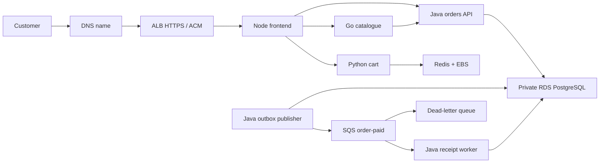

# Commerce AWS — learn to build, deliver and operate an AWS application

This is one application in one AWS **learning** environment. It reuses the Commerce
app so that your work focuses on infrastructure and operations. It does not depend
on your laptop Kubernetes cluster or the previous six-repository delivery system.

**Status snapshot, 31 October 2026:** The protected AWS infrastructure Apply
run **41211513095** completed successfully after recovery of the earlier partial
apply. Its reviewed plan reconciled the existing Terraform state, created the
missing worker and EKS add-ons, and replaced the tainted runtime-secret resource.
The final apply reported 6 added, 0 changed and 1 destroyed; the destroyed object
was the tainted secret instance. Terraform now manages 59 session resources.

AWS currently has one active EKS 1.35 cluster (`commerce-aws`) with one Ready
`m7i-flex.large` worker, one private single-AZ PostgreSQL RDS instance (`db.t4g.micro`),
queues, secrets and supporting services. Argo CD is installed. Its six platform
Applications—baseline, cert-manager, External Secrets, metrics-server, AWS Load
Balancer Controller and monitoring—plus the platform root and commerce Application
are Synced and Healthy. Prometheus, Grafana and Alertmanager are running; the
Alertmanager Slack secret is mounted. No test alert has been sent.

The commerce Application is registered but the environment is deliberately disabled:
`deploy/environment.yaml` has `enabled: false` and ingress disabled. Bootstrap
Terraform now manages retained public Route 53 zone `narx.space` (hosted-zone ID
`Z06237232MW4CNEZD77K6`). It currently contains only Route 53's default NS and SOA
records. Cloudflare remains authoritative; no registrar delegation was changed. There
is no ALB, ACM certificate or shop record. Export and review the complete Cloudflare
record set before recreating records in Route 53 or changing nameservers at the
registrar.
Secure public HTTPS is needed before exercising login or checkout with real browser
sessions. The Razorpay test credentials are not configured.

The four immutable image digests in `deploy/release.json` exist in ECR and have
previously verified signatures and SBOM attestations. `DELIVERY_ENABLED=false` means
future main changes will not publish images. `INFRA_ENABLED=false` blocks new
infrastructure workflow starts; neither flag stops the currently running AWS
resources. EKS, its worker, RDS and monitoring EBS volumes continue to incur charges.
No infrastructure destroy, restore, live customer journey or test alert has been
performed yet. This status is a snapshot, not proof of the current AWS bill.

Read this guide in order for the first build: architecture and costs; identity and
bootstrap; GitHub setup; session creation; platform and release; operations and
cleanup. The reference chapters after the runbook explain each code file and trace
requests, credentials, deployment, recovery and troubleshooting. Examples use
placeholders; replace them locally and never paste secrets or MFA codes into chat.
This status is a snapshot, not proof of the current AWS bill or resource inventory.

## What you will learn

| Service/tool | Its actual responsibility here |
|---|---|
| VPC, subnets, routing, security groups | Public worker/ALB subnets, isolated database subnets, PostgreSQL access from nodes only |
| IAM, STS, GitHub OIDC | Human operator identity and short-lived workflow credentials |
| EKS, EC2 managed node group | Kubernetes control plane and one replaceable worker |
| ECR | Private, immutable application images and signed release evidence |
| EBS | Encrypted gp3 volumes for Redis and monitoring |
| RDS PostgreSQL | Private encrypted database, automated backups and manual restore exercises |
| SQS and dead-letter queue | Asynchronous order receipts, retries, duplicate handling and failed-message recovery |
| Secrets Manager and EKS Pod Identity | Scoped AWS workload identities; secrets never committed to Git |
| S3 | Versioned encrypted Terraform state, state locks and private saved plans |
| ALB and ACM | Public HTTPS endpoint and HTTP-to-HTTPS redirect |
| DNS / Route 53 | Point a domain you own to the ALB; existing external DNS is also fine |
| CloudWatch, SNS, KMS, Budgets | EKS audit logs, encrypted queue-alarm notifications, key policy and spending visibility |
| GitHub Actions | PR checks, parallel affected-image builds, signed publication, infrastructure plan/apply |
| Helm and Argo CD | Reconcile the reviewed deployment manifest into EKS |
| Prometheus, Grafana, Alertmanager, Slack | Kubernetes/application metrics, dashboards, actionable alerts and resolutions |
| CloudTrail event history | Investigate who performed AWS management operations |

We intentionally leave out service mesh, multiple accounts/clusters, multi-region,
multi-AZ data availability, Karpenter, complex progressive delivery and additional
databases. Learn reliable deployment and recovery before introducing those tools.

## Understand the traffic



Four application images run six processes. Orders, publisher and worker share the
same Java image with different `DELIVERY_ROLE` settings. The API writes an order
and outbox event in one database transaction. The publisher sends that event to
SQS; the worker records a receipt and acknowledges only after committing. The
inbox prevents a duplicate message from creating duplicate business effects.

The app contains accounts, administration, inventory, orders, refunds and an INR
storefront. Razorpay is **test mode only** and is not configured automatically in
AWS. Checkout needs test credentials before the payment exercise can pass. Do not
enable the local fake-payment mode on an internet-facing deployment.

## Repository map

```text
application/              Existing frontend, catalogue, orders and cart source/tests/Dockerfiles
infrastructure/bootstrap/ Retained S3 state bucket, ECR, publisher OIDC role and budget
infrastructure/session/   Environment composition, backend, inputs/outputs and resource moves
infrastructure/modules/   Network, EKS and data child modules
deploy/chart/             One small Helm application chart
deploy/platform/          Argo platform Applications, baseline resources and chart values
deploy/environment.yaml   Reviewed AWS environment settings; initially disabled
deploy/release.json       Four reviewed immutable image references
deploy/argocd.yaml        AppProject and the one application
.github/workflows/ci.yml  PR checks, required gate and release proposal
.github/workflows/image.yml Reusable affected-component build and publication
.github/workflows/infrastructure.yml Manual saved-plan apply/destroy
scripts/                  Small, documented automation helpers
tests/                    Delivery boundary tests
```

`application/SOURCES.md` records the reviewed source commits. Existing repositories
have not been deleted or replaced. Keep them until this project works independently.
Changes to the source repositories do **not** automatically appear in this snapshot.

## Cost choices and their tradeoffs

The design priority is production-style change control, ownership, security and
repeatable operations. Cost choices adjust capacity, availability and retention;
they must not create artificial dependencies between infrastructure and application
pipelines. Provisioning EKS and installing its platform does not require a completed
application image release. Application CI can publish independently of cluster
existence. Preparing charts or images early is optional scheduling, not a gate.

The default session uses one `m7i-flex.large` x86 worker and one `db.t4g.micro` RDS
instance. Check current regional prices before applying; these defaults are a
capacity starting point, not a cost estimate. The control plane, worker, public
IPv4, RDS, ALB/LCUs, EBS, logs, secrets, images, snapshots, DNS and data transfer can
all contribute to the bill. The alarm-notification KMS key and requests also have
charges. CPU credits can also matter for burstable instances.

On 31 October 2026, AWS's API marked `m7i-flex.large` Free Tier eligible and
available in the selected Mumbai AZs, with 2 vCPU and 8 GiB memory. The previous
`t3.large` choice was not marked eligible. The checked Linux/shared rate for the
new worker is USD 0.10075/hour. Eligibility does not make resource usage free:
usage can consume credits, and service availability still depends on the account.
The revised core estimate is approximately USD 0.28/hour, or USD 0.84 for three
hours including an assumed ALB/one LCU. Taxes, logs, API calls, data transfer,
extra/surge nodes and retained storage/snapshots can add cost; this is not a cap.

* EKS requires two AZ subnets. Only the first AZ has a worker and database instance.
* The worker has a public IP but no SSH rule or internet-open application NodePort.
  ALB targets pod IPs. RDS is private. This avoids NAT Gateway charges; a hardened
  continuously running production system would normally use private workers.
* One worker is not highly available. Pod rescheduling does not survive an AZ loss.
  HPA can add frontend/catalogue pods but **does not add EC2 nodes**. The node group
  allows up to two nodes for manual scaling; no Cluster Autoscaler is installed.
* Monitoring keeps six hours of metrics and EKS audit logs keep three days. There
  is no central application-log archive in this first version; use `kubectl logs`.
* Redis uses encrypted EBS instead of a separate ElastiCache service. Cart data can
  be lost during session teardown. Orders and accounts belong in RDS.
* A single-replica deployment has no PDB: a `minAvailable: 1` PDB would prevent
  draining the only replica. Add replicas and a PDB during the availability exercise.
* Budgets send delayed notifications; they **do not stop charges**. Teardown is an
  explicit action. Closing the browser, stopping the laptop or scaling workers to
  zero does not delete the paid EKS control plane.
* Bootstrap resources are retained. Images, S3 state and retained RDS snapshots can
  cost money after a session is destroyed. Audit these at the end of each session.

A ₹1,000 target requires short, planned sessions and a current regional estimate.
This repository makes no guarantee that a fixed number of sessions fits that sum.

The agreed region is Mumbai (`ap-south-1`) and the monthly target is ₹1,000.
Before creating anything, inventory the selected account and review current Billing,
including existing resources in other regions. The default account-wide warning
threshold is a conservative USD 8, with alerts at 50%/80% actual and 100% forecast.
Taxes count; credits/refunds do not mask gross usage. Check the actual INR conversion
and invoice taxes before setting this threshold. No USD threshold guarantees an INR cap.

## Account inventory and ownership tracking

Terraform tracks directly managed resources. Kubernetes controllers own additional
resources: the managed node group creates EC2 instances, root disks and interfaces;
EBS CSI provisions PVC disks; the load-balancer controller creates ALBs, target
groups and security groups. Project tags are explicitly applied to these paths;
Terraform provider tags alone do not propagate to every child resource.

Take a baseline after secure login and another inventory after each session:

```bash
python3 scripts/inventory.py --profile commerce-learning --account YOUR_12_DIGIT_ACCOUNT_ID
```

This helper only lists/describes resources, verifies the expected account before
querying them, includes untagged/pre-existing resources and writes a private,
timestamped JSON report under gitignored `.work/inventory/`. A permission failure
makes the report incomplete and exits nonzero; it does not mean resources are absent.
It never retrieves secret values, creates resources or deletes resources. Keep the
baseline to distinguish this project from existing work; never delete unrelated
resources simply because they appear in the report. It covers the main Mumbai
services plus global S3 bucket and Route 53 zone names, not every AWS service/region or a billing audit.

Tagging is ownership evidence, not proof of zero charges. After teardown compare
inventories, inspect service-owned remnants and retained resources, then review
Billing after its reporting delay. A default VPC or unrelated existing resource
must not be destroyed as part of this project's cleanup.

## Security and review boundaries

### Resource ownership and retention contract

Every project resource must have an owner, a source of desired configuration and
a deletion or retention decision. Terraform state tracks direct AWS resources;
controllers track their generated resources through Kubernetes objects and AWS
identifiers/tags. The account inventory is the independent check. A controller-created
ALB does not also belong in Terraform state: two writers would conflict.

| Resource | Configuration owner | End-of-session handling |
|---|---|---|
| State bucket, ECR repositories, budget, OIDC and pipeline identities/boundaries | Terraform bootstrap state | Intentionally retained; review storage, image retention and permissions. |
| VPC, EKS, node group/launch template, RDS, queues, runtime secret, alarms and notification key/topic | Terraform session state | Destroy through a reviewed plan; check scheduled key deletion and retained data separately. |
| EC2 instances, root disks, autoscaling group and node interfaces | EKS managed node group / AWS service | Delete through the node group; verify instance, volume, ASG and interface inventory afterward. |
| ALB, listeners, target groups and controller security groups | Reviewed Helm Ingress + Load Balancer Controller | Remove Ingress while its controller runs; inspect AWS inventory, including target groups and security groups. |
| Redis and monitoring EBS disks | Reviewed StorageClass/PVCs + EBS CSI | Delete PVCs while CSI runs; inspect disks and volume attachments afterward. |
| Argo CD bootstrap release | Pinned Helm chart + `argo-values.yaml`, installed by platform helper | Uninstall last, after Argo finishes child-resource cleanup. |
| Platform components and baseline resources | Argo platform Applications + pinned charts and reviewed Git values | Ordered cascading Application deletion through the helper before destroying EKS. |
| Application Kubernetes objects | Argo CD Application + Helm chart and reviewed Git values | Stop reconciliation and remove the namespace during teardown. |
| Manual database recovery snapshots | Snapshot exercise command, ownership tags and private inventory IDs | Intentionally retained only with a recorded purpose; delete when no longer needed. Snapshots are not automatically managed by session state. |
| `narx.space` public hosted zone | Terraform bootstrap state with `prevent_destroy` | Retained; keep the current Cloudflare delegation until all records are copied and verified. |
| ACM certificate, validation and shop alias | Pending a reviewed follow-up after DNS record inventory and zone delegation | Keep shop ingress disabled until the certificate is issued and its ALB alias is reviewed. |
| AWS service-linked roles | AWS service lifecycle, recorded in global inventory | May be shared across workloads; retain intentionally rather than deleting shared identities blindly. |
| Existing human IAM user/group/MFA, domain registration and registrar settings | Pre-existing account/domain administration | Keep outside Terraform; Terraform manages the Route 53 zone, not domain ownership or registrar account settings. |

The temporary `commerce-aws-iam-setup` role was a recorded bootstrap exception and
has been deleted. The persistent objects it created were imported into bootstrap
state and the post-import plan showed no drift. Do not create new project resources
manually without importing them or assigning an explicit controller/retention owner.
Inventory includes project IAM identities, service-linked roles, ALB target groups,
secrets pending deletion and KMS deletion status; absence of a successful query is
never evidence of cleanup. This remains a scoped Mumbai/global inventory, not a
guarantee that every AWS service and region has been audited.

The initial snapshot exercise and DNS cutover remain pending. Do not change
registrar nameservers as part of zone creation. First export Cloudflare's full DNS
record set, recreate all required records in Route 53 through reviewed Terraform,
verify the records, then change delegation at the domain registrar. The hosted
zone's automatically assigned NS values are available from the bootstrap outputs.
An approval, inventory report or tag alone does not make a resource Terraform-managed.

Use a dedicated learning AWS account if available, MFA on the root account and an
SSO/assumable role for normal work. Never create root access keys. Do not put AWS
access keys, GitHub App private keys, Slack URLs or payment keys into this repo/chat.

Main requires a successful `Required checks` gate and a CODEOWNER review by
`Narx-Space-Prod/code-reviewers` (Code-S-12). Administrators are covered, stale
reviews are dismissed, last-push approval is required, and force pushes/deletions
are blocked. The developer cannot approve their own change. Initial repository
creation only seeds README on main; the implementation arrives by PR.

PR code gets a read-only GitHub token and no AWS credentials. Publication runs only
on main in `registry-release`, using an OIDC role trusted for that exact repository
and GitHub environment. Infrastructure uses separate plan and apply roles, and
`infrastructure-apply` requires a human reviewer. Protect all cloud environments
with main-only deployment branch policies before enabling the workflows.

Application workloads run as non-root, drop Linux capabilities, use read-only root
filesystems, resource requests/limits and startup/readiness/liveness probes. The
commerce namespace enforces restricted Pod Security. EKS VPC CNI network-policy
support is enabled. Policies isolate the namespace and limit external egress to
DNS, HTTPS, PostgreSQL and the Pod Identity endpoint. They are intentionally a
namespace boundary, not a separate least-privilege policy for every service pair.

Node IMDS requires v2 with hop limit one. Publisher can only send to its queue;
worker can only consume/delete/change visibility on that queue. External Secrets
can read only the two provisioned Secrets Manager ARNs. PostgreSQL connections
verify the RDS TLS certificate and hostname. A sync Job creates a limited login
for the application; regular workloads never receive the RDS master password.
The TLS CA bundle is public trust material, not a private key.

Pod Identity trust also requires the documented `eks-cluster-arn` request tag to
match this exact account/region/cluster. Keep session tags enabled on associations.

Terraform state contains generated secrets. S3 is private, encrypted, versioned and
TLS-only. Backend locks use S3 lockfiles. Saved infrastructure plans contain secrets
too: the workflow stores them privately in S3, passes their object version/checksum
between jobs and expires plan objects after one day. They are not GitHub artifacts.
Review/apply on the same day; an expired/stale plan must be regenerated.

The state backend uses SSE-S3; EKS 1.35 provides default API-data envelope encryption
with an AWS-owned key. Alarm notifications use a session KMS key with a specific
CloudWatch service grant. Four path-specific IaC scan exceptions in
`.trivyignore.yaml` document the learning networking choices and these encryption
decisions; they expire on 2027-01-30. Other HIGH/CRITICAL infrastructure findings
block CI. Exceptions must be reviewed rather than renewed automatically.

Images are signed, and SBOMs are attested. The initial chart does not install an
image-signature admission controller. Reviewers must verify candidate signatures
as described below. A digest-shaped reference alone does not prove a signature.
The first AWS exercise must validate actual IAM, CRD admission and network-policy
behaviour; offline renders are not proof that a cloud deployment works.

## 1. Validate without spending on AWS

Use a fresh clone or separate worktree for the following backend-disabled checks;
do not reinitialize an operational state-connected checkout with `-backend=false`.
Tools: Git, GitHub CLI, Docker/BuildKit, Python 3, Terraform 1.16.0, Helm 3.22.0,
kubectl compatible with Kubernetes 1.35, AWS CLI v2 and jq. On headless Linux use
SSH port forwarding for private administrative UIs. Tool downloads used in CI are
version-pinned and checksum checked by `scripts/tools.sh`.

```bash
git clone https://github.com/Narx-Space-Prod/commerce-aws.git
cd commerce-aws
python3 -m venv .venv
. .venv/bin/activate
pip install PyYAML==6.0.3
bash scripts/tools.sh helm kubeconform actionlint gitleaks
export PATH="$PWD/.work/bin:$PATH"
python3 -m unittest discover -s tests -v
python3 scripts/check_chart.py
actionlint
terraform fmt -check -recursive infrastructure
for root in bootstrap session; do
  terraform -chdir="infrastructure/$root" init -backend=false -lockfile=readonly
  terraform -chdir="infrastructure/$root" validate
  terraform -chdir="infrastructure/$root" test
done
```

Tests use mocked AWS providers, not your account. Helm renders validation-only dummy
digests in a temporary directory, never in `deploy/release.json`. Core Kubernetes
objects get strict schema checks. Operator custom resources are rendered and
structurally checked; real CRD admission still needs the EKS exercise.

Each Dockerfile runs its own component tests before producing a runtime image:

```bash
docker build -t commerce/frontend:check application/frontend
docker build -t commerce/catalogue:check application/catalogue
docker build -t commerce/orders:check application/orders
docker build -t commerce/cart:check application/orders/cart
```

Do not run all four builds simultaneously on a small laptop. GitHub-hosted runners
build affected components in parallel, with independent caches. A cart-only change
does not rebuild Java. Deployment/docs/inventory-only changes do not rebuild images.
Workflow changes and the shared build/release/tool scripts revalidate all images;
platform installation and inventory helpers do not invalidate application layers.

## 2. Review AWS access, budget and retained bootstrap

Before spending, verify the account, agreed Mumbai region (`ap-south-1`), session
duration and current cost estimate. If IAM Identity Center is already configured,
you can use the SSO commands below. For this project's standalone account, use the
non-root console-login path after the example; do not create an organization just
to follow an SSO example.

```bash
aws configure sso --profile commerce-sso-example
aws sso login --profile commerce-sso-example
export AWS_PROFILE=commerce-sso-example
aws sts get-caller-identity
aws ec2 describe-availability-zones --region ap-south-1
aws iam list-open-id-connect-providers
```

For this account, initial access uses the non-root `commerce-operator` IAM user with
MFA and `aws login --remote --profile commerce-learning --region ap-south-1`.
The user belongs to the read-only `commerce-observers` group with
`ReadOnlyAccess` and `SignInLocalDevelopmentAccess`; no permanent access keys are
needed. Use existing Identity Center if already available. Creating/joining an AWS
Organization can expire Free Tier credits; do not enable an organization as an
incidental login setup step. A direct paid-plan upgrade has different credit rules;
review that separately only if a required service actually needs it.

### Scoped access for the first foundation apply

Read-only access can inventory and plan; it cannot create the budget, state bucket,
registry or publisher role. `bootstrap/access.tf` defines an optional human setup
role named `commerce-aws-bootstrap`. It trusts one exact IAM user, requires MFA and
limits sessions to one hour. Its writes cover only the named state bucket, four
ECR repositories, the `commerce-aws` budget, GitHub OIDC and the bounded publisher
role. It cannot create EKS/EC2/RDS, modify its own access, or rewrite/remove the
publisher boundary. The observer group's permissions stay read-only.

There is a one-time identity bootstrap: root creates four **IAM-only** objects
from the reviewed definitions, which are then imported into Terraform. Root is
needed because the observer cannot grant itself permissions. These objects must
be tracked before applying the chargeable foundation; they are not an unrecorded
exception to infrastructure ownership. No `AdministratorAccess` policy is used.

1. Set `bootstrap_user_arn` in your private bootstrap variables to the exact
   non-root user ARN verified with STS. Generate a **plan**, not an apply. The
   `bootstrap_access_documents` planned output contains the trust JSON, write JSON,
   publisher boundary JSON and exact names/descriptions/tags. These documents have
   account identifiers but no credentials. Keep the full plan private: it also
   includes notification contact details.
2. In the root console, create customer-managed policy
   `commerce-aws-publisher-boundary` from the exported boundary JSON, using its
   exported description and tags. This caps the publisher at its four ECR repos.
3. Create role `commerce-aws-bootstrap` using **Custom trust policy** and the
   exported trust JSON. Attach AWS-managed `ReadOnlyAccess`; use the exported role
   description/tags and a maximum session of one hour.
4. On that role, create inline policy `bootstrap-resources` from the exported
   write JSON. Root owns these access controls; the scoped role cannot change them.
5. Sign back in as the IAM user. Configure profile `commerce-bootstrap` with
   `role_arn=arn:aws:iam::ACCOUNT:role/commerce-aws-bootstrap`,
   `source_profile=commerce-learning`, `mfa_serial=YOUR_MFA_DEVICE_ARN`,
   `duration_seconds=3600` and `region=ap-south-1`. In your own terminal, run
   `aws sts get-caller-identity --profile commerce-bootstrap` and enter the MFA code
   there. Never paste a code or exported credentials into chat.
6. For Terraform, use a separate `commerce-bootstrap-tf` process-credentials profile:
   `credential_process = /ABSOLUTE/PATH/TO/aws configure export-credentials --profile commerce-bootstrap --format process`.
   The CLI retrieves the cached role session for the SDK without printing secrets
   into a shell log. Authenticate the CLI interactively first; an expired role
   session needs a fresh MFA login. Do not run the export command directly in chat.

For a brand-new account, the S3 backend bucket does not exist yet. Temporarily move
the backend declaration aside and initialize local state before the imports. Restore
it after the first foundation apply, then migrate the state as described below.

```bash
mkdir -p .work
mv infrastructure/bootstrap/backend.tf .work/bootstrap-backend.tf
terraform -chdir=infrastructure/bootstrap init
```

With `AWS_PROFILE=commerce-bootstrap-tf`, import the four pre-created objects:

```bash
# Pass your private bootstrap -var-file to each import command if it isn't terraform.tfvars.
terraform -chdir=infrastructure/bootstrap import 'aws_iam_policy.publisher_boundary[0]' \
  'arn:aws:iam::ACCOUNT:policy/commerce-aws-publisher-boundary'
terraform -chdir=infrastructure/bootstrap import 'aws_iam_role.bootstrap[0]' commerce-aws-bootstrap
terraform -chdir=infrastructure/bootstrap import 'aws_iam_role_policy_attachment.bootstrap_read[0]' \
  'commerce-aws-bootstrap/arn:aws:iam::aws:policy/ReadOnlyAccess'
terraform -chdir=infrastructure/bootstrap import 'aws_iam_role_policy.bootstrap_write[0]' \
  'commerce-aws-bootstrap:bootstrap-resources'
```

Re-plan after import. Stop if Terraform proposes modifying the protected access
objects: root must reconcile the reviewed JSON, descriptions and tags first.
Only the expected foundation creations should remain. Keep this role restricted
to foundation maintenance; separate reviewed OIDC roles will provision the session.
Authentication/MFA and real IAM sufficiency must be checked in AWS before apply;
mocked policy tests cannot establish live permission behaviour.

Primary access references: [custom role creation](https://docs.aws.amazon.com/IAM/latest/UserGuide/id_roles_create_for-custom.html),
[same-account trusted principals](https://docs.aws.amazon.com/IAM/latest/UserGuide/reference_policies_elements_principal.html),
[role profiles](https://docs.aws.amazon.com/cli/latest/userguide/cli-configure-role.html),
[Free Tier upgrade and Organizations rules](https://docs.aws.amazon.com/awsaccountbilling/latest/aboutv2/free-tier-FAQ.html).

Copy the bootstrap example, edit its account/region/email/bucket, and reuse any
existing GitHub OIDC provider in this account. The local file is gitignored.

```bash
cp infrastructure/bootstrap/bootstrap.example.tfvars infrastructure/bootstrap/terraform.tfvars
terraform -chdir=infrastructure/bootstrap plan -out=bootstrap.tfplan
terraform -chdir=infrastructure/bootstrap apply bootstrap.tfplan
terraform -chdir=infrastructure/bootstrap output
```

The bootstrap root starts with **local sensitive state**. Restore the reviewed
backend declaration moved aside above, then migrate state to the new bucket:

```bash
mv .work/bootstrap-backend.tf infrastructure/bootstrap/backend.tf
terraform -chdir=infrastructure/bootstrap init -migrate-state \
  -backend-config='bucket=YOUR_STATE_BUCKET' \
  -backend-config='key=bootstrap/terraform.tfstate' \
  -backend-config='region=ap-south-1' \
  -backend-config='encrypt=true' -backend-config='use_lockfile=true'
```

Keep an encrypted backup until migration is verified, then remove local state copies
securely. Backend details are supplied at initialization; do not commit credentials.
This one-time migration is deliberate; Terraform cannot create its own backend
before that bucket exists. Do not repeatedly create new state buckets.

Check the budget in AWS Billing before starting the session. Review its recipients.
The bucket, ECR repositories and public Route 53 zone have `prevent_destroy`;
session teardown does not delete them. Do not disable those guards to fix an unrelated
Terraform error. Route 53 charges $0.50 USD per public hosted zone per month for
the first 25 zones, plus query charges where applicable; this is a persistent cost
([pricing details](https://aws.amazon.com/route53/pricing/)).

## 3. Configure GitHub before enabling cloud workflows

Repository variables:

| Variable | Value |
|---|---|
| AWS_ACCOUNT_ID / AWS_REGION | Reviewed account and region |
| TF_STATE_BUCKET | Retained bucket name |
| AWS_RELEASE_ROLE_ARN | Bootstrap `release_role_arn` output |
| AWS_PLAN_ROLE_ARN / AWS_APPLY_ROLE_ARN | Dedicated infrastructure OIDC roles provisioned/reviewed for this account |
| RELEASE_APP_ID | Dedicated release GitHub App ID |
| DELIVERY_ENABLED / INFRA_ENABLED | Keep `false` until the respective activation checks pass |

Secrets:

* `RELEASE_APP_PRIVATE_KEY`: enter directly in the **release-proposal environment's
  Secrets**, not repository-wide secrets. Main-only environment protection prevents
  a developer's same-repository PR workflow from accessing the signing key. The App is installed
  only on this repository, with Contents read/write, Pull requests read/write,
  Metadata read. No Actions write, Administration, or bypass permission is needed.
  App-authored PRs trigger checks; PRs written with the ordinary `GITHUB_TOKEN`
  would not automatically trigger these workflows.
* `SESSION_TFVARS_JSON`: an **infrastructure-plan environment secret** containing
  JSON with the variables in
  `infrastructure/session/session.example.tfvars`. Match the account/region and
  replace the documentation-only IP with your current public `/32` address.

Create environments `registry-release`, `release-proposal`, `infrastructure-plan`
and `infrastructure-apply`, limited to main. Require Code-S-12 approval on
`infrastructure-apply` and prevent self-review. Source and release PRs provide the
application review gates; do not require four separate approvals for image publishers.

The infrastructure roles are **not** created with AdministratorAccess by this
repository. Provision them with an AWS administrator after selecting the account.
Both trust only `sts.amazonaws.com` and this repo's exact environment subject:
`repo:Narx-Space-Prod@346206471/commerce-aws@1439227210:environment:infrastructure-plan` or
`...:environment:infrastructure-apply`. GitHub's immutable OIDC subject includes
the numeric owner and repository IDs; a name-only trust does not match this repo.
Verify the current subject configuration with `gh api repos/Narx-Space-Prod/commerce-aws/actions/oidc/customization/sub`.
Use max session durations matching the
workflow (plan 30 minutes, apply two hours). The plan role needs discovery/read
permissions for session resources and runtime secret refresh, state GetObject,
plan PutObject, and state-lock Get/Put/Delete. The apply role additionally needs
session resource CRUD, scoped PassRole, IAM session-role management, plan-version
GetObjectVersion and state writes. Do not grant either role write access to its own
trust/policies, bootstrap publisher trust, or unrelated infrastructure. Review IAM
permissions against the actual plan before activation; Terraform validation cannot
prove that an IAM policy is sufficient or safely scoped.

These role policies and GitHub App credentials are an AWS activation prerequisite,
not something the unconfigured workflows can silently invent for your account.

`bootstrap/workload-boundaries.tf` defines eight retained permission boundaries,
one for each session workload role. `workload-boundary-policies.json` stores reviewed
snapshots of the AWS-managed policies used by cluster/node/CNI/storage roles;
the ingress boundary uses the checked-in upstream controller policy. Queue roles
have separate send and receive caps. The secrets cap permits runtime-secret and
RDS-managed-secret ARN patterns in this account/region; the role's inline policy
still grants only the two concrete secrets. A boundary sets a maximum and grants
no permissions by itself. These are reviewed maximums, not proof that every upstream
policy action is needed by this deployment.

The session resources now require those role-specific boundary ARNs. Provision
the eight policies under administrator control and track them in bootstrap state
before deploying the session. The existing MFA bootstrap role cannot create or edit
these policies. Do not apply the bootstrap additions with an unreviewed identity.
Future deployment permissions must require the corresponding boundary on each role
creation and prevent its removal or replacement. `apply-identity.tf` now defines
that role-specific enforcement; it is provisioned but not yet live-tested. AWS-managed policy updates do not automatically expand
the checked-in snapshots: review them alongside EKS/add-on upgrades. The reviewed
resource prefix is fixed to `commerce-aws` so queue/secret caps stay consistent.

The apply role uses six managed policies to keep each IAM document within its
size limit: IAM, network, cluster, data, state and read access. Writes target the
session resource names or project tags; EC2 creation requires project request tags,
and existing-network changes require project ownership tags. Read discovery is
broader, since many AWS describe/list APIs do not support useful resource scoping.
The role cannot change its own policies/trust, the bootstrap/publisher identities,
or the boundary policies. Service-linked-role creation is limited to the required
AWS services; those service-owned IAM objects may be shared and are not destroyed
as ordinary session resources. The preflight rejects existing workload roles that
lack their expected boundary. This is a guard, not protection against a trusted
administrator changing access concurrently.

This policy is prepared for the default fresh session. Route 53 hosted-zone creation
is included in bootstrap because the AWS authorization model requires `Resource: *`
for `route53:CreateHostedZone`; that single permission cannot delete a hosted zone or
change its records. Tagging is limited to hosted-zone resources. Keep this bootstrap
role MFA-protected. Because it cannot rewrite its own inline policy, an AWS
administrator must first add the exact Route 53 create and hosted-zone tagging
statements from the reviewed `bootstrap-resources` policy to that role; the next
Terraform bootstrap apply then records the policy configuration in state. Do not add
Route 53 record-write permissions until a reviewed DNS migration plan exists. ACM
and DNS-record changes require a later, separately scoped authorization. Do not
broaden permissions to all services after an AccessDenied. Review the exact API, its
resource and condition-key requirements, update the code through a PR and retry a
reviewed plan. Offline validation and IAM simulation cannot prove a complete
create/update/destroy cycle; live testing remains an activation gate.

Administrator setup must create the eight boundary policies, six apply policies,
the `commerce-aws-apply` role with the generated trust and two-hour maximum session,
and six attachments. They must be tracked in bootstrap state before continuing.
The current scoped bootstrap identity cannot create or import this whole setup
through privileged writes; an administrator must perform the provisioning or create
and import the reviewed objects under controlled access. Keep `INFRA_ENABLED=false`
and do not run a whole bootstrap apply with the existing limited role.

The reviewed `infrastructure/bootstrap/plan-identity.tf` defines the plan role.
The existing MFA bootstrap role deliberately cannot create new IAM roles. Have an
AWS administrator create this role and its inline policy from the reviewed Terraform
documents, then import both resources into the existing bootstrap state before any
bootstrap apply. Use the same private variable file and MFA bootstrap profile used
for the original imports:

```bash
terraform -chdir=infrastructure/bootstrap import -var-file=../../.work/bootstrap-access.tfvars.json aws_iam_role.plan commerce-aws-plan
terraform -chdir=infrastructure/bootstrap import -var-file=../../.work/bootstrap-access.tfvars.json aws_iam_role_policy.plan commerce-aws-plan:commerce-aws-plan
terraform -chdir=infrastructure/bootstrap plan -var-file=../../.work/bootstrap-access.tfvars.json
```

Confirm the plan shows no changes to these imported resources. Set
`AWS_PLAN_ROLE_ARN` to the resulting role ARN. The role can read session state and
write its lock and saved plans, so treat it as sensitive; it cannot overwrite the
state or deploy the session. Its discovery permissions and access to the runtime
secret need review and verification against a real plan. Creating this identity alone
does not deploy an EKS cluster. Keep `INFRA_ENABLED=false` until the separate apply
identity and all activation checks are complete.

## 4. Create the session infrastructure

For the first session you can plan locally using the authenticated read-only profile;
the existing bootstrap role is not authorized to apply session infrastructure. An
actual apply requires the separately reviewed deployment role and approval.
Initialize the backend after replacing the example values below:

```bash
cp infrastructure/session/session.example.tfvars infrastructure/session/terraform.tfvars
terraform -chdir=infrastructure/session init -reconfigure \
  -backend-config='bucket=YOUR_STATE_BUCKET' \
  -backend-config='key=session/terraform.tfstate' \
  -backend-config='region=ap-south-1' \
  -backend-config='encrypt=true' -backend-config='use_lockfile=true'
terraform -chdir=infrastructure/session plan -out=session.tfplan
```

The saved plan is sensitive. Do not apply it with an unreviewed identity; use the
protected pipeline after the apply role is ready. Remove local plan files securely
when no longer needed.

Check the current EKS support calendar and regional add-on compatibility before
applying. Kubernetes starts at 1.35 with standard support only; add-on versions are
selected by EKS at initial creation and recorded in state. Review/pin the resulting
compatible versions for subsequent upgrade exercises. Update the PSA version and
schema validation together when deliberately changing Kubernetes versions.

For GitHub-operated sessions, set `INFRA_ENABLED=true`, dispatch **AWS infrastructure**,
choose `plan` to verify the planning identity without an apply job, or choose
`apply` and inspect the Plan job. `plan` is the default operation; it still writes
the state lock and a private, expiring saved plan, and requires the planning role.
Code-S-12 approves Apply, which downloads
the exact S3 object version and checks its SHA-256 before applying. Do not run a
local apply concurrently. State locking also prevents concurrent state changes.

Before the first deployment, choose `verify` to exercise both OIDC identities and
the same protected approval gate. After approval, the second job verifies access to
the versioned saved plan and existing workload-role boundaries, then exits before
Terraform apply. It does not prove that resource creation, updates, optional DNS,
database restore or teardown permissions are sufficient. It still creates a private
saved plan and acquires/releases its state lock. Keep the enable flag off between
intentionally dispatched sessions.

Subscribe/confirm the SNS email: unconfirmed subscriptions do not deliver alarms.

### Recover a partially failed Apply

A failed Terraform Apply can leave healthy, billable resources. Keep the remote
state, inspect the workflow error and inventory, and fix the specific permissions
before generating a new plan. The first run created EKS/RDS but no worker.

The fix adds runtime-secret `GetResourcePolicy` to the scoped read statement shared
by Plan and Apply. EKS with a custom launch template also requires the caller to
have `ec2:RunInstances` and `ec2:CreateTags`: template use is restricted by the
Project tag, launch inputs by account/region and template context, and created
instances/volumes/interfaces by required ownership tags. Tagging is permitted only
at launch. These are caller permissions, separate from the worker role and its
existing permissions boundary. See [AWS's EKS launch-template guidance](https://docs.aws.amazon.com/eks/latest/userguide/launch-templates.html).

Pipeline identities cannot change their own IAM policies; the MFA bootstrap role
also cannot edit these pipeline policies. An account administrator must publish
reviewed changes to managed policies `commerce-aws-apply-network` and
`commerce-aws-apply-read`, and inline policy `commerce-aws-plan` on the
`commerce-aws-plan` role. Keep their Terraform definitions as the source, verify
the resulting AWS documents and refresh bootstrap state. No additional permanent
administrator role or broad EC2 access is needed. Generate a fresh session plan
against the saved partial state, review any tainted-resource replacement, and use
a new protected approval. This does not yet prove the next Apply or destroy works.

## 5. Install the platform and private administration tools

Use a kubectl within one minor version of the EKS API. The system client was 1.32.3;
the current project-local client is checksum-verified 1.35.10. Follow the official
[Kubernetes installation instructions](https://kubernetes.io/docs/tasks/tools/install-kubectl-linux/)
when preparing a new machine. The helper checks the AWS account, cluster name and actual API endpoint. It targets
the dedicated `commerce-aws` context, never your local kind cluster:

```bash
# Use the project-local compatible kubectl and a dedicated AWS kubeconfig.
export PATH="$PWD/.work/bin:$PATH"
export KUBECONFIG="$PWD/.work/commerce-aws.kubeconfig"
# Optional: download and validate the pinned Argo CD bootstrap chart.
bash scripts/platform.sh prepare
# After infrastructure exists, prepare non-secret configuration for a reviewed PR.
bash scripts/platform.sh configure
# Bootstrap Argo and wait for its platform Applications, with account/cluster checks.
bash scripts/platform.sh install
kubectl --context commerce-aws get nodes
kubectl --context commerce-aws get pods -A
kubectl --context commerce-aws get storageclass
```

Terraform owns AWS infrastructure and EKS-managed add-ons. The helper installs
**only Argo CD** as a Helm release. Argo CD then owns six platform Applications:

| Application | Desired configuration | Order |
|---|---|---|
| `platform-baseline` | Git resources: encrypted gp3 StorageClass, commerce/monitoring namespaces, commerce PSA labels and quota | Wave -20 |
| `platform-cert-manager` | Pinned OCI cert-manager chart; internal webhook certificate issuance and renewal | Wave -10 |
| `platform-external-secrets` | Pinned External Secrets chart | Wave 0 |
| `platform-metrics-server` | Pinned metrics-server chart | Wave 0 |
| `platform-ingress` | Pinned AWS Load Balancer Controller chart + Git ingress values | Wave 0 |
| `platform-monitoring` | Pinned kube-prometheus-stack chart + Git monitoring values | Wave 0 |

`deploy/platform-root.yaml` defines the privileged platform AppProject and parent
Application. The parent reconciles child Application definitions from
`deploy/platform/apps/`. Platform CODEOWNER review is essential: this project can
install cluster RBAC, webhooks and CRDs within its declared kind/repository limits.
The separate commerce AppProject remains restricted to application resources.
The Application health customization makes the parent wait for baseline and
cert-manager health before advancing sync waves.

Argo renders the Helm charts; it does not create Helm release records for these
children. Upgrade a platform chart pin or values through a reviewed PR and Argo
reconciles it. Argo CD itself is deliberately outside its own Application tree:
upgrade its pin/values through a PR, then rerun the bootstrap helper. Do not also
install these children with Helm or Terraform. This path targets a fresh EKS
cluster; adopting existing Helm releases requires a separately reviewed migration.

The controller and monitoring Applications use multiple sources: an exact upstream
chart version and a Git `ref: values` source. `$values/...` resolves reviewed values
from this repository. Annotation-based Argo resource tracking preserves the Helm
release labels used by selectors when the Application and release names differ.
cert-manager owns the generated internal TLS secrets and webhook CA bundles;
Argo ignores only the injected webhook CA bundle fields. This internal TLS does
not configure public application HTTPS, DNS or an ACM certificate.

`prepare` caches only the Argo bootstrap chart and validates its archive metadata;
it does not query AWS or Kubernetes or require an application image. Argo downloads
its child charts when reconciling; upstream availability is still required.
`configure` reads Terraform outputs and writes two ignored, non-secret candidates:
`.work/environment.generated.json` and `.work/platform-ingress.generated.json`.
Review/copy these through a configuration PR into `deploy/environment.yaml` and
`deploy/platform/ingress-values.yaml` respectively (JSON is valid YAML). The VPC ID
changes when the session is recreated; the installer rejects mismatched cluster,
region or VPC values before bootstrapping. The application candidate stays disabled,
with ingress disabled; `https://localhost` is an unconfigured placeholder.

Install waits for ready nodes, seeds private monitoring inputs, atomically installs
Argo CD, applies the platform root and waits up to 20 minutes for all six children
to report Synced and Healthy. It then checks required operator CRDs and applies the
commerce Application. A chart download or health failure blocks this final step;
inspect Application conditions and pod events before retrying. Local tests cover
ownership, configuration and cleanup ordering. Live reconciliation, operator
admission, node pod/IP capacity and memory fit still require the first EKS session;
a single worker is a learning sizing target, not a verified capacity guarantee.
The Argo application-controller requests 512 MiB and has a 1 GiB limit after the
initial cluster-wide sync exceeded the previous 512 MiB limit. Revisit this sizing
as the number of managed applications and Kubernetes resources grows. The platform
AppProject explicitly permits the AWS controller's `IngressClass` and
`IngressClassParams` cluster resources.
Offline renders currently contain about 20 steady platform pods, before EKS
add-ons and commerce pods. Terraform therefore enables VPC CNI **prefix delegation**
(`ENABLE_PREFIX_DELEGATION=true`, `WARM_PREFIX_TARGET=1`) before creating the node
group. Instead of allocating individual secondary private IPs, CNI allocates `/28`
prefixes with 16 addresses each. One spare prefix provides IP headroom for new pods.
Network-policy enforcement stays enabled. This changes private IP allocation, not
worker count, instance size or public IP allocation.

The managed node group uses EKS-managed AL2023 with no AMI ID/user-data override;
EKS calculates its recommended `maxPods` for the CNI configuration. Do not hard-code
110 into a custom bootstrap script: that is a managed-node upper bound for this
instance's vCPU class, not evidence that 110 application pods fit its CPU/memory.
The default `m7i-flex.large` is Nitro-based. Recheck compatibility before changing
instance type or supplying a custom AMI. The session creates fresh `/24` subnets;
prefix allocation still requires contiguous free `/28` blocks. Existing/fragmented
subnets need an IP reservation or a separately reviewed subnet migration.

Follow [AWS's prefix-delegation procedure](https://docs.aws.amazon.com/eks/latest/userguide/cni-increase-ip-addresses-procedure.html)
and [prefix-mode best practices](https://docs.aws.amazon.com/eks/latest/best-practices/prefix-mode-linux.html).
This source change addresses IP capacity; live node limits, IP assignment and
CPU/memory fit still require verification. After Terraform creates the session,
check these before enabling commerce:

```bash
# All commands are read-only; use the dedicated AWS context.
kubectl --context commerce-aws get nodes -o custom-columns=NAME:.metadata.name,PODS:.status.allocatable.pods,CPU:.status.allocatable.cpu,MEMORY:.status.allocatable.memory
kubectl --context commerce-aws -n kube-system get daemonset aws-node -o jsonpath='{.spec.template.spec.containers[?(@.name=="aws-node")].env}'
kubectl --context commerce-aws describe nodes
kubectl --context commerce-aws get pods -A -o wide
kubectl --context commerce-aws top nodes
kubectl --context commerce-aws get events -A --field-selector reason=FailedScheduling
```

Confirm prefix mode is enabled, effective pod slots leave room for EKS add-ons,
platform, application and rollout/HPA growth, and allocated requests fit. Inspect
CNI logs if pods fail to obtain IPs (`InsufficientCidrBlocks` indicates subnet
fragmentation). `top` needs a healthy metrics-server. A Ready node alone does not
prove capacity. Prefix mode does not add CPU/RAM or make the single worker highly
available. For an already running cluster, follow the AWS new-node-group migration
procedure; merely changing the CNI setting does not guarantee existing nodes get
new kubelet limits. Do not downgrade CNI below prefix-mode support.


The helper generates/preserves Grafana credentials and prompts for a **dedicated**
Slack incoming webhook with hidden input. It never copies credentials from the old
project or prints them. Installing the alert route can send real operational alerts
to that channel. Grafana/Prometheus/Argo are not exposed through the public ALB.

```bash
kubectl --context commerce-aws -n monitoring port-forward svc/monitoring-grafana 3000:80 --address 127.0.0.1
# In another terminal:
kubectl --context commerce-aws -n argocd port-forward svc/argocd-server 8443:443 --address 127.0.0.1
```

From your desktop use `ssh -L 3000:127.0.0.1:3000 -L 8443:127.0.0.1:8443 user@linux-host`.
Open Grafana at `http://localhost:3000` and Argo at `https://localhost:8443`.
Retrieve initial login credentials locally from the scoped Kubernetes secrets;
never paste them into a ticket/chat or commit them. Change initial admin passwords
before sharing access. Existing secrets are preserved rather than reset on each run.
For noninteractive bootstrap, a protected runner/secret-manager injection can supply
`SLACK_WEBHOOK` in the helper process environment. The code does not print it or
put it in command arguments. The project has not configured a persistent source
for this input yet; on a fresh cluster it otherwise asks through a hidden prompt.
Secret lookup errors stop installation, and create-only writes prevent overwriting
an existing secret during a race. Rotate credentials through a deliberate operation.


Default Grafana dashboards cover Kubernetes/node/workload resources. The app's
ServiceMonitor scrapes all six processes; use Explore for request rates, latency,
errors and delivery metrics. Alertmanager routes warning/critical alerts to Slack,
with a 30-second grouping delay and resolved notifications. CloudWatch queue alarms
use SNS email. Per-stage GitHub/Argo Slack summaries are not implemented here yet;
Actions/Argo remain the delivery status source.

## 6. Configure HTTPS and the first signed release

The retained Route 53 public hosted zone exists, but Cloudflare is still authoritative.
Do not set `shop_hostname` or `route53_zone_id` in the session variables until the
complete DNS record set has been migrated and delegation is intentionally switched.
After that cutover, Terraform can provision a regional ACM certificate and its DNS
validation record and wait for issuance. The current certificate resources live in
the disposable session state, so a session destroy removes them; keep ingress disabled
until the certificate and hostname are verified. The project does not buy the domain.

Use the non-secret Terraform output ARNs in `deploy/config.example.yaml`, update
host/certificate/publicOrigin, then copy its reviewed contents to
`deploy/environment.yaml` on a feature branch. Keep it disabled until a complete
release exists. Never put secret values in Helm values.

Before setting `DELIVERY_ENABLED=true`, check ECR repositories, OIDC trust,
main-only environments, branch protection and release App permissions. Enable
publication and merge a small, real application change, or manually dispatch `CI`
on main. The dispatch has no diff base, so it selects all four images. This is the
explicit first-release/revalidation path and does not create AWS infrastructure:

```bash
gh workflow run ci.yml --repo Narx-Space-Prod/commerce-aws --ref main
```

`DELIVERY_ENABLED` must be true for publication; otherwise the run only checks/builds
and scans. Publication still requires main and the protected registry environment,
and the release App still opens a human-reviewed release PR. Dispatching a feature
branch cannot publish. There is no mutable `latest` release, and reruns cannot
replace an immutable source tag with different image content. ECR image storage and
requests may incur small charges even while the cluster is absent.

The main pipeline tests/scans each affected image, exports the exact runtime tar,
loads it in a separate publisher, publishes an immutable commit tag, signs its
digest and attests its SBOM. There is **no publication rebuild**. A release App
opens `release/<source-sha>` containing the four digest references. Later component
releases preserve previously reviewed digests for unchanged services.

Before approving a release, log in to ECR locally and verify **every** candidate
image using a pinned Cosign v3 client:

```bash
aws ecr get-login-password --region ap-south-1 | docker login \
  --username AWS --password-stdin ACCOUNT.dkr.ecr.ap-south-1.amazonaws.com
cosign verify \
  --certificate-oidc-issuer https://token.actions.githubusercontent.com \
  --certificate-identity https://github.com/Narx-Space-Prod/commerce-aws/.github/workflows/image.yml@refs/heads/main \
  'ACCOUNT.dkr.ecr.ap-south-1.amazonaws.com/commerce-aws/frontend@sha256:REAL_DIGEST'
```

The first publication was verified using the exact `image.yml` identity shown
above. Keep the identity restricted to the intended main workflow; do not replace
it with an unrestricted regex. Verify the CycloneDX attestation with
`cosign verify-attestation --type cyclonedx` using the same issuer/identity before
relying on its evidence. A future workflow identity change requires a deliberate
verification-policy update.

Merge the reviewed release/configuration PRs. Argo polls main and syncs the app.
External Secrets creates runtime secrets; the database-user Job completes before
application deployments. RDS's generated master password stays out of app pods.

```bash
kubectl --context commerce-aws -n commerce get externalsecret
kubectl --context commerce-aws -n commerce get pods,svc,hpa,ingress,pvc
kubectl --context commerce-aws -n commerce rollout status deploy/commerce-orders --timeout=10m
kubectl --context commerce-aws -n commerce rollout status deploy/commerce-frontend --timeout=10m
kubectl --context commerce-aws -n argocd get application commerce
```

Find the ALB DNS name from the Ingress, then add a Route 53 alias A record or an
external-provider CNAME for your shop subdomain. Test HTTP redirect, valid HTTPS,
registration/login, cart, test payment, order history and asynchronous receipt.
For Razorpay, put test keys into a dedicated secret and map to `commerce-payments`;
the current chart references that optional secret but does not provision keys.
Do not call the payment journey verified until the sandbox exercise passes.

## 7. Normal developer and delivery flow

```text
feature branch → PR → read-only checks + affected-image tests/scans
→ CODEOWNER review → merge main → exact tested images to ECR + signatures/SBOM
→ release PR → reviewer verifies evidence/digests → merge
→ Argo sync → database-user setup → rolling deployments → readiness → monitoring
```

Required checks summarise configuration plus all necessary image builds. HIGH or
CRITICAL image findings block delivery, including unfixed ones. Fix the dependency
or prepare a specifically justified security change; do not switch off scanning.
Source changes that arrive during an older build prevent that older release proposal
from replacing the newer source. Review outstanding release PRs before merging a
newer release; close superseded candidates rather than merging out of order.

The reusable Dockerfiles contain the test commands. Node tests protect session,
checkout and BFF behaviour; Go tests cover the catalogue facade; Java tests cover
commerce and delivery; Python tests cover cart behaviour. You should understand
what fails and what is released, even if application development is not your role.

## 8. Useful operations commands and exercises

Always specify `--context commerce-aws` to avoid changing the old local cluster.

```bash
kubectl --context commerce-aws -n commerce get events --sort-by=.lastTimestamp
kubectl --context commerce-aws -n commerce describe pod POD_NAME
kubectl --context commerce-aws -n commerce logs deploy/commerce-orders --tail=100
kubectl --context commerce-aws -n commerce logs deploy/commerce-worker --previous --tail=100
kubectl --context commerce-aws top pods -n commerce
kubectl --context commerce-aws get volumeattachments,pv
aws eks describe-cluster --name commerce-aws --region ap-south-1
aws cloudtrail lookup-events --max-results 10 --region ap-south-1
```

Practice these in order and record the result, cause and recovery:

1. **Deploy a small UI change.** Observe only frontend rebuilding, the release PR,
   digest change, Argo sync, readiness and the new UI. Avoid cached/mutable image tags.
2. **Break a readiness endpoint in a branch.** Confirm failed rollout diagnosis;
   recover via a reviewed Git revert. Readiness is a traffic gate, not a data rollback.
3. **Investigate ImagePullBackOff.** Check exact digest, ECR region/account and node
   pull policy. Never fix it by making the registry public.
4. **Exercise HPA.** Generate controlled traffic, watch CPU and desired replicas.
   Observe Pending pods if capacity runs out. Manually grow the node group through
   Terraform, and reduce it after the exercise. Do not confuse HPA with node scaling.
5. **Exercise network policy.** Confirm application paths and monitoring work;
   a temporary pod in another namespace must not reach the database/app directly.
   Inspect the CNI and security groups instead of disabling policies permanently.
6. **Exercise SQS.** Stop the worker through a reviewed replica change, create a
   test event and watch backlog/age. Restore it and confirm receipt processing.
   Test a poison event with dedicated test data, observe the DLQ, diagnose before
   redriving, and confirm duplicate delivery does not duplicate a receipt.
7. **Test an alert and its resolution.** Use a clearly labelled temporary rule in
   a reviewable change; verify Slack accepts both notifications and remove the rule.
   Do not send repeated production-looking test alerts to an unrelated channel.
8. **Inspect CloudTrail and audit logs.** Find an operator change, correlate identity,
   action and time. CloudTrail Event History is available for management events;
   no separate long-term trail/archive is provisioned in this first version.
9. **Recover an application release.** Revert the relevant release/config commit
   through a PR. Argo restores the reviewed old digests. `kubectl rollout undo`
   alone is temporary because GitOps will reconcile it away.
10. **Perform the database restore below**, then complete a full teardown and rebuild.

There is no unattended business-data rollback. Flyway schema changes must stay
compatible with the previous application release. A Git revert cannot undo an order,
refund, destructive SQL migration or external payment.

## 9. Database backup and restore

RDS keeps one day of automated backups while the session exists. Session deletion
removes automated backups and **skips the final snapshot** to make cost cleanup
predictable. Preserve data with a manual snapshot before approving destroy.

```bash
snapshot="commerce-aws-manual-$(date -u +%Y%m%d%H%M%S)"
aws rds create-db-snapshot --db-instance-identifier commerce-aws \
  --db-snapshot-identifier "$snapshot" --region ap-south-1 \
  --tags Key=Project,Value=commerce-aws Key=Environment,Value=learning Key=ManagedBy,Value=manual-backup
aws rds wait db-snapshot-available --db-snapshot-identifier "$snapshot" --region ap-south-1
aws rds describe-db-snapshots --db-snapshot-identifier "$snapshot" --region ap-south-1
```

To restore into a new session, set `existing_backup_snapshot` to the saved snapshot
identifier and review the replacement plan. Never replace an active database by
accident: restore into a separate temporary identifier first for a non-disruptive
exercise, or destroy the disposable session after verifying its backup.
The RDS master password is managed by Secrets Manager; the bootstrap Job establishes
the limited application login with the new runtime password. Test login, product,
order and receipt data after restoring. A snapshot marked Available proves snapshot
creation; successful application reads prove recovery. Snapshots continue costing
money until intentionally deleted after they are no longer needed.

## 10. End every AWS session deliberately

Check backups before using these commands. Teardown deletes commerce/monitoring
PVCs and their data. Retained manual RDS snapshots are the recovery path.

```bash
CONFIRM_DESTROY='destroy commerce-aws' bash scripts/platform.sh teardown
# Inspect controller-owned resources before destroying the cluster:
aws elbv2 describe-load-balancers --region ap-south-1
aws ec2 describe-volumes --region ap-south-1
terraform -chdir=infrastructure/session plan -destroy -out=destroy.tfplan
terraform -chdir=infrastructure/session apply destroy.tfplan
```

Alternatively dispatch the infrastructure workflow with operation `destroy` and
confirmation `destroy commerce-aws`, inspect the saved destroy plan and approve it.
Run Kubernetes cleanup first. Immediately before a workflow destroy, the apply job
also refuses to proceed if any load balancer remains in the session VPC or any
project-tagged CSI volume remains. The apply role needs read access to those AWS
APIs. This guard cannot identify untagged orphaned volumes, and local Terraform
commands do not run it; always perform the inventory and billing review below.
Removing EKS before the ALB controller processes its
Ingress finalizer can leave billable load balancers and network interfaces behind.
The helper removes the non-cascading parent first, disables child auto-sync, then
cleans the commerce workload and monitoring Application/PVCs while the ALB and CSI
controllers still run. It removes the remaining controller Applications before
cert-manager, deletes baseline resources, and uninstalls Argo CD last. Child deletion
finalizers keep Argo running until their resources are removed; never strip a stuck
finalizer without investigating. StatefulSet deletion does not reliably delete its
retained PVCs, so the helper explicitly deletes monitoring PVCs while CSI exists.

Finally verify EKS cluster deletion and inspect EC2 instances, EBS, ALBs, RDS,
snapshots, public IPs, secrets and CloudWatch log groups for this project. Confirm
there is no NAT Gateway. Keep state/images only intentionally. Review AWS Billing
after its reporting delay; a successful Terraform command is not a billing audit.
Do not destroy the retained bootstrap root as part of normal session cleanup.

## Python scripts: what a DevOps engineer should understand

You do not need to memorise every line. You should be able to explain inputs,
outputs, permissions, side effects, failures and how to rerun safely.

| Script | What to understand |
|---|---|
| `changes.py` | Git diff selects components; workflows/build scripts invalidate all builds; inventory/platform changes do not; cart is independent of Java |
| `release.py` | Publisher records merge into one JSON manifest; exact component/account/region/digest validation |
| `check_chart.py` | Temporary enabled/disabled renders, core API schemas and container security checks; no cloud access |
| `seed_secret.py` | Hidden Slack input, generated Grafana password, fixed context/scope, preservation, stdin-only secret writes |
| `inventory.py` | Read-only before/after resource reports, account guard, untagged resources and explicit incomplete-result handling |

The shell helpers install checksum-verified tools and perform explicit EKS platform
installation/cleanup. CI YAML orchestrates steps; Terraform describes AWS resources;
Helm templates Kubernetes resources. Keeping these responsibilities separate avoids
one giant script that tries to build, provision, deploy and recover everything.

## What remains before calling the environment operational

Infrastructure creation and platform bootstrap have completed through protected
workflows and reviewed PRs. The stack is still a single-AZ learning environment, not
an availability-equivalent production system. The following production exercises
remain:

1. **Secure customer access:** `narx.space` now has a retained public Route 53 zone,
   but Cloudflare remains authoritative and the new zone has only its default NS/SOA
   records. Export the full Cloudflare record set, recreate and verify the required
   records through Terraform, then deliberately switch nameservers at the registrar.
   After public DNS resolves through Route 53, issue and DNS-validate an ACM
   certificate through Terraform. Keep ingress disabled until the certificate,
   hostname and ALB route are verified. Do not expose login or checkout over plain HTTP.
2. **Release and activation:** the existing ECR digests are already present and
   verified; there is no need to rebuild them just to deploy. When ready for future
   source changes, enable image publication through the reviewed release workflow.
   Use a PR to enable the commerce environment and HTTPS ingress, then merge the
   reviewed release/configuration changes and verify the Argo rollout.
3. **Application exercises:** configure Razorpay test-mode credentials in a dedicated
   secret; verify registration/login, checkout, INR order history, payment callback,
   outbox-to-SQS delivery and DLQ behavior. Do not treat the payment flow as verified
   until sandbox transactions succeed.
4. **Operations exercises:** send an intentional test alert to Slack, confirm
   dashboards and alert recovery, perform a database backup/restore, test the
   reviewed application rollback path, and tear down the temporary session through
   Terraform. Inventory leftovers and inspect billing after AWS reporting catches up.

Record the actual results of each exercise. Prepared YAML and healthy platform
controllers alone do not prove that the application or its operational recovery works.

## Reference: concepts before commands

**A Git commit** is a snapshot identified by a hash. A branch is a movable name
for a series of commits. A pull request (PR) asks a reviewer to merge a branch;
checks provide evidence but do not replace human review. GitHub environments
protect jobs and scope secrets. Their branch restrictions are part of the OIDC trust
boundary, so changing them can change who can access AWS.

**A container image** is a packaged filesystem and startup configuration. A tag
is a name; a digest identifies exact content. ECR stores images; EKS runs them. A
Dockerfile explains how to build an image; Kubernetes manifests explain how to run
it. Helm renders templates and values into manifests. A Deployment maintains pods,
a Service gives pods a stable internal address, and an Ingress describes external
HTTP routing. A controller observes desired objects and creates or adjusts actual
resources. Argo CD is a controller whose desired application state comes from Git.

**Terraform** compares configuration with state and AWS, builds a dependency graph
and presents a plan. State maps Terraform resource addresses to actual AWS IDs;
it is not the infrastructure itself. `init` downloads providers and connects the
backend; `validate` checks configuration; `plan` proposes changes; `apply` makes
changes; `destroy` proposes deletion of managed resources. A provider is the
plugin that talks to AWS; a module is a collection of configuration. These two
roots have independent state, so destroy of `session` must not delete `bootstrap`.
Terraform automatically orders references but cannot see every resource a
Kubernetes controller creates. Keep state and saved plans private: both may contain
secrets, even when CLI output hides them.

**One identity, different jobs.** A human signs in with MFA; GitHub Actions requests
a short-lived OIDC token; AWS validates its repository/environment claims and
returns temporary role credentials. An IAM role has a trust policy describing who
may assume it and permission policies describing what an assumed role may do. A
permissions boundary limits the maximum permissions that role can receive; it does
not grant permissions. Pod Identity maps a Kubernetes service account to an AWS
role for specific pods. None of these is a reason to put long-lived keys in Git.

## Reference: repository and Terraform code tour

### Terraform modules in the current layout

`infrastructure/bootstrap` and `infrastructure/session` are two root modules with
separate backends/state keys. Files inside a root are loaded together; filenames
do not determine execution order. References establish the dependency graph.
The environment root now composes three child modules: `modules/network`,
`modules/eks` and `modules/data`. The network exports public/database subnet IDs;
EKS consumes the public subnets and exports its name/security group; data consumes
those references and owns the private database access rules. This keeps networking
independent of the cluster and avoids a circular dependency. Notification resources
stay with data because their alarms directly monitor its queues. Optional certificate
configuration remains in the root until the DNS integration is completed.

Child modules declare required providers but never configure credentials, regions,
backends or default account tags; those come from the root. Inputs and outputs form
the interface. Their IAM boundaries and naming conventions are specific to this
project, rather than a claim of a general-purpose company-wide module library.
Tests run the EKS and data modules with mocked providers and check actual resource
security settings. Root validation still rejects unsafe operator CIDRs.

`session/moved.tf` maps all previous resource blocks into their new modules,
including all count/for_each instances. Keep these declarations while old states
may still be used. The root outputs, account guard, variable interface, IAM names
and backend keys are unchanged. Existing resources require a migration plan showing
no unintended replacement. This environment has not been provisioned yet, so a
fresh plan still contains additions; it cannot by itself demonstrate migration of
a populated live state. Do not migrate or rename state keys during this refactor.

This table describes the current source, including optional or disabled paths. An
entry describes intent; successful validation or a real deployment is separate.

| Path | Responsibility and important details |
|---|---|
| `infrastructure/bootstrap/versions.tf`, `variables.tf` | Provider/Terraform versions, region and state-bucket inputs; inspect constraints before upgrading. |
| `infrastructure/bootstrap/main.tf`, `backend.tf` | Retained S3 bucket, public-access block, encryption, ownership and versioning; S3 backend points at remote state after initial bootstrap. |
| `infrastructure/bootstrap/budget.tf` | Account-wide monthly USD budget and email warnings, not an automatic spending limit. |
| `infrastructure/bootstrap/registry.tf` | GitHub OIDC provider, four immutable ECR repos, bounded registry publisher and lifecycle expiration for private plan objects. |
| `infrastructure/bootstrap/access.tf` | The separately bootstrapped, MFA-required human role and publisher permission boundary; the role deliberately cannot grant itself more access. |
| `infrastructure/bootstrap/plan-identity.tf` | Plan role trust is restricted to the planning environment and main; it may read state/metadata and write locks/plans but not overwrite session state. |
| `infrastructure/bootstrap/outputs.tf`, `bootstrap.example.tfvars`, `.terraform.lock.hcl` | Non-secret outputs, example inputs and locked provider selections/checksums; real values belong in ignored private files. |
| `infrastructure/bootstrap/tests/` | Mocked AWS tests of trust, boundaries and retained resources. Mock tests do not prove live AWS access or eventual consistency. |
| `infrastructure/session/versions.tf`, `variables.tf` | Session providers, account allowlist and defaults/validation, including two AZs and explicit operator IPv4 `/32` addresses. |
| `infrastructure/modules/network/main.tf` | `10.42.0.0/16` VPC, two public and two database subnets, internet gateway, public routes. Database access rules live in the data module; no NAT or SSH is created. |
| `infrastructure/modules/eks/main.tf` | EKS control plane, managed nodes/launch template, API access, logging, add-ons, prefix delegation before node creation, node/CNI/storage identities and pod-identity integrations. |
| `infrastructure/modules/data/main.tf` | RDS, SQS + DLQ, generated passwords, runtime secret and separate publisher/worker/secrets identities. Session publisher name is distinct from retained ECR publisher. |
| `infrastructure/modules/eks/ingress.tf` and `policies/load-balancer.json` | Load Balancer Controller identity and its pinned upstream IAM policy; the controller, not Terraform, creates the ALB after an enabled ingress. |
| `infrastructure/session/https.tf` | Optional ACM certificate and DNS validation in the retained Route 53 zone; it currently belongs to disposable session state, so session destroy removes it. No domain is purchased. |
| `infrastructure/modules/data/notifications.tf` | SNS email subscription and KMS policy/key for queue notifications. Email subscription must be confirmed. |
| `infrastructure/modules/data/observability.tf` | Queue age and DLQ CloudWatch alarms. EKS log retention is configured in `cluster.tf`. |
| `infrastructure/session/outputs.tf`, `session.example.tfvars`, `.terraform.lock.hcl`, `tests/` | Useful references, example inputs, locked provider versions and mocked boundary checks. |
| `deploy/chart/templates/` | Workloads and services, Redis/storage, bootstrap job, External Secrets, network policies, monitoring resources and optional ingress. |
| `deploy/chart/values.yaml`, `deploy/environment.yaml`, `deploy/release.json` | Base defaults, reviewed environment settings and immutable release digests. Argo combines environment and release files; actual current settings start disabled. |
| `deploy/platform/` | Pinned child Applications, Git chart values and baseline resources; Argo continuously reconciles these. `versions.env` pins only the Helm-installed Argo bootstrap. |
| `deploy/platform-root.yaml` | Privileged platform AppProject and parent Application; ordered sync with child health and controlled teardown. |
| `deploy/argocd.yaml` | One AppProject and one Application, tracking `main`; automated sync, pruning, self-heal and selected HPA replica-difference handling. |
| `.github/CODEOWNERS`, `.github/PULL_REQUEST_TEMPLATE.md` | Review ownership and PR prompts. Effective branch protection/environment settings live in GitHub and must also be checked there. |
| `.github/workflows/` | CI orchestration, reusable image workflow, manual infrastructure workflow and manually dispatched release-App verification. |
| `.trivyignore.yaml` | Documented, expiring infrastructure scan exceptions. Review each exception and its expiry; it is not a blanket image-scan exception. |

### Dockerfiles: from source to runtime

Each component has its own build context and multi-stage Dockerfile. A stage is a
named intermediate image; the final `runtime` stage is the one CI tests and, after
merge, publishes. All base images are pinned by digest. `COPY` adds files, `RUN`
executes build steps, `USER` chooses the runtime user, and `ENTRYPOINT` or `CMD`
defines startup. `EXPOSE` documents a port; it does not publish it to the internet.

| Dockerfile | Build/test path | Runtime result |
|---|---|---|
| `application/frontend/Dockerfile` | Node dependencies installed with `npm ci --ignore-scripts`; source and tests copied; `npm test` runs. | Node runtime copies tested source and public files, removes package-management tools and runs as UID 10001 on port 8080. |
| `application/catalogue/Dockerfile` | Go format, vet and tests run before building a static binary. | Small Alpine runtime contains the binary and runs as UID 10001 on port 8081. |
| `application/orders/Dockerfile` | Maven dependencies are cached in an earlier stage; `mvn verify` runs and builds the JAR. | Java runtime copies the tested JAR and database CA certificates, runs as UID 10001 on port 8083. Orders, publisher and worker use this same image. |
| `application/orders/cart/Dockerfile` | Hash-pinned Python dependencies become wheels; pytest runs with development dependencies. | Runtime installs only production dependencies from wheels, copies tested app code and runs as UID 10001 on port 8082. |

Pinning a base image gives repeatable selection, not permanent safety: dependencies
and base images still require reviewed security updates. Cache speeds up builds;
it does not make an old cached result trustworthy by itself. Kubernetes adds
read-only root filesystems, capability restrictions, probes and resource settings
in the chart. CI additionally inspects the runtime image user and scans it.

## Reference: AWS service choices and prerequisites

| Service | Job in this project | Before use / important limitation |
|---|---|---|
| IAM and STS | Human role, GitHub OIDC roles and workload permissions. | Enable root MFA; use a non-root operator and short-lived credentials. The apply role is provisioned; live deployment verification is pending. Never create or paste root access keys. |
| VPC / EC2 networking | Network isolation, routes, security groups, and worker connectivity. | Confirm account, region, two available AZs, free address space and quotas. Public worker addresses save NAT cost but are not the usual hardened private-node production topology. |
| EKS and EC2 | Managed Kubernetes API and a managed worker node group. | Check service eligibility, quotas, version/add-on compatibility and current price. One worker is a single point of failure; EKS control-plane availability does not make the workload highly available. |
| ECR | Four immutable image repositories. | OIDC publisher, repository permissions, encryption and scan settings. The initial repositories exist; publishing is disabled. Image storage is retained and can cost money. |
| S3 | Separate bootstrap and session state keys plus encrypted, versioned saved plans and lock files. | Restrict bucket access; state and plans can contain passwords. Bucket versioning and plan expiry do not replace access review or backups. |
| RDS PostgreSQL | Private order/account database, encrypted storage and managed master secret. | Check engine availability and capacity; confirm backup/restore and compatible migrations. The disposable session deletes automated backups and skips a final snapshot. |
| EBS | Worker root disk and encrypted dynamically provisioned Kubernetes volumes. | CSI add-on and storage class must work. A PVC can create a billable disk outside Terraform's direct state. |
| SQS | Order-paid queue, retries and dead-letter queue. | Pod Identity permissions must be validated. Monitor oldest message age and DLQ depth; a redrive needs investigation and duplicate-safe consumers. |
| Secrets Manager | Runtime connection data and RDS-managed master credentials. | External Secrets and Pod Identity must work. State is also sensitive. Secret rotation and payment sandbox setup need their own exercises. |
| ACM / Route 53 / ALB | Retained Route 53 zone is created; certificate, shop record and public ingress remain disabled. | Migrate DNS records and delegate the domain, issue regional ACM certificate, then enable ingress and controller. ALB adds ongoing cost; certificate/ALB are not created by default. |
| CloudWatch / SNS / KMS | EKS log group and queue alarms delivered through an encrypted topic. | Confirm SNS email subscription; verify KMS/topic policies and alarms in a live session. Logs and key usage may cost money. |
| AWS Budgets / Billing | Account-wide email warnings and actual spend visibility. | Budget thresholds are delayed warnings, not a stop button. Check credits, currency, taxes, other regions and actual billing separately. |
| CloudTrail | Event history for investigating AWS management actions. | The project does not configure a durable, centralized multi-account audit archive. Do not assume event history replaces a long-term trail. |

### How the network fits together

The internet-facing ALB listens on 80 and 443, redirects HTTP to HTTPS and forwards
to frontend pod IPs when ingress is enabled. The frontend calls backend Services
inside the cluster. PostgreSQL sits in database subnets with no public IP and accepts
TCP 5432 from the referenced EKS cluster security group. The public subnets have
routes to an internet gateway; the database subnets have no NAT route. Node public
IPs support outbound access without a NAT gateway. Security groups are stateful;
Kubernetes NetworkPolicy provides additional pod traffic restrictions when its CNI
implementation is working. Neither layer replaces the other.

EKS requires subnets in two AZs, but this configuration places its worker and RDS
instance in the first AZ. An AZ label can map to different physical AZs in different
AWS accounts. This is a deliberately low-cost learning tradeoff, not multi-AZ
application resilience. The current operator IP is an explicit `/32`; laptop or
network changes can change it. Refresh the protected variable and review an
infrastructure plan before relying on API access. Do not open `0.0.0.0/0` to make a
failing connection disappear.

### Request and message journey

1. A browser resolves the shop hostname, reaches ALB HTTPS and receives a valid ACM
   certificate. The ingress controller routes the request to the frontend Service.
2. Frontend requests reach the catalogue, cart and orders Services as appropriate.
   Redis holds cart data; orders and accounts are stored in private RDS.
3. The order service records an order and outbox event together in the database.
   The publisher reads the outbox and sends a message to SQS with its own IAM role.
4. The worker receives the message with a different role, records its receipt and
   acknowledges it. Duplicate-delivery handling matters because SQS can redeliver.
5. Failed messages eventually reach the DLQ; CloudWatch alarm → SNS email and
   Prometheus alert → Alertmanager → Slack are separate notification paths.

Payment integration is a sandbox exercise: test credentials must be separately
configured, and a successful deployment does not itself prove a payment, refund,
order or notification has worked.

## Reference: pipeline, step by step

### PR and image checks

A developer creates a branch and opens a PR against `main`. The `CI` workflow starts
on the PR and on pushes to `main`. `Configuration checks` selects affected images,
validates workflow syntax, shell scripts, secrets, Terraform format/provider/mock
tests, Python tests and chart renders, and scans Terraform. `scripts/changes.py`
compares changed paths without executing code from those paths. Frontend-only
changes select frontend; a cart-only path selects cart without selecting Java orders;
workflow and shared build-script changes select all four. A docs-only change does
not build images. This optimization does not eliminate the configuration checks.

Each selected image runs the reusable `image.yml` workflow. Its Dockerfile builds
and runs that component's tests; the runtime image must declare a non-root user.
Trivy scans the image and produces a CycloneDX SBOM; HIGH/CRITICAL findings fail
the scan. Selected components run as a parallel matrix with independent BuildKit
caches. The single `Required checks` gate succeeds only when configuration passed
and selected image builds passed or were legitimately skipped. A successful gate
is evidence of those checks, not evidence of a real EKS deployment.

Code-S-12 reviews the source PR under the repository's branch protection. A
reviewer should inspect the diff and check results; a bot passing checks does not
act as an independent human reviewer. Merging then triggers the main workflow.

### Publish and propose a release

With `DELIVERY_ENABLED=true` and a qualifying main push, the workflow exports the
**same tested runtime image** as an artifact, then the publisher job loads it;
it does not rebuild the image. It assumes the registry role using GitHub OIDC,
pushes an immutable commit tag to the correct ECR repo, obtains its digest, signs
it with Cosign and attaches an SBOM attestation. The immutable-tag check refuses a
conflicting image under the same source tag. Security evidence and release records
are workflow artifacts with the retention specified in YAML; the ECR image is
separately retained. Signature generation does not install an admission policy.

The release-proposal job fetches current `main` and refuses to create a stale
proposal if relevant application, workflow or script code changed since the build.
`release.py` validates component, source SHA, ECR account/region and digest shape,
then merges new records with existing reviewed digests for unchanged components.
The dedicated GitHub App opens a PR updating `deploy/release.json`. Reviewers verify
the signature and SBOM for each candidate digest and review the deployment diff.
On the first release, the manifest needs all four images; an affected-only build
cannot invent missing prior digests. Merge the release PR when approved.

The App token is for a scoped GitHub installation; the AWS role is a different
identity. The App can open a PR, but its token must not bypass required checks or
human review. The App's manual verification workflow is an authentication check;
it is not an end-to-end release test.

### Infrastructure plan and approval

The manual `AWS infrastructure` workflow operates only on main when
`INFRA_ENABLED=true`. Its plan job assumes the plan role and loads session variables
from the protected environment secret. For destroy, it checks the exact confirmation
phrase. Terraform saves a binary plan privately to versioned S3; the job passes its
object version and SHA-256 to the next job. Plans may contain passwords and expire
according to the bucket lifecycle; do not publish them as build artifacts.

The apply job waits for the `infrastructure-apply` environment's independent
reviewer, assumes a separate apply identity, downloads that exact object version,
checks its hash and applies it. Approval is for the displayed plan and source
revision; a stale/expired/changed-state plan must be regenerated and reviewed.
For destroy, it first checks the session VPC for load balancers and checks for
project-tagged CSI volumes. A failure blocks that workflow apply. This is a partial
guard: it does not discover every untagged orphan or stop a local Terraform apply.
The apply role is defined in `bootstrap/apply-identity.tf` and `apply-services.tf`
and is provisioned. Its first live Apply created part of the session and exposed
missing launch/secret-policy reads; end-to-end creation and teardown remain unverified. Its two-hour session
covers the 90-minute apply-job limit; an expired or failed apply still needs careful
state inspection before a new plan/retry.

### Argo CD and Kubernetes

The platform helper installs Argo CD and its platform root; Argo reconciles the
platform children described above and the separate commerce Application. The
commerce Application watches the public repository's main branch and chart path,
rendering values in order from environment and release files. When desired state changes, automated sync applies it; `selfHeal`
repairs supported drift and `prune` removes objects no longer in desired state.
A release PR merge can therefore change the running pods after Argo polls and syncs,
provided the app is enabled and the cluster is healthy. It is not a guarantee of
an instant successful rollout. Check Argo sync/health, pod events, readiness and
ALB targets. Readiness stops unready pods receiving Service traffic; liveness and
startup probes handle different failure conditions. HPA changes selected replica
counts based on CPU; it does not add nodes. Argo ignores those replica differences
for the selected deployments so it doesn't fight the autoscaler.

A reviewed Git revert points Argo back to a previous desired image/configuration;
it doesn't undo database changes, messages, refunds or payments. Keep migrations
backward-compatible and test recovery. This project does not currently implement
unattended application or database rollback.

## Reference: scripts and how to read them

You don't need to become a Python developer, but you should read code at the level
needed to identify **input → validation → action → output → failure**. Start with
`python3 -m unittest discover -s tests -v`, then read the code and test together.

* `scripts/changes.py`: takes GitHub event JSON and a Git diff, selects allowed
  components and emits a JSON matrix through `GITHUB_OUTPUT`. Understand the special
  cart path, the full-rebuild triggers and what happens when a base SHA is missing.
* `scripts/release.py`: reads publisher JSON records, validates source SHA and exact
  ECR digest/account/region/component, combines them with existing release values,
  then writes `deploy/release.json` only when records were supplied. It validates
  digest shape and location, not cryptographic signatures.
* `scripts/check_chart.py`: renders disabled and fully enabled profiles using dummy
  data, checks security properties and validates standard Kubernetes schemas. It
  uses temporary files and caches pinned schemas with bounded downloads. Operator
  CRDs are structurally checked here, not live-admitted by a cluster.
* `scripts/inventory.py`: checks the expected account, runs a fixed read-only list
  of AWS queries, records private timestamped JSON, and reports errors as incomplete.
  It does not delete anything or guarantee coverage of every region/service.
* `scripts/seed_secret.py`: requires the dedicated Kubernetes context, preserves an
  existing secret, generates a Grafana password or accepts a hidden Slack webhook,
  and passes the Kubernetes object over stdin. It does not create an AWS secret.
* `scripts/platform.sh`: verifies account, cluster and endpoint before installing
  Argo CD and waiting for GitOps platform health, or cleaning up. Teardown requires the exact confirmation
  phrase and must run while the cluster/controller still exists.
* `scripts/tools.sh`: downloads selected pinned CI tools and verifies checksums.
  Review the source, checksum and version before changing a pin. `.work` is local,
  ignored workspace material and must not be committed.

Useful read-only commands, run from the repository root with the correct context:

```bash
# Git and GitHub
 git status --short --branch
 git log --oneline -8
 gh pr list --repo Narx-Space-Prod/commerce-aws
 gh run list --repo Narx-Space-Prod/commerce-aws --limit 10
# AWS identity and infrastructure
 aws sts get-caller-identity --profile commerce-learning
 aws eks list-clusters --region ap-south-1 --profile commerce-learning
 aws ecr describe-repositories --region ap-south-1 --profile commerce-learning
# Kubernetes, after the cluster and dedicated context exist
 kubectl --context commerce-aws get nodes
 kubectl --context commerce-aws get pods -A
 kubectl --context commerce-aws -n commerce get deploy,svc,hpa,ingress,pvc
 kubectl --context commerce-aws -n argocd get applications
```

Commands that create infrastructure, change Git, post messages, access secrets or
delete data require the correct identity and an intentional reviewed operation.
A `describe` or `get` failure is not proof the resource is absent: check identity,
region, network, permissions and CLI error first.

## Reference: first session checklist and incident thinking

**Before applying:** confirm the exact AWS account/region, MFA and current login;
check the latest budget/credits and actual prices; check current operator public
IP; verify the state bucket and branch protections; make sure the apply role and
plan role are provisioned/tested; inspect the saved plan, session duration, quota,
image and DNS prerequisites; record baseline inventory and a stop time. Verify
backup requirements and whether the session is disposable. No budget alert makes
a hard cap. AWS Free plan/service eligibility must be checked for the account;
seeing an empty EKS console does not establish eligibility.

**After applying:** verify cluster and node readiness, install platform components,
confirm SNS email, configure only intended Slack routing, validate secret access,
review and merge the release, then check Argo, pods, ingress, health and a sandbox
transaction. Record what was actually exercised and any failures. Avoid assuming
that a successful Terraform apply proves the app or alerting works.

**When a release fails:** identify the layer before changing anything. A failed PR
check needs its Actions log; a failed publish needs ECR/OIDC/signature logs; an
absent release PR needs the `DELIVERY_ENABLED` flag, selected components and
proposal job; an OutOfSync Application needs Argo's diff/events; an unhealthy pod
needs describe/events/logs; an unreachable public URL needs DNS, ACM, ingress, ALB
listeners/targets and network checks. Never disable security controls simply to
make a check green. Preserve evidence, choose a reviewed revert if appropriate,
then verify recovery.

**When a destroy fails:** keep the cluster and controllers available until ingress
and PVC cleanup is finished; inspect ALB/VPC and tagged CSI volumes, retry the
reviewed plan, compare pre/post inventories, inspect untagged resources and review
Billing later. A manual RDS snapshot can be kept deliberately, but has ongoing
storage cost. A scheduled KMS deletion or retained logs/images/state can also remain
after the session; check their current lifecycle and charges. Do not delete
unrelated baseline resources. If state has no VPC output after a partial apply,
the workflow guard fails closed; investigate the partial state and resources before
choosing a documented recovery path.

### Practice path and interview questions

Work through a reviewed PR and affected build; inspect an image digest and SBOM;
explain OIDC and trust vs permission policies; trace traffic to a pod and DB;
observe Argo sync; diagnose a failing readiness probe; test SQS/DLQ and an alert;
restore a database snapshot and verify data; rehearse a Git revert; destroy the
session and compare inventory with baseline. For each exercise, record the trigger,
expected result, actual evidence, failure, fix, cost and cleanup.

Be able to answer: Why two state roots? Why is a digest safer than `latest`? Why
must apply use the reviewed plan version? Why can HPA leave pods Pending? Why isn't
an EKS control plane a guarantee of app availability? How do IAM trust and permission
policies differ? Why can an ALB survive a broken cluster teardown? Why doesn't a Git
revert undo a payment? Why is an AWS Budget not a spending cap? Explain the project's
actual tradeoffs rather than claiming multi-AZ availability or untested recovery.


## Primary references

* [EKS networking requirements](https://docs.aws.amazon.com/eks/latest/userguide/network-reqs.html)
* [EKS pricing](https://aws.amazon.com/eks/pricing/)
* [EKS supported Kubernetes versions](https://docs.aws.amazon.com/eks/latest/userguide/kubernetes-versions-standard.html)
* [EKS Pod Identity](https://docs.aws.amazon.com/eks/latest/userguide/pod-identities.html)
* [Pod Identity trust conditions](https://docs.aws.amazon.com/eks/latest/userguide/pod-id-role.html)
* [EKS default envelope encryption](https://docs.aws.amazon.com/eks/latest/userguide/envelope-encryption.html)
* [CloudTrail event history](https://docs.aws.amazon.com/awscloudtrail/latest/userguide/view-cloudtrail-events.html)
* [GitHub AWS OIDC](https://docs.github.com/en/actions/how-tos/secure-your-work/security-harden-deployments/oidc-in-aws)
* [Terraform S3 backend and locking](https://developer.hashicorp.com/terraform/language/backend/s3)
* [AWS Load Balancer Controller v3.6.2 IAM policy](https://github.com/kubernetes-sigs/aws-load-balancer-controller/blob/v3.6.2/docs/install/iam_policy.json)

