# 1. CI/CD handbook: from a code change to a reviewed release

This chapter follows one developer change all the way through the repository. It assumes no prior CI/CD knowledge, then maps each concept to the workflow and helper code that implements it.

## 1.1 The mental model

**Continuous integration (CI)** answers: “Is this proposed source change safe to merge?” It checks syntax, tests code, renders deployment configuration, validates infrastructure and scans artifacts. CI should be repeatable and should not need production credentials for ordinary pull requests.

**Continuous delivery (CD)** answers: “Can this exact, verified build be delivered?” This project publishes a tested image by digest and opens a separate GitOps change. Argo CD later observes and applies that desired state. A human reviews/merges the release PR; CI does not silently edit production configuration on a developer's behalf.

A **pipeline** is an automated sequence of jobs. A **job** is a unit scheduled on a clean GitHub-hosted runner. Jobs declare dependencies: independent jobs may run in parallel; `needs` creates an ordering edge. A **gate** is the one required result branch protection should require. A **matrix** repeats one reusable job for a list of changed components.

```mermaid
flowchart LR
  F[Feature branch] --> PR[Pull request]
  PR --> C[Configuration, IaC, unit and Helm checks]
  C --> B[Build changed images in parallel]
  B --> G[Required checks gate]
  G --> M[Human merges source PR]
  M --> T[Build/test/scan exact image on main]
  T --> P[OIDC publish to ECR, sign and attest]
  P --> R[Release PR updates deploy/release.json]
  R --> H[Human reviews and merges release PR]
  H --> A[Argo CD reconciles Kubernetes]
```



The diagram is the intended workflow when the GitHub variables/secrets and cluster are enabled. At the snapshot in `DOC.md`, image delivery and AWS infrastructure workflows are disabled, and the application environment is disabled. A workflow file existing in Git is not proof that its external prerequisites are configured.

## 1.2 Developer workflow

Use a short-lived feature branch and pull request. The checks should start on `pull_request`; after the required gate passes, an authorized reviewer merges. Branch protection/rulesets are a GitHub repository setting, not created by YAML in this repo. Verify the default branch, required check name (`Required checks`), review count and merge method in GitHub before treating policy as enforced.

```bash
git switch main
git pull --ff-only
git switch -c feature/describe-the-change
# edit files
git add path/to/changed-file
git commit -m "Describe the change"
git push -u origin feature/describe-the-change
gh pr create --base main --fill
```

In a pull request the pipeline runs validation and builds only affected application images. It does not assume AWS credentials for ordinary checks and does not publish those PR builds to ECR. The reusable image job uses a local `commerce-check/<component>:<commit>` tag.

## 1.3 What the CI workflow checks

`.github/workflows/ci.yml` is the orchestrator.

1. **Trigger and concurrency.** It runs on pull requests, pushes to `main`, and manual dispatch. PR runs for the same PR can cancel older runs; main runs are not canceled by this rule. This saves runner time without dropping a merged deployment.
2. **Change selection.** `scripts/changes.py` maps changed paths to the four build contexts (`frontend`, `catalogue`, `cart`, `orders`). Shared files can select all relevant components. The output becomes a JSON matrix. If no app image changed, the build job is skipped by design.
3. **Static/configuration checks.** `actionlint` checks workflow syntax; ShellCheck checks shell; Gitleaks scans Git history for accidental secrets. Terraform formatting, initialization without a backend, validation and native Terraform tests run for both `bootstrap` and `session`. Python unit tests exercise delivery logic. `scripts/release.py` validates release records; `scripts/check_chart.py` renders and validates Helm/Kubernetes output. Trivy scans Terraform configuration for high/critical issues, with only explicit reviewed learning exceptions in `.trivyignore.yaml`.
4. **Affected image builds.** `build` calls the reusable `.github/workflows/image.yml` once per selected component. Matrix entries run concurrently (`fail-fast: false` means one failure does not hide other results).
5. **Required gate.** `gate` uses `if: always()` so it reports a result even if a dependency failed or was skipped. It succeeds only when configuration checks succeeded and the build succeeded or was legitimately skipped. Configure GitHub to require this gate, not every incidental job name.
6. **Release proposal.** On a main push/manual run, and only when `DELIVERY_ENABLED == 'true'` and a component changed, `proposal` downloads publisher records. It verifies that a later main commit did not change application/workflow inputs since the source commit, checks/merges records into current main, and uses a dedicated GitHub App token to open a release PR changing `deploy/release.json`.

The `proposal` job is separate from the build. It never rebuilds an image. A mismatch between an artifact source commit and newer application source causes it to stop, preventing a stale build from becoming the current release.

## 1.4 One image build, publication and provenance

`.github/workflows/image.yml` is a reusable workflow called by CI. It has two jobs.

### Build, test and scan

- Confirms the requested component/context pair matches `scripts/changes.py` to avoid building an arbitrary path.
- Sets up Buildx and builds the Dockerfile's `runtime` target. Each service Dockerfile includes its own tests/build stage, so a successful runtime build depends on those checks.
- Uses a GitHub Actions cache scoped by component. Cache speeds repeated builds; it is not a release artifact and is not trusted instead of tests.
- Inspects the resulting container user and rejects root.
- Runs Trivy vulnerability checks, emits vulnerability JSON, converts it into a CycloneDX SBOM, and fails on high/critical findings unless an explicit approved exception exists.
- Uploads security evidence. On eligible main delivery, saves the exact locally-tested image as a short-retention artifact for the publish job.

### Publish exact tested image

The second job runs only on main/manual dispatch with delivery enabled. It downloads that tested image and evidence, requests a short-lived AWS role using GitHub OIDC, logs into ECR, and pushes an immutable source-commit tag. It validates the image digest; a tag that already points at another image is rejected. It then signs the digest using keyless Cosign and attests the SBOM. The output record contains the ECR digest and source SHA and is uploaded for `proposal`.

**Why a digest?** A tag such as `latest` can be moved. `repository@sha256:...` identifies immutable content. The deployment PR should promote that exact content. There is no stage-to-prod rebuild in this workflow; environments should consume the same tested digest and change configuration/promote the digest under review.

**Why separate build and publish?** PR jobs need no registry-write access. Only the trusted main branch and protected `registry-release` GitHub Environment can obtain the ECR publisher identity. GitHub OIDC exchanges a short-lived workflow identity for temporary AWS credentials; no long-lived AWS access key is stored in Actions.

## 1.5 Infrastructure pipeline is a separate control plane

`.github/workflows/infrastructure.yml` is manually dispatched with `plan`, `verify`, `apply`, or `destroy`. It requires `INFRA_ENABLED=true` and `main`. The plan identity can inspect resources and write a saved plan to a private encrypted/versioned S3 key; it cannot apply. The apply job is attached to a protected GitHub Environment, assumes a distinct role, downloads the exact S3 object version, verifies its SHA-256 checksum and checks account/workload permission boundaries before execution. Destroy additionally requires the literal confirmation and checks for controller-owned load balancers and CSI volumes before Terraform removes EKS.

`verify` verifies protected AWS identity/state/workload boundaries without applying the plan. `plan` is a review artifact, not permission to apply. Every apply must use the saved plan that was reviewed; do not substitute a newly generated or local plan after approval. At the current snapshot `INFRA_ENABLED=false`, and the AWS apply role's installed permissions still need reconciliation with merged code.

## 1.6 GitHub Actions configuration inventory

These are integration inputs, not values to commit to YAML:

| Setting | Purpose |
|---|---|
| `AWS_ACCOUNT_ID`, `AWS_REGION` | Restrict AWS identity and region; account is checked by credentials action. |
| `AWS_RELEASE_ROLE_ARN` | OIDC role permitted to publish only to the project ECR repositories. |
| `TF_STATE_BUCKET` | Private state/plan bucket for infrastructure workflow. |
| `AWS_PLAN_ROLE_ARN`, `AWS_APPLY_ROLE_ARN` | Separate read/plan and protected apply identities. |
| `DELIVERY_ENABLED` | Explicit feature gate for image publication and release PR. |
| `INFRA_ENABLED` | Explicit feature gate for AWS infrastructure operations. |
| `RELEASE_APP_ID`, `RELEASE_APP_PRIVATE_KEY` | Dedicated GitHub App identity that can create release branches/PRs. Keep the private key in GitHub Secrets. |
| `SESSION_TFVARS_JSON` | Session-only Terraform inputs. Avoid printing this secret in logs. |

Environment protection should protect `registry-release`, `release-proposal`, `infrastructure-plan`, and especially `infrastructure-apply`. Only the last one authorizes infrastructure mutation. GitHub App repository installation must be limited to this repository and the minimum Contents/PR permissions needed.

## 1.7 How to inspect and troubleshoot a run

```bash
gh run list --workflow CI --limit 10
gh run view RUN_ID --verbose
gh run watch RUN_ID
# See changed files/commit and release PR
gh pr list --state open
gh pr view PR_NUMBER --json title,headRefName,baseRefName,statusCheckRollup,url
```

Typical diagnosis:

- **No build job:** no mapped application source changed; inspect the change classifier output before assuming a skipped build is an error.
- **Required gate red:** inspect `Configuration checks` and affected image jobs. The gate is intentionally the summary policy.
- **No release PR:** confirm push was to `main`, `DELIVERY_ENABLED` is true, changed component was selected, ECR OIDC publish succeeded, release artifact exists, GitHub App is installed with PR/write permissions, and the anti-stale check passes.
- **Image appears unchanged:** compare `deploy/release.json` image digest and source SHA, then inspect Argo's desired/live revision. Browser cache is not a fix for a release that never changed.
- **AWS assume-role denied:** check OIDC subject, audience, repository/environment/ref conditions, allowed account and role ARN. Do not add static access keys to make it pass.
- **Slow run:** use timing per job. Configuration validation currently combines several tools; matrix builds are already parallel. Optimize repeated dependency installation/cache only when timing evidence identifies it, and preserve one required gate and security controls.

## 1.8 Learn by following source

Read in this order: `ci.yml` → `scripts/changes.py` → `image.yml` → one component Dockerfile → `scripts/release.py` → `deploy/release.json` → `deploy/argocd.yaml`. Then inspect `verify-release-app.yml` for GitHub App checks and `infrastructure.yml` for the separate AWS change path.

You do not need to become a Python application developer. A DevOps engineer should be able to read the small helper scripts well enough to explain their inputs, outputs, error cases, credentials and side effects. Here, the key helpers select build contexts, validate/render a release/chart, inventory AWS read-only, seed private Kubernetes secrets and orchestrate platform bootstrap/teardown. Treat them as production code: review, test, log safely and keep ownership clear.

## 1.9 Production ideas demonstrated—and limits

Demonstrated: PR-first changes, a single required gate, parallel changed-component builds, least-privilege OIDC, immutable image digests, SBOM/vulnerability evidence, signing, separate release PR, protected infra apply and GitOps reconciliation.

Still requires deliberate operation: independent human review, actual branch protection, GitHub Environment approvals, recovery drills, credential rotation, artifact retention policy and live validation. This lab has one AWS account and a low-availability session profile; it is not equivalent to a multi-account production service.
