# 1. CI/CD handbook: from a code change to a reviewed release

## Contents

- [Start here: what are we trying to automate?](#start-here-what-are-we-trying-to-automate)
- [1.1 The mental model](#11-the-mental-model)
- [1.2 Developer workflow](#12-developer-workflow)
- [1.3 What the CI workflow checks](#13-what-the-ci-workflow-checks)
- [1.4 One image build, publication and provenance](#14-one-image-build-publication-and-provenance)
- [1.5 Infrastructure pipeline is a separate control plane](#15-infrastructure-pipeline-is-a-separate-control-plane)
- [1.6 GitHub Actions configuration inventory](#16-github-actions-configuration-inventory)
- [1.7 How to inspect and troubleshoot a run](#17-how-to-inspect-and-troubleshoot-a-run)
- [1.8 Learn by following source](#18-learn-by-following-source)
- [1.9 Production ideas demonstrated—and limits](#19-production-ideas-demonstratedand-limits)
- [1.10 Trace a real change through the code](#110-trace-a-real-change-through-the-code)
- [1.11 Read the workflow YAML from top to bottom](#111-read-the-workflow-yaml-from-top-to-bottom)
- [1.12 Dockerfile stages: tests become a build dependency](#112-dockerfile-stages-tests-become-a-build-dependency)
- [1.13 Every helper script and why it exists](#113-every-helper-script-and-why-it-exists)
- [1.14 How to learn a failing run instead of guessing](#114-how-to-learn-a-failing-run-instead-of-guessing)
- [1.15 Hands-on CI exercises](#115-hands-on-ci-exercises)
- [1.16 CI/CD vocabulary checkpoint](#116-cicd-vocabulary-checkpoint)
- [1.17 Workflow configuration: required settings and who owns them](#117-workflow-configuration-required-settings-and-who-owns-them)
- [1.18 What this pipeline does not guarantee](#118-what-this-pipeline-does-not-guarantee)
- [1.19 Reproduce the main checks locally](#119-reproduce-the-main-checks-locally)

This chapter follows one developer change all the way through the repository. It assumes no prior CI/CD knowledge, then maps each concept to the workflow and helper code that implements it.

## Start here: what are we trying to automate?

Imagine changing the checkout page. Your laptop can display the change, but another developer's laptop may have different dependencies. The server might still run yesterday's image. A manual deployment might copy half the files before failing. CI/CD makes the steps explicit and repeatable: identify the source, validate it, package it, record evidence, authorize a release, then observe its behavior.

A Git **commit** identifies a source snapshot. A branch is a movable pointer to commits. A pull request asks reviewers to merge a branch into another branch; it is not itself a deployment. An image **digest** identifies a packaged artifact. A deployment commit selects which artifact Kubernetes should run. Keep these identifiers separate when debugging.

### Worked example: three identifiers for one change

Suppose source commit `A` changes frontend code. CI builds image digest `D` from `A`. The release bot creates commit `B`, which changes `deploy/release.json` to reference `D`. Argo observes `B` and deploys `D`. The running image should match `D`; it should not be compared directly to `B` as though the Git commit and image digest were interchangeable.

| Evidence | Question it answers | Where to look |
|---|---|---|
| Source SHA `A` | Which application code was built? | Workflow run and publisher record |
| Image digest `D` | Which exact packaged artifact was released? | ECR and `deploy/release.json` |
| Deployment SHA `B` | Who reviewed the desired-state change? | Release PR and Argo revision |
| Ready pods + runtime signals | Does that release operate correctly? | Kubernetes, metrics and customer checks |

If the browser shows old UI, walk this chain in order. If `D` never changed, cache-clearing cannot deploy missing code. If desired `D` changed but pods run another image, inspect Argo/rollout. If pods run `D`, then examine routing and browser/CDN caching. Each hypothesis needs evidence.

### Build, release, deploy: three separate responsibilities

A build transforms source into an artifact. A release selects an artifact and its configuration. A deployment makes the selected release run somewhere. The same artifact may be deployed repeatedly without rebuilding. A configuration-only change may require deployment without changing app source. Terraform provisioning is a fourth operation: it supplies the cluster/network/data resources on which the app depends.

The repository's complete learning path is: understand this distinction; trace section 1.10; read the Dockerfile stages in 1.12; study helpers in 1.13; reproduce selected local checks in 1.19. Read the AWS handbook before enabling cloud jobs.


## 1.1 The mental model

**Continuous integration (CI)** answers: “Is this proposed source change safe to merge?” It checks syntax, tests code, renders deployment configuration, validates infrastructure and scans artifacts. CI should be repeatable and should not need production credentials for ordinary pull requests.

**Continuous delivery (CD)** answers: “Can this exact, verified build be delivered?” This project publishes a tested image by digest and opens a separate GitOps change. Argo CD later observes and applies that desired state. A human reviews/merges the release PR; CI does not silently edit production configuration on a developer's behalf.

A **pipeline** is an automated sequence of jobs. A **job** is a unit scheduled on a clean GitHub-hosted runner. Jobs declare dependencies: independent jobs may run in parallel; `needs` creates an ordering edge. A **gate** is the one required result branch protection should require. A **matrix** repeats one reusable job for a list of changed components.

```mermaid
flowchart LR
  F[Feature branch] --> PR[Pull request]
  PR --> C[Configuration, IaC, unit and Helm checks]
  C --> B[Build changed images in parallel]
  B --> G[Required checks gate]
  G --> M[Human merges source PR]
  M --> T[Build/test/scan exact image on main]
  T --> P[OIDC publish to ECR, sign and attest]
  P --> R[Release PR updates deploy/release.json]
  R --> H[Human reviews and merges release PR]
  H --> A[Argo CD reconciles Kubernetes]
```



The diagram is the intended workflow when the GitHub variables/secrets and cluster are enabled. At the snapshot in `DOC.md`, image delivery and AWS infrastructure workflows are disabled, and the application environment is disabled. A workflow file existing in Git is not proof that its external prerequisites are configured.

## 1.2 Developer workflow

Use a short-lived feature branch and pull request. The checks should start on `pull_request`; after the required gate passes, an authorized reviewer merges. Branch protection/rulesets are a GitHub repository setting, not created by YAML in this repo. Verify the default branch, required check name (`Required checks`), review count and merge method in GitHub before treating policy as enforced.

```bash
git switch main
git pull --ff-only
git switch -c feature/describe-the-change
# edit files
git add path/to/changed-file
git commit -m "Describe the change"
git push -u origin feature/describe-the-change
gh pr create --base main --fill
```

In a pull request the pipeline runs validation and builds only affected application images. It does not assume AWS credentials for ordinary checks and does not publish those PR builds to ECR. The reusable image job uses a local `commerce-check/<component>:<commit>` tag.

## 1.3 What the CI workflow checks

`.github/workflows/ci.yml` is the orchestrator.

1. **Trigger and concurrency.** It runs on pull requests, pushes to `main`, and manual dispatch. PR runs for the same PR can cancel older runs; main runs are not canceled by this rule. This saves runner time without dropping a merged deployment.
2. **Change selection.** `scripts/changes.py` maps changed paths to the four build contexts (`frontend`, `catalogue`, `cart`, `orders`). Shared files can select all relevant components. The output becomes a JSON matrix. If no app image changed, the build job is skipped by design.
3. **Static/configuration checks.** `actionlint` checks workflow syntax; ShellCheck checks shell; Gitleaks scans Git history for accidental secrets. Terraform formatting, initialization without a backend, validation and native Terraform tests run for both `bootstrap` and `session`. Python unit tests exercise delivery logic. `scripts/release.py` validates release records; `scripts/check_chart.py` renders and validates Helm/Kubernetes output. Trivy scans Terraform configuration for high/critical issues, with only explicit reviewed learning exceptions in `.trivyignore.yaml`.
4. **Affected image builds.** `build` calls the reusable `.github/workflows/image.yml` once per selected component. Matrix entries run concurrently (`fail-fast: false` means one failure does not hide other results).
5. **Required gate.** `gate` uses `if: always()` so it reports a result even if a dependency failed or was skipped. It succeeds only when configuration checks succeeded and the build succeeded or was legitimately skipped. Configure GitHub to require this gate, not every incidental job name.
6. **Release proposal.** On a main push/manual run, and only when `DELIVERY_ENABLED == 'true'` and a component changed, `proposal` downloads publisher records. It verifies that a later main commit did not change application/workflow inputs since the source commit, checks/merges records into current main, and uses a dedicated GitHub App token to open a release PR changing `deploy/release.json`.

The `proposal` job is separate from the build. It never rebuilds an image. A mismatch between an artifact source commit and newer application source causes it to stop, preventing a stale build from becoming the current release.

## 1.4 One image build, publication and provenance

`.github/workflows/image.yml` is a reusable workflow called by CI. It has two jobs.

### Build, test and scan

- Confirms the requested component/context pair matches `scripts/changes.py` to avoid building an arbitrary path.
- Sets up Buildx and builds the Dockerfile's `runtime` target. Each service Dockerfile includes its own tests/build stage, so a successful runtime build depends on those checks.
- Uses a GitHub Actions cache scoped by component. Cache speeds repeated builds; it is not a release artifact and is not trusted instead of tests.
- Inspects the resulting container user and rejects root.
- Runs Trivy vulnerability checks, emits vulnerability JSON, converts it into a CycloneDX SBOM, and fails on high/critical findings unless an explicit approved exception exists.
- Uploads security evidence. On eligible main delivery, saves the exact locally-tested image as a short-retention artifact for the publish job.

### Publish exact tested image

The second job runs only on main/manual dispatch with delivery enabled. It downloads that tested image and evidence, requests a short-lived AWS role using GitHub OIDC, logs into ECR, and pushes an immutable source-commit tag. It validates the image digest; a tag that already points at another image is rejected. It then signs the digest using keyless Cosign and attests the SBOM. The output record contains the ECR digest and source SHA and is uploaded for `proposal`.

**Why a digest?** A tag such as `latest` can be moved. `repository@sha256:...` identifies immutable content. The deployment PR should promote that exact content. There is no stage-to-prod rebuild in this workflow; environments should consume the same tested digest and change configuration/promote the digest under review.

**Why separate build and publish?** PR jobs need no registry-write access. Only the trusted main branch and protected `registry-release` GitHub Environment can obtain the ECR publisher identity. GitHub OIDC exchanges a short-lived workflow identity for temporary AWS credentials; no long-lived AWS access key is stored in Actions.

## 1.5 Infrastructure pipeline is a separate control plane

`.github/workflows/infrastructure.yml` is manually dispatched with `plan`, `verify`, `apply`, or `destroy`. It requires `INFRA_ENABLED=true` and `main`. The plan identity can inspect resources and write a saved plan to a private encrypted/versioned S3 key; it cannot apply. The apply job is attached to a protected GitHub Environment, assumes a distinct role, downloads the exact S3 object version, verifies its SHA-256 checksum and checks account/workload permission boundaries before execution. Destroy additionally requires the literal confirmation and checks for controller-owned load balancers and CSI volumes before Terraform removes EKS.

`verify` verifies protected AWS identity/state/workload boundaries without applying the plan. `plan` is a review artifact, not permission to apply. Every apply must use the saved plan that was reviewed; do not substitute a newly generated or local plan after approval. At the current snapshot `INFRA_ENABLED=false`, and the AWS apply role's installed permissions still need reconciliation with merged code.

## 1.6 GitHub Actions configuration inventory

These are integration inputs, not values to commit to YAML:

| Setting | Purpose |
|---|---|
| `AWS_ACCOUNT_ID`, `AWS_REGION` | Restrict AWS identity and region; account is checked by credentials action. |
| `AWS_RELEASE_ROLE_ARN` | OIDC role permitted to publish only to the project ECR repositories. |
| `TF_STATE_BUCKET` | Private state/plan bucket for infrastructure workflow. |
| `AWS_PLAN_ROLE_ARN`, `AWS_APPLY_ROLE_ARN` | Separate read/plan and protected apply identities. |
| `DELIVERY_ENABLED` | Explicit feature gate for image publication and release PR. |
| `INFRA_ENABLED` | Explicit feature gate for AWS infrastructure operations. |
| `RELEASE_APP_ID`, `RELEASE_APP_PRIVATE_KEY` | Dedicated GitHub App identity that can create release branches/PRs. Keep the private key in GitHub Secrets. |
| `SESSION_TFVARS_JSON` | Session-only Terraform inputs. Avoid printing this secret in logs. |

Environment protection should protect `registry-release`, `release-proposal`, `infrastructure-plan`, and especially `infrastructure-apply`. Only the last one authorizes infrastructure mutation. GitHub App repository installation must be limited to this repository and the minimum Contents/PR permissions needed.

## 1.7 How to inspect and troubleshoot a run

```bash
gh run list --workflow CI --limit 10
gh run view RUN_ID --verbose
gh run watch RUN_ID
# See changed files/commit and release PR
gh pr list --state open
gh pr view PR_NUMBER --json title,headRefName,baseRefName,statusCheckRollup,url
```

Typical diagnosis:

- **No build job:** no mapped application source changed; inspect the change classifier output before assuming a skipped build is an error.
- **Required gate red:** inspect `Configuration checks` and affected image jobs. The gate is intentionally the summary policy.
- **No release PR:** confirm push was to `main`, `DELIVERY_ENABLED` is true, changed component was selected, ECR OIDC publish succeeded, release artifact exists, GitHub App is installed with PR/write permissions, and the anti-stale check passes.
- **Image appears unchanged:** compare `deploy/release.json` image digest and source SHA, then inspect Argo's desired/live revision. Browser cache is not a fix for a release that never changed.
- **AWS assume-role denied:** check OIDC subject, audience, repository/environment/ref conditions, allowed account and role ARN. Do not add static access keys to make it pass.
- **Slow run:** use timing per job. Configuration validation currently combines several tools; matrix builds are already parallel. Optimize repeated dependency installation/cache only when timing evidence identifies it, and preserve one required gate and security controls.

## 1.8 Learn by following source

Read in this order: `ci.yml` → `scripts/changes.py` → `image.yml` → one component Dockerfile → `scripts/release.py` → `deploy/release.json` → `deploy/argocd.yaml`. Then inspect `verify-release-app.yml` for GitHub App checks and `infrastructure.yml` for the separate AWS change path.

You do not need to become a Python application developer. A DevOps engineer should be able to read the small helper scripts well enough to explain their inputs, outputs, error cases, credentials and side effects. Here, the key helpers select build contexts, validate/render a release/chart, inventory AWS read-only, seed private Kubernetes secrets and orchestrate platform bootstrap/teardown. Treat them as production code: review, test, log safely and keep ownership clear.

## 1.9 Production ideas demonstrated—and limits

Demonstrated: PR-first changes, a single required gate, parallel changed-component builds, least-privilege OIDC, immutable image digests, SBOM/vulnerability evidence, signing, separate release PR, protected infra apply and GitOps reconciliation.

Still requires deliberate operation: independent human review, actual branch protection, GitHub Environment approvals, recovery drills, credential rotation, artifact retention policy and live validation. This lab has one AWS account and a low-availability session profile; it is not equivalent to a multi-account production service.

## 1.10 Trace a real change through the code

Follow this example: a developer changes `application/frontend/src/server.js` to fix a checkout rendering issue.

### Pull request run

1. The `pull_request` trigger starts `CI`. At the workflow top level, `permissions: contents: read` gives the default token only repository read access. The concurrency key includes the PR number; a newer run on the same PR can cancel an older one because the workflow sets `cancel-in-progress` only for PRs.
2. Checkout uses a pinned action SHA and `persist-credentials: false`. Pinning means a mutable action tag cannot silently change what the job executes. Disabling persisted checkout credentials reduces the chance that later build tools can use the token to push Git changes.
3. `scripts/changes.py` reads GitHub's event file to find the PR base commit, then asks Git for changed paths. `application/frontend/src/server.js` matches the `frontend` build context. The script serializes an include matrix and writes it to `$GITHUB_OUTPUT`. The output is data consumed by the next job; the script does not run code found in the changed path.
4. `checks` runs independently of the image build except that `build` has `needs: checks`. In this workflow, all the configuration/security/static checks must pass before image build starts. This is a deliberate quality gate: broken workflows, IaC or Helm should fail before spending time on the container build.
5. `build` expands the matrix to one call of `image.yml` with `component=frontend`, `context=application/frontend`. The job has no AWS role assumption for PRs. The built image is named `commerce-check/frontend:<PR-head-sha>`, is tested and scanned, and is never pushed to ECR.
6. `gate` runs even when a dependency is skipped or failed. It reads the actual job results through environment variables and exits nonzero unless checks succeeded and image build either succeeded or was properly skipped.
7. A reviewer sees the single required gate in the PR checks. Merge only after its success and code review. CI validates a proposal; it is not a reviewer and cannot judge whether the behavior is correct.

For a change to `application/orders/cart/app.py`, the selector chooses **cart**, not `orders`. `changes.py` checks the cart path before treating `application/orders/` as the Java orders context. A change to `scripts/release.py`, `scripts/tools.sh`, or any GitHub workflow rebuilds all images because those files can affect each image's release pipeline. Markdown-only edits do not build app images.

### Main branch run

After the source PR merges, the `push` to `main` is a new event and a new workflow run. It revalidates the merged commit and rebuilds/tests/scans the selected component. If delivery is enabled, `image.yml` saves the tested image tar and evidence as short-lived workflow artifacts. A separate publisher job downloads those exact bytes. It does not run `docker build` again.

The publisher obtains a 15-minute AWS session through GitHub OIDC. ECR rejects moving an immutable source tag. If that source tag already exists, the workflow compares its image configuration digest with the local tested image; a different image under the same immutable source tag stops publication. The resulting `image@sha256:...` reference—not a branch name or mutable tag—is what is handed to release logic.

`proposal` waits for checks, builds and the required gate. It also checks the Git diff from the built source SHA to current `origin/main` for `application`, `.github/workflows` and `scripts`. If any of these changed since the publisher run, it stops instead of putting a stale digest in the release file. It then starts from current main, merges publisher records into all four image entries, validates account/region/component mapping, and uses the release GitHub App to push a `release/<source-sha>` branch and create a PR.

The deployment PR is a distinct review object. It changes desired image digests in `deploy/release.json`; it does not contain new app code. When merged, Argo CD notices the Git commit and renders that image digest into Deployments.

## 1.11 Read the workflow YAML from top to bottom

The workflow syntax has a few easy-to-miss controls:

- `on`: declares events. `pull_request` checks untrusted proposed code; `push.branches: [main]` is the trusted release path; `workflow_dispatch` enables a deliberate rerun.
- top-level `permissions`: the maximum `GITHUB_TOKEN` permissions unless a job narrows/overrides them. A job that assumes AWS separately requests `id-token: write`; that permission lets it request an OIDC JWT, not automatically access AWS.
- `concurrency`: names a mutually exclusive run group. It is a runner efficiency/correctness control; it does not serialize all branches unless their group key is shared.
- `needs`: expresses DAG dependency. Jobs without a dependency can run together; a matrix creates parallel invocations of the reusable workflow.
- `if`: chooses when a job runs. `vars.*` values are repository/environment configuration, while `secrets.*` are sensitive. A disabled workflow can still perform PR validation while skipping publication.
- `environment`: binds job to GitHub Environment protections and provides its environment-scoped secrets/variables. Merely naming an environment does not configure its approvers; repository settings do.
- `timeout-minutes`: bounds a stuck runner. It does not bound the AWS resource lifetime after the job exits.
- `uses: ./.github/workflows/image.yml`: a reusable workflow call, not a shell command. Its inputs and permissions are declared by `workflow_call` in the called file.
- action `uses:` refs are immutable commit IDs with a human-readable release comment. Review an action update as code: inspect the upstream change, update the SHA, and verify behavior.

The overall flow is a directed acyclic graph: checks → image matrix → gate → proposal on main. Infrastructure has its own plan → approval-protected apply graph. Separating these graphs prevents routine app CI from needing permission to create or delete the cluster.

## 1.12 Dockerfile stages: tests become a build dependency

A Dockerfile stage is a named filesystem/build environment. `FROM ... AS test` starts a stage; a later `COPY --from=test` can reuse its outputs. Only the final runtime stage is shipped, so compilers, test frameworks and build dependencies need not be in the production image.

| Component | What the Dockerfile does | What the final image contains |
|---|---|---|
| `application/frontend/Dockerfile` | Installs locked npm dependencies with `npm ci --ignore-scripts`, copies source/tests, runs `npm test` in the `test` stage. | Node runtime app/source/public files, with npm/corepack tools removed; runs as UID/GID 10001. |
| `application/catalogue/Dockerfile` | Checks `gofmt`, runs `go vet` and uncached `go test`, then compiles a stripped, trimmed, static binary. | Minimal pinned Alpine base plus `/usr/local/bin/catalogue`; non-root UID 10001. |
| `application/orders/Dockerfile` | Downloads Maven dependencies in a reusable stage, runs `mvn verify`, then copies the built jar and RDS CA bundle. | JRE-only runtime, non-root user, constrained JVM memory, one jar used by API/publisher/worker modes. |
| `application/orders/cart/Dockerfile` | Builds locked Python wheels, installs test dependencies from those wheels, runs pytest, then installs only runtime requirements. | Python app and runtime dependencies, no development/test packages; non-root UID/GID 10001. |

The base images are referenced by digest, making their bytes stable even if a registry tag moves. `--target runtime` ensures the final runtime image is loaded for scanning. The tests run during the build graph because runtime copies build/test outputs. A failed test means BuildKit cannot successfully construct the dependent runtime target.

A cache improves speed by reusing a previous layer when its inputs are unchanged. It does not mean CI skipped the source-level policy checks; it means deterministic build steps did not need to execute again. Cache scope is per component to reduce collisions. Never place secrets into Docker build arguments or cache layers.

## 1.13 Every helper script and why it exists

These scripts are small policy adapters. Read the inputs, subprocess calls and failure paths; avoid treating them as magic.

| Script | Input → output | Safety/behavior to understand |
|---|---|---|
| `scripts/changes.py` | GitHub event JSON + Git path diff → component matrix in `$GITHUB_OUTPUT` | Uses fixed component/context map; excludes docs; cart path maps separately; pipeline/script changes rebuild all. It never executes changed source. |
| `scripts/release.py` | Current `deploy/release.json` plus publisher record JSON files → updated validated release manifest | Requires exactly four component-matched ECR digest references, one source commit, and consistent account/region. It prevents a tag or foreign repo from becoming desired state. |
| `scripts/check_chart.py` | Helm chart, current deployment values and enabled fixture → rendered manifests + assertions + schema checks | Checks both the currently disabled configuration and an enabled fixture; asserts six Deployments, non-root/read-only/probes, expected resource kinds and pinned Kubernetes schemas. Downloads missing schemas into ignored `.work/schemas`, with timeouts and a pinned schema revision. This is validation, not cluster deployment. |
| `scripts/tools.sh` | Tool names → pinned archives installed under runner temp or ignored `.work/bin` | Uses explicit versions and SHA-256 checks before extraction; fails on unknown tools. This avoids `curl | sh` and accidental PATH-wide installs. |
| `scripts/inventory.py` | Expected AWS account/profile/region → timestamped JSON inventory | Has a fixed list of `describe/list` API calls and no write operations; fails closed on account mismatch, records permission failures as incomplete, never reads secret values, and sets private file permissions. Inventory is not a billing audit. |
| `scripts/seed_secret.py` | `grafana` or `slack` + hidden prompt → one Kubernetes Secret via stdin | Refuses the wrong kube context, preserves an existing secret, generates a random Grafana password or validates Slack webhook host/path, avoids putting secret bytes in argv/stdout/temp files. Its usage error currently says `scripts/secrets.py`; the actual filename and invocation are `scripts/seed_secret.py`. |
| `scripts/platform.sh` | `prepare`, `configure`, `install`, or `teardown` → guarded local bootstrap/orchestration actions | Checks Terraform outputs, caller account, cluster identity, endpoint and context before install; `configure` writes generated non-secret files; install waits for platform health; teardown removes controllers/resources in dependency order. See the Argo handbook for each operation. |

The `scripts/seed_secret.py` filename/usage-message mismatch is cosmetic, but it is a useful example of why docs and code deserve cross-checking. Do not fix by changing the invocation; fix the displayed usage text in a reviewed code change if desired.

## 1.14 How to learn a failing run instead of guessing

For every red check, ask these questions in order:

1. **Which event and SHA?** A PR head SHA and a main SHA are different pipeline inputs. Use `gh run view` and compare `headSha` with the PR/merge commit.
2. **Which job failed first?** Later jobs may be skipped because `needs` did not succeed. The skipped job is a consequence, not the root cause.
3. **What contract failed?** Examples: formatter, IAM boundary Terraform test, Docker unit test, Trivy severity, Helm API schema, ECR immutable tag or GitHub App permission.
4. **Was a credential actually required?** PR checks should not assume the release role. An OIDC failure should be debugged via trust subject, audience, environment and job permissions—not by adding an AWS key.
5. **What state changed?** For a release problem, compare the main commit, uploaded `release-<component>.json`, resulting release PR, merged `deploy/release.json` and Argo revision. This identifies whether the break is in build, publish, proposal, approval or reconcile.
6. **Is retry safe?** Rerunning a deterministic check usually is. Re-running a manual infrastructure apply, release publisher or destroy can have side effects. Read workflow conditions and current AWS/GitHub state first.

The required CI status is a summary gate. Configure branch rules against its exact GitHub check context, then verify with a deliberately failing PR that merge is blocked. Do not require every matrix child individually; adding/removing a component would otherwise require ruleset edits. A ruleset must also disallow direct pushes/bypass according to the organization's review policy.

## 1.15 Hands-on CI exercises

These exercises use local rendering or a feature branch; none should enable AWS publishing.

1. Change a comment in a frontend-only source file and predict the matrix. Then change `application/orders/cart/` and compare the selected component.
2. Change only a Markdown file and confirm no image build is required while configuration checks still run.
3. Render the application chart with the disabled profile and with `deploy/config.example.yaml` plus a fixture release. Explain why an enabled chart without four digests must fail.
4. Find the PR check gate, then trace each upstream result it summarizes. Explain why a skipped build can still be a successful overall gate.
5. Read one Dockerfile and point to the test command, final runtime stage, base-image digest, runtime user and exposed port.
6. In a non-production branch, intentionally make a Helm value invalid and observe which validation layer catches it. Revert the change; do not merge it.
7. Explain what evidence is created for an image (vulnerability report/SBOM/signature/attestation) and what each item can and cannot prove.

## 1.16 CI/CD vocabulary checkpoint

- **Artifact:** a file produced by a job. Here, a short-retention image tar and release record are transport between isolated jobs; they are not the desired deployment source.
- **Registry:** ECR stores OCI images. A repository contains manifests/layers; a digest identifies a specific manifest/content.
- **SBOM:** software bill of materials, a machine-readable inventory of components. It supports vulnerability analysis; it does not guarantee software is safe.
- **Signature:** cryptographic evidence that a signing identity signed a digest. Verification must also establish a trusted identity/policy.
- **Attestation:** a signed statement about an artifact, here associating an SBOM with the image digest.
- **OIDC:** a short-lived identity assertion from GitHub that STS exchanges for temporary credentials after AWS validates claims.
- **Promotion:** moving the same image digest through reviewed environment/config changes. Rebuilding for each environment can create different bytes and weakens “tested artifact equals deployed artifact.”
- **GitOps reconciliation:** an ongoing controller loop that compares desired Git state with live Kubernetes state and tries to converge them.

## 1.17 Workflow configuration: required settings and who owns them

GitHub workflow files define job behavior, but repository settings and AWS IAM define the surrounding policy. Treat these as two halves of one system.

| Control | Defined in | Why it matters |
|---|---|---|
| Required PR check `Required checks` | GitHub branch protection/ruleset + `ci.yml` gate job | Prevents merge when any required validation/build failed. YAML cannot protect `main` by itself. |
| Reviewers/branch restrictions for `infrastructure-apply` | GitHub Environment settings | Holds the apply job before it receives credentials. Apply role trust also requires the named environment claim. |
| Release proposal App secret | `release-proposal` environment secret | The key exists only in a trusted main-branch job; do not make it a repository-wide secret unnecessarily. |
| `DELIVERY_ENABLED`, `INFRA_ENABLED` | GitHub repository variables | Explicit feature flags. A branch commit cannot enable a variable by changing YAML. Confirm flags and role setup before toggling. |
| AWS plan/apply/publisher role ARNs | GitHub variables + Terraform outputs | Selects which IAM role each job asks STS to assume. The AWS trust policy still validates OIDC claims. |
| Image/Dockerfile unit tests | Each component Dockerfile | Makes image build success depend on service-specific test/build steps. CI matrix only selects what paths changed. |
| Cloud/Kubernetes runtime readiness | Argo health, probes, Prometheus, external smoke checks | CI cannot prove that a running database, ingress, payment provider or live user journey works. |

A **secret** is sensitive and masked in many GitHub logs, but masking is not a reason to print it. A **variable** is nonsecret configuration. Store only private keys/webhooks/session tfvars as secrets. Role ARNs, account IDs and region are identifiers and can be variables, but still validate account/region and avoid exposing internal details where not needed.

### Least-privilege job tokens

The global CI token has `contents: read`. The reusable image build grants `contents: read` and `id-token: write` at the call boundary; only the `publish` job declares `id-token: write` and assumes AWS. The `proposal` job uses `actions/create-github-app-token` to request an installation token for only this repo and uses it for branch/PR operations. The verify workflow requests Contents/PR write permissions and checks token repository scope. This separation means:

- A syntax/test job cannot push to ECR or edit branches.
- An image-build job can request OIDC only where workflow permissions allow, but AWS role trust/publisher role are also required.
- The publisher can upload to four ECR repositories, not manage the account.
- The proposal App can create/update PR content, but should not administer repositories or bypass review.
- The apply identity is not available to app CI; only the protected infrastructure job can request it.

When reviewing a permission error, identify the principal and layer: GitHub token permission, Environment secret scope, OIDC claim/trust, AWS role permission/boundary, ECR repository policy, Kubernetes RBAC, or service API. Adding a broad permission at the wrong layer may have no effect and can create new risk.

## 1.18 What this pipeline does not guarantee

A green CI check means the tested source passed the defined checks on the runner. It does not prove:

- Code has no vulnerabilities; scanners can miss issues and databases change.
- The image is trusted unless signature identity/policy is verified by the deploy admission/runtime path. Signing alone is not enforcement.
- Terraform can successfully mutate AWS; validation/tests do not simulate all live IAM/API/quota conditions.
- A release PR is correct; a reviewer must verify digests, source commit and behavior.
- Argo sync implies end-to-end service health; probes and metric alerts do not exercise payment workflows by themselves.
- A stage/prod promotion occurred; this repo currently models one environment and one release manifest, not separate dev/QA/prod clusters.
- Rollback is automatic; normal rollback is a Git change restoring a known-good digest/config. There is no configured automated analysis-driven rollback.

These are not reasons to skip checks. They are boundaries: every automation should state exactly what evidence it produces and what human/runtime check remains.

## 1.19 Reproduce the main checks locally

GitHub Actions is the source of truth because it defines exact tool versions, environment, event context and credentials. Local runs help you get fast feedback but do not replace a green PR check.

```bash
# Install only the pinned static tools needed for workflow/config checks.
bash scripts/tools.sh actionlint gitleaks trivy helm kubeconform
export PATH="$PWD/.work/bin:$PATH"

# Workflow/shell syntax and Terraform formatting/validation/tests.
actionlint -color
shellcheck -x scripts/tools.sh scripts/platform.sh
terraform fmt -check -recursive infrastructure
for root in bootstrap session; do
  terraform -chdir="infrastructure/$root" init -backend=false -input=false -lockfile=readonly
  terraform -chdir="infrastructure/$root" validate -no-color
  terraform -chdir="infrastructure/$root" test -no-color
done

# Python delivery and chart validation helpers.
python3 -m pip install --disable-pip-version-check PyYAML==6.0.3
python3 -m unittest discover -s tests -v
python3 scripts/release.py
python3 scripts/check_chart.py

# Terraform security scan; this does not contact an AWS account.
trivy config --config /dev/null --ignorefile .trivyignore.yaml --severity HIGH,CRITICAL --exit-code 1 infrastructure
```

`gitleaks` is run by CI against Git history with redacted output; do not copy raw secret findings into issue comments. The local `changes.py` expects GitHub event variables and is normally exercised in workflow context. To inspect its mapping locally, import `select()` from the script and pass a fixed list of paths; it only computes a matrix. Do not fabricate `GITHUB_EVENT_PATH` pointing at a real secret-bearing event.

To build one container locally, use Docker Buildx and the intended application directory, for example:

```bash
docker buildx build --target runtime --load \
  --tag commerce-check/frontend:local application/frontend
docker inspect commerce-check/frontend:local --format '{{.Config.User}}'
```

The image build invokes its Dockerfile tests. A local Docker engine may use a different architecture/cache than GitHub's `ubuntu-24.04` runner, and Trivy database freshness can differ. CI results remain the merge gate.
