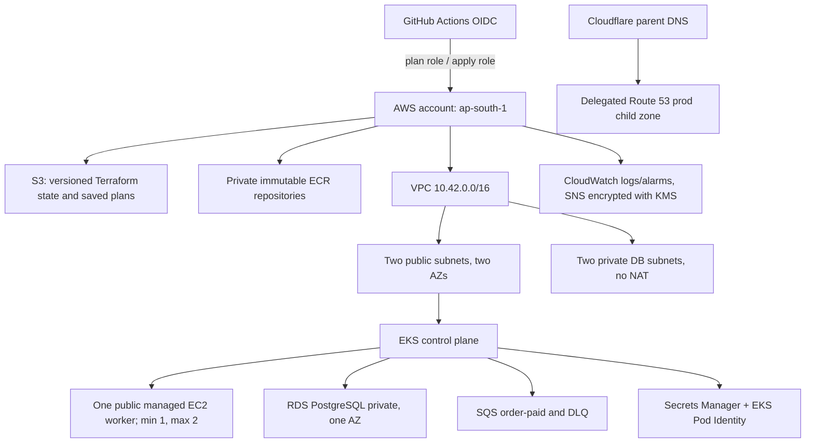

# 2. AWS and Terraform handbook: account to infrastructure

This is a guided tour of the AWS design encoded by the repository. Read it before enabling the infrastructure workflow. Cloud resources cost money, and Terraform can delete them; understand the identity, state and plan before using any mutating command.

## 2.1 Architecture at a glance



The architecture has two Terraform roots with separate purposes. **Bootstrap** resources create the durable foundation: remote state bucket, budget, OIDC provider/roles, ECR, IAM permission boundaries and optional DNS delegation. **Session** resources create the spend-heavy temporary learning environment: VPC, EKS, worker, RDS, SQS, secrets and alarms. Session teardown should preserve bootstrap state and registries.

At this documentation snapshot, a protected destroy partially removed session infrastructure: 51 resources were reported destroyed, including EKS, node group, RDS, VPC, queues and monitoring volumes; it stopped while deleting eight workload roles because the AWS apply policy lacked a narrow list-instance-profiles permission. PR #37 merged a code fix, but AWS policy update plus a new reviewed destroy plan are pending. The exact live inventory is unknown here; do not assume all remaining resources or charges are gone. Root Route 53 remains delegated from Cloudflare; retained ECR digests/state are expected. `INFRA_ENABLED=false`.

## 2.2 AWS services and why they are here

| AWS service | Job in this lab | Important operational idea |
|---|---|---|
| IAM + STS | Human/workflow/workload identities and temporary role sessions | A role trust policy says who may assume it; a permission policy says what it may do. Both must allow an operation. |
| GitHub OIDC provider | Lets GitHub Actions exchange a signed job token for short-lived AWS credentials | Trust is restricted to repository, branch and named GitHub Environment. No stored AWS access keys. |
| S3 | Terraform backend and versioned saved plans | State contains sensitive identifiers and sometimes secret-derived values. Keep private, encrypted, versioned, locked and least-privilege. |
| ECR | Four private repositories for frontend/catalogue/cart/orders | Immutable source tag plus digest; scan/sign the exact tested image. Retained images can incur storage charges. |
| VPC, subnets, IGW, routes, security groups | Network isolation and controlled paths | Public worker subnet avoids NAT cost in this lab; RDS stays private. This is not the usual hardened production worker placement. |
| EKS, EC2 managed node group | Kubernetes control plane and replaceable worker capacity | EKS control plane has an hourly charge; one worker/AZ is not HA. EKS access entries govern Kubernetes API access. |
| RDS PostgreSQL | Durable account/order data | Encrypted, private, one AZ, short automated backup retention; the current session teardown intentionally skips final snapshot. Take/verify manual backup first. |
| SQS + DLQ | Asynchronous order receipt processing and failed-message isolation | Visibility timeout, retry count, idempotent consumer and alarmed queue age matter. |
| Secrets Manager | Runtime and DB master credentials | Never place secret values in Git or output them to shell logs. Rotation is a separate operational exercise. |
| EBS + CSI | Persistent disks for monitoring/Redis | A PVC causes a separately billed EBS volume; delete PVCs before deleting the cluster/CSI controller. |
| CloudWatch + SNS + KMS | Short-retention EKS audit logs and queue notifications | SNS email needs confirmation. KMS keys and API/log usage may cost money. |
| Route 53 + ACM + ALB controller | Optional delegated DNS and HTTPS ingress | These are configured/planned, not currently live; no active ALB/cert/shop DNS is claimed. |
| AWS Budgets | Spending alerts | Alerts are delayed and never stop resources. Billing data is not an exact real-time meter. |

## 2.3 Network and availability concepts

The VPC module uses `10.42.0.0/16`, two public subnets spread across two Availability Zones, and two database subnets. Public subnets route to an Internet Gateway. Database subnet route tables have only the VPC-local route: no public IP route and no NAT. Database security group accepts TCP 5432 only from the EKS cluster security group.

The worker node is in the first public subnet and receives a public address. No SSH ingress is created; administrative traffic uses the Kubernetes API with an operator IP allowlist. The EKS public API endpoint is also restricted to operator CIDRs. The ALB controller can provision public ingress resources when enabled. This network profile saves NAT gateway charges but exposes worker nodes to public addressing; a common production pattern places workers in private subnets and budgets for controlled outbound access.

EKS needs subnets in at least two AZs, but this does **not** make the data or workload highly available. The node group has one desired/minimum node and maximum two, and pins the worker to one subnet. RDS is single-AZ. Multi-AZ architecture adds cost but protects against an AZ failure. HPA scales pod replicas, not EC2 nodes; no autoscaler is installed. `maxUnavailable=1` on a one-node group is a replacement/update setting, not extra capacity. The EKS node group supports desired 1–2 only when manually changed or a node scaler is added.

## 2.4 Terraform layout and code tour

Terraform is declarative: files describe desired resources, the provider compares them with state and AWS, and a **plan** previews operations. `apply` changes infrastructure. Terraform state maps resource addresses to real cloud identifiers; it is not disposable cache. S3 backend locking prevents concurrent state writers. Provider lock files pin plugin versions and checksums.

### Bootstrap root: `infrastructure/bootstrap/`

- `versions.tf`, `.terraform.lock.hcl`: Terraform/provider constraints and exact provider selections.
- `backend.tf`: bootstrap starts with local state and supports S3 after the state bucket exists. The migration is an explicit operation.
- `main.tf`: private S3 state bucket with versioning, public-access block, owner-enforced ACLs, encryption, TLS-only bucket policy and `prevent_destroy`.
- `budget.tf`: budget thresholds and email notification target. Budget alerts are not a hard limit.
- `registry.tf`: ECR repositories, image tag mutability/scanning/lifecycle settings and publisher identity/boundary.
- `plan-identity.tf`: OIDC trust for named `infrastructure-plan` environment; read/describe permissions and narrowly scoped saved-plan object access. It cannot mutate session infra.
- `apply-identity.tf`, `apply-services.tf`: OIDC trust for protected `infrastructure-apply`; split managed policies for AWS service domains; permissions to manage session resources and exact IAM roles while constrained by boundaries. Narrow fix for `iam:ListInstanceProfilesForRole` exists in merged code; the AWS-side policy must be brought up to date.
- `workload-boundaries.tf`, `workload-boundary-policies.json`: maximum permission ceilings for cluster/node/CNI/storage/ingress/publisher/worker/secrets roles. A boundary does not grant permission by itself; an identity policy must also grant the action. JSON snapshots of AWS managed policy documents are review aids and can become stale; compare with current AWS docs before updating.
- `access.tf`: optional MFA-protected human bootstrap role. This is a constrained setup role, not a root-account replacement.
- `dns.tf`: retained Route 53 zones/delegation and required tagging/records. Cloudflare is still the parent authority; avoid creating an unrelated duplicate root zone.
- `outputs.tf`, `variables.tf`, `production.auto.tfvars`, `bootstrap.example.tfvars`, `tests/`: public outputs, validated inputs, selected lab profile, example input and policy/contract tests.

### Session root and modules

- `infrastructure/session/main.tf` composes `network`, `eks` and `data`. This is the root for temporary cluster resources.
- `session/variables.tf` and `session.example.tfvars` define account, region, operator CIDRs, node size/AZs, notifications and optional backup snapshot. `session.auto.tfvars.json` is generated from GitHub secret at runtime, removed on runner exit, and must never be committed.
- `session/https.tf` describes optional ACM certificate/validation resources. Terraform code defines narrowly scoped ACM permissions, but the AWS-side `commerce-aws-apply-dns` policy update has not been confirmed; there is no live certificate/ALB claim. Domain/TLS activation needs the reviewed policy applied, DNS validation and route setup.
- `session/moved.tf` preserves resource addresses when code was modularized, preventing Terraform from replacing unchanged objects simply because the file path changed.
- `modules/network/`: VPC, subnets, route tables, IGW, tags and outputs.
- `modules/eks/`: cluster, restricted access entry, node/cluster/CNI/storage roles, permissions boundaries, addons, node launch template, encrypted gp3 root disk, IMDSv2 and cluster log group. Logs retain three days.
- `modules/data/`: RDS, DB security, SQS queues and redrive policy, Secrets Manager values, EKS Pod Identity roles/associations, KMS/SNS/CloudWatch alarms.
- `modules/eks/ingress.tf` and `session/policies/load-balancer.json`: permissions and trust for AWS Load Balancer Controller. Kubernetes creates ALB resources; Terraform owns the IAM prerequisites, not the controller-created ALB itself.

## 2.5 IAM in plain language

An IAM **principal** is a user, role or AWS service. A **trust policy** controls who can assume a role. A **permissions policy** grants allowed actions on resources. An **explicit deny** or permissions boundary can still block those actions. `iam:PassRole` lets a caller pass a role to a named AWS service; it is sensitive and therefore limited to exact roles/service names.

The identity chain is:

1. Developer authenticates to GitHub/AWS with their human identity and MFA as configured.
2. GitHub's OIDC token has repository/ref/environment claims. `sts:AssumeRoleWithWebIdentity` trusts only the exact expected claims.
3. Plan job assumes `commerce-aws-plan`; apply job after environment approval assumes `commerce-aws-apply`; image publisher assumes the narrowly scoped ECR role.
4. In Kubernetes, EKS Pod Identity maps a namespace/service account to a workload role. The SQS publisher can send; worker can receive/delete/change visibility; External Secrets can read only named runtime/master secrets.
5. EKS control plane/node/CNI/EBS CSI/controller roles are distinct because each component needs different AWS operations.

**Least privilege** means grant only required actions on the smallest resource scope. `Resource: "*"` may be unavoidable for some AWS `Describe` APIs, but write actions should be scoped. **Permissions boundary** is a maximum ceiling, not an allow-list in place of the role policy. **Separation of duties** means plan and apply identities differ and apply awaits a protected independent approval.

### Role and policy matrix

The code defines these distinct identities. Names are from the default `commerce-aws` profile; session roles may be absent after teardown.

| Role/identity | Trusted caller | Effective purpose and boundary |
|---|---|---|
| `commerce-aws-bootstrap` | One named human IAM user, with MFA present | Optional foundation setup only. ReadOnlyAccess plus tightly scoped writes to the state bucket, ECR, budget, GitHub OIDC and publisher role; cannot create EKS/RDS or rewrite its own access. Initial IAM objects require administrator setup/import. |
| `commerce-aws-plan` | GitHub OIDC for this repo's `infrastructure-plan` environment on main | AWS describe/read calls, runtime-secret metadata/value refresh where needed, S3 state read/lock and saved-plan write. Cannot apply or write Terraform state. |
| `commerce-aws-apply` | GitHub OIDC for this repo's protected `infrastructure-apply` environment on main | Executes the reviewed saved plan. Seven attached customer-managed policies divide IAM, network, cluster, data, DNS/certificate, state and read/preflight permissions. It cannot rewrite its own trust/policies or the boundary policies. |
| `commerce-aws-publisher` | GitHub OIDC for this repo's protected `registry-release` environment | ECR auth token plus layer/image upload/read actions only on four `commerce-aws/*` repositories; capped by `commerce-aws-publisher-boundary`. |
| `commerce-aws-cluster` | `eks.amazonaws.com` | EKS control-plane operations via AWS managed `AmazonEKSClusterPolicy`, capped by `cluster-boundary`. |
| `commerce-aws-node` | `ec2.amazonaws.com` | Worker registration and ECR pull (`AmazonEKSWorkerNodePolicy`, `AmazonEC2ContainerRegistryPullOnly`), capped by `node-boundary`. |
| `commerce-aws-cni` | EKS Pod Identity for the cluster | VPC CNI networking actions (`AmazonEKS_CNI_Policy`), capped by `cni-boundary`. |
| `commerce-aws-storage` | EKS Pod Identity for the cluster | EBS CSI volume operations (`AmazonEBSCSIDriverPolicy`), capped by `storage-boundary`. |
| `commerce-aws-ingress` | EKS Pod Identity in `kube-system` | AWS Load Balancer Controller policy for ALB lifecycle, capped by `ingress-boundary`. Only needed when ingress is enabled. |
| `commerce-aws-session-publisher` | EKS Pod Identity in namespace `commerce`, service account `commerce-publisher` | `sqs:SendMessage` to the single order-paid queue, capped by `session-publisher-boundary`. |
| `commerce-aws-session-worker` | EKS Pod Identity in namespace `commerce`, service account `commerce-worker` | `sqs:ReceiveMessage`, `DeleteMessage`, `ChangeMessageVisibility` on that queue, capped by `session-worker-boundary`. |
| `commerce-aws-secrets` | EKS Pod Identity in `external-secrets`, service account `external-secrets` | `GetSecretValue`/`DescribeSecret` on the runtime secret and RDS master secret only, capped by `secrets-boundary`. |
| AWS service-linked roles | Created/used by named AWS services | AWS-managed service plumbing (EKS, node groups, RDS, autoscaling, load balancing). These are not the app's workload roles and can outlive a session. |

Most permissions boundaries are maximums only. The role's attached/inline policy must also allow the action, and its trust must allow the caller. The EKS Pod Identity trust condition checks the exact cluster ARN, then the association binds role to namespace/service account. Kubernetes service-account names are therefore security-sensitive configuration.

`commerce-aws-apply-*` policies are generated in `apply-services.tf`; the policy suffix does not mean a separate role. Their resources are constrained by account, region, project names/tags, exact IAM role ARNs and `iam:PassedToService` conditions. Some AWS list/describe APIs require `Resource:"*"`; write permissions are more tightly scoped. `iam:ListInstanceProfilesForRole` is read-only and scoped to the eight session roles, added because the Terraform provider checks for attached instance profiles before deleting a role.

## 2.6 Safe access and setup sequence

Prerequisites: AWS account with MFA enabled on the root identity and a non-root operator identity/role; GitHub access to this repository and its Environments/Secrets/Variables; Terraform version pinned by the repo; AWS CLI; Git; and an approved budget/email. Do not paste access keys/MFA codes into chat. Prefer SSO/assume-role or MFA-protected role sessions; do not create a permanent IAM access key for CI.

1. **Inventory first.** Confirm account ID and region, inspect existing resources and billing. This project shares an account; never delete unrelated resources.
2. **Configure a local named profile** using your organization's approved MFA/SSO process. `scripts/inventory.py` is read-only and confirms account before it inventories. Do not write credentials into repository files.
3. **Review the bootstrap configuration** and current GitHub OIDC trust/permissions. Bootstrap manages retained state, ECR and identities; understand the account impact before its apply.
4. **Plan bootstrap and inspect every change.** Follow section 2.7 for local state, scoped identity imports, initial foundation apply and migration. Never create a second bucket/zone to “fix” an unknown existing one.
5. **Set GitHub Actions variables/secrets** for plan/apply/release roles, state bucket and session vars. Restrict GitHub Environment reviewers. Keep account/region allowlists accurate.
6. **Session infrastructure uses the protected workflow** from main: select `plan`, inspect its full plan summary, then choose `apply` only after review. Apply consumes the saved, versioned plan after protected environment approval. Do not use local `terraform apply` as a shortcut.
7. Verify account, cluster, nodes, database, tags, alarms and costs before installing Kubernetes platform components.

A fresh bootstrap or restoration should be done from repository instructions and Terraform outputs, not from stale identifiers in this guide. The current snapshot's session resources are partially destroyed and the current AWS bill has not been refreshed.

## 2.7 First-time bootstrap: identity, local state, then remote state

Bootstrap is more complicated than a normal session because Terraform cannot put its own state in an S3 bucket that does not exist yet. This one-time sequence creates a tightly scoped state/ECR foundation, then migrates the local state to S3. The source is `infrastructure/bootstrap/`; review its current variables, account identity and plan before following these first-run examples. Existing permissions, role ARNs and hosted zones may differ by account. Never use root credentials for routine Terraform or CI.

### Human identity prerequisite

Use the non-root MFA-enabled operator identity and approved profile. The prior lab used an observer profile for read-only inventory and a separate MFA-assumed `commerce-aws-bootstrap` role for scoped foundation changes. If your account now uses IAM Identity Center, use its profile instead. Authenticate and verify account before any action:

```bash
aws sts get-caller-identity --profile YOUR_READONLY_PROFILE
aws ec2 describe-availability-zones --region ap-south-1 --profile YOUR_READONLY_PROFILE
```

The optional `infrastructure/bootstrap/access.tf` path creates an MFA trust role, but its initial trust/boundary/inline policy must be provisioned by an administrator and then imported: a read-only observer cannot grant itself access. Do not create manual IAM objects from memory; first inspect the exact current `bootstrap_access_documents` values from a Terraform plan and compare names, trust, tags and JSON against current code. Root is not needed for routine AWS CLI commands; only an administrator with authority over IAM setup is needed for that one-time controlled provisioning.

For an already provisioned scoped role, configure a separate CLI role profile using `source_profile`, exact role ARN, MFA device ARN and 3600-second duration. A Terraform `credential_process` can consume the cached role session without printing credentials. Never redirect credentials to a file or send them in chat. If the current local environment does not contain the profile or CLI executable, stop and repair local setup; do not invent a path such as `.work/bin/aws`.

### Initialize and migrate the bootstrap backend

The bootstrap backend is initially local. Confirm the repository is clean and `.gitignore` excludes private variables/state. Use a private var-file, not a committed `terraform.tfvars`:

```bash
mkdir -p .work
cp infrastructure/bootstrap/bootstrap.example.tfvars .work/bootstrap.tfvars
# Edit .work/bootstrap.tfvars locally: account, region, unique bucket, email, DNS choices.
# If this is the first ever run, temporarily move the S3 backend declaration.
mv infrastructure/bootstrap/backend.tf .work/bootstrap-backend.tf
terraform -chdir=infrastructure/bootstrap init -input=false
terraform -chdir=infrastructure/bootstrap fmt -check
terraform -chdir=infrastructure/bootstrap validate
terraform -chdir=infrastructure/bootstrap plan -var-file=../../.work/bootstrap.tfvars -out=../../.work/bootstrap.tfplan
```

If this optional bootstrap role is not yet present, set the exact non-root user's ARN in the private var-file. Review the plan's `bootstrap_access_documents` output; it provides the expected trust JSON, inline write policy, publisher boundary, descriptions and tags. An administrator creates the customer-managed policy `commerce-aws-publisher-boundary`, role `commerce-aws-bootstrap` with that MFA trust and one-hour maximum session, its `ReadOnlyAccess` attachment, and inline policy `bootstrap-resources`. Then import these already-created IAM objects before applying any foundation changes:

```bash
terraform -chdir=infrastructure/bootstrap import -var-file=../../.work/bootstrap.tfvars \
  'aws_iam_policy.publisher_boundary[0]' \
  'arn:aws:iam::ACCOUNT:policy/commerce-aws-publisher-boundary'
terraform -chdir=infrastructure/bootstrap import -var-file=../../.work/bootstrap.tfvars \
  'aws_iam_role.bootstrap[0]' commerce-aws-bootstrap
terraform -chdir=infrastructure/bootstrap import -var-file=../../.work/bootstrap.tfvars \
  'aws_iam_role_policy_attachment.bootstrap_read[0]' \
  'commerce-aws-bootstrap/arn:aws:iam::aws:policy/ReadOnlyAccess'
terraform -chdir=infrastructure/bootstrap import -var-file=../../.work/bootstrap.tfvars \
  'aws_iam_role_policy.bootstrap_write[0]' 'commerce-aws-bootstrap:bootstrap-resources'
terraform -chdir=infrastructure/bootstrap plan -var-file=../../.work/bootstrap.tfvars
```

Stop if Terraform proposes rewriting imported IAM objects; reconcile their exact trust, policies, descriptions and tags first. The optional bootstrap role does not have EKS/RDS provisioning rights. Root/administrator console setup is a one-time access bootstrap, and the objects are tracked in Terraform state before the foundation is applied.

Inspect the plan, especially public hosted zones, budgets, IAM, ECR and `prevent_destroy`. Apply only the saved, reviewed bootstrap plan with the approved scoped identity:

```bash
terraform -chdir=infrastructure/bootstrap apply ../../.work/bootstrap.tfplan
terraform -chdir=infrastructure/bootstrap output
```

After the state bucket exists, restore the backend configuration and migrate state. Keep the local state backup encrypted until remote state is verified; then securely remove local state copies. Do not commit any `.tfstate`, plan or vars file.

```bash
mv .work/bootstrap-backend.tf infrastructure/bootstrap/backend.tf
terraform -chdir=infrastructure/bootstrap init -migrate-state -input=false \
  -backend-config='bucket=YOUR_STATE_BUCKET' \
  -backend-config='key=bootstrap/terraform.tfstate' \
  -backend-config='region=ap-south-1' \
  -backend-config='encrypt=true' \
  -backend-config='use_lockfile=true'
terraform -chdir=infrastructure/bootstrap state list
terraform -chdir=infrastructure/bootstrap plan -var-file=../../.work/bootstrap.tfvars
```

If the foundation already exists, do not repeat the initial apply or choose a new bucket/zone. Configure the backend to the existing bucket/key and inspect state. A duplicated state bucket or DNS zone is not a safe recovery method.

## 2.8 GitHub Actions and IAM activation checklist

The workflows expect GitHub repository/environment variables and secrets; Terraform code alone cannot activate GitHub settings. Configure only after AWS identity resources are provisioned and tracked. Current values are account-specific; get role ARNs from Terraform outputs and validate OIDC trust subject against the actual GitHub repository identity.

Repository variables include `AWS_ACCOUNT_ID`, `AWS_REGION`, `TF_STATE_BUCKET`, `AWS_RELEASE_ROLE_ARN`, `AWS_PLAN_ROLE_ARN`, `AWS_APPLY_ROLE_ARN`, `DELIVERY_ENABLED` and `INFRA_ENABLED`. Keep delivery/infrastructure flags `false` until each relevant role and its boundaries are reviewed. `RELEASE_APP_ID` is a variable; `RELEASE_APP_PRIVATE_KEY` belongs in the protected `release-proposal` Environment secret. `SESSION_TFVARS_JSON` belongs in `infrastructure-plan` environment secrets and must match `session.example.tfvars`. Do not print secrets in workflow logs. Limit the GitHub App installation to this repository and only required Contents/PR permissions.

Create/verify these GitHub Environments: `release-proposal`, `registry-release`, `infrastructure-plan`, `infrastructure-apply`. Restrict deployment branches to `main`; require an independent reviewer for apply and prevent self-review where the plan supports it. Required check names/rules are repository settings: configure `Required checks` as the gate after verifying its actual check run name. An Actions YAML file does not enable branch protection by itself.

The OIDC provider must trust GitHub's `sts.amazonaws.com` audience and exact repository/environment subject. The plan trust should only match the plan Environment; apply trust only the apply Environment and main ref. Publisher trust is separate and only grants ECR publishing. Do not attach `AdministratorAccess`, store static AWS keys in GitHub, or grant CI permissions to modify its own role trust/policies.

The bootstrap apply role has separate managed policies for IAM, network, cluster, data, DNS/certificate, state and read APIs. `workload-boundaries.tf` defines eight maximum-permission policies; the apply role must require the matching boundary when creating each role. Existing role permissions from the AWS console must be reconciled with Terraform before enabling infrastructure. A code change merged in PR #37 permits `iam:ListInstanceProfilesForRole` scoped to those eight role ARNs, but that change is not effective in AWS until the managed policy is updated through its owner and then a fresh plan is reviewed.

## 2.9 Useful read-only and operational commands

First verify the caller; if this returns the wrong account, stop:

```bash
aws sts get-caller-identity --profile YOUR_PROFILE
aws configure list --profile YOUR_PROFILE
aws ec2 describe-regions --region ap-south-1 --profile YOUR_PROFILE
```

Read-only project inventory (script writes a timestamped private JSON report under ignored `.work/`):

```bash
python3 scripts/inventory.py --profile YOUR_PROFILE --account YOUR_12_DIGIT_ACCOUNT_ID
```

Cloud resource spot checks (all are read-only):

```bash
aws eks list-clusters --region ap-south-1 --profile YOUR_PROFILE
aws rds describe-db-instances --region ap-south-1 --profile YOUR_PROFILE --query 'DBInstances[].{id:DBInstanceIdentifier,status:DBInstanceStatus,az:AvailabilityZone}'
aws ec2 describe-instances --region ap-south-1 --profile YOUR_PROFILE --filters Name=tag:Project,Values=commerce-aws --query 'Reservations[].Instances[].{id:InstanceId,state:State.Name,type:InstanceType,az:Placement.AvailabilityZone}'
aws elbv2 describe-load-balancers --region ap-south-1 --profile YOUR_PROFILE --query 'LoadBalancers[].{name:LoadBalancerName,state:State.Code,vpc:VpcId}'
aws ec2 describe-volumes --region ap-south-1 --profile YOUR_PROFILE --filters Name=tag:Project,Values=commerce-aws --query 'Volumes[].{id:VolumeId,state:State,gb:Size,az:AvailabilityZone}'
aws sqs list-queues --region ap-south-1 --profile YOUR_PROFILE
```

For cost, the Billing console/Cost Explorer and AWS Budgets are the source of truth; resource listing is not a bill. AWS inventory commands can return incomplete results if permissions are denied. A missing item from a partial inventory is not evidence it does not exist.

Terraform inspection in CI is preferred. Local static validation without AWS mutation is safe but does not prove a live plan:

```bash
terraform fmt -check -recursive infrastructure
for root in bootstrap session; do
  terraform -chdir="infrastructure/$root" init -backend=false -input=false -lockfile=readonly
  terraform -chdir="infrastructure/$root" validate -no-color
  terraform -chdir="infrastructure/$root" test -no-color
 done
```

For live session operations, use Actions > AWS infrastructure and the exact saved-plan workflow. With authenticated GitHub CLI, dispatching a `plan` is also possible:

```bash
gh workflow run infrastructure.yml --ref main -f operation=plan
gh run list --workflow infrastructure.yml --limit 5
gh run watch RUN_ID
# After reviewing the plan and satisfying the protected environment:
gh workflow run infrastructure.yml --ref main -f operation=apply
# Destruction additionally requires the exact confirmation input and a fresh reviewed plan:
gh workflow run infrastructure.yml --ref main -f operation=destroy -f 'confirmation=destroy commerce-aws'
```

An `apply`/`destroy` dispatch does not bypass the protected GitHub Environment approval. The workflow plans first, saves that exact plan in private versioned S3, checks its version and checksum, then waits for the apply reviewer. Read `docs/01-CI-CD.md` before running `plan`, `verify`, `apply` or `destroy`. Destroy is irreversible for resources configured with no final snapshot; make and restore-test the backup first.

## 2.10 State, backups and recovery

Terraform state is the control ledger connecting Terraform addresses to AWS object IDs. Losing it can orphan resources; corrupting it can cause replacement or deletion. The S3 bucket has versioning/encryption and the backend uses an S3 lock file. Never manually edit or delete state objects/versions to solve a lock. Inspect state only in a secure shell because state can contain sensitive values. `terraform state list` is useful only with the correct backend and identity.

RDS automated backups are configured for one day, but session destroy explicitly sets `skip_final_snapshot=true`. That choice makes teardown cheap and destructive. A retained manual snapshot is a separate billable resource. Before destroying a database: create a manual snapshot, wait until `available`, document its ID, and test restore when feasible. Restoring requires the session Terraform input `existing_backup_snapshot` and a fresh plan. Current lab's RDS data was deleted without a final/manual snapshot; treat it as lost.

Partial apply/destroy is a normal failure mode. Do not rerun an old saved plan after source or infrastructure changed. Diagnose the exact denied API, update the narrow policy through its Terraform owner, confirm the AWS managed policy matches source, create a fresh plan, and review all remaining changes. This is the current situation with `iam:ListInstanceProfilesForRole`.

## 2.11 Cost and production tradeoffs

No fixed daily/hourly estimate should be copied from an old snapshot. Prices, tax, free-tier eligibility and account credits change. The principal spend items are EKS control plane, EC2 node, RDS instance/storage, ALB and public IPv4 if created, EBS PVCs, KMS/SNS requests, logs, snapshots, data transfer and retained ECR images. Two AZ subnet objects themselves are not an extra compute charge; NAT gateways, load balancers and EKS control plane are.

This project chooses one worker, one RDS AZ, short retention and no NAT to fit a lab. Normal production commonly adds multiple accounts/environments, private nodes, multiple worker replicas/AZs, Multi-AZ database, backup retention/restore drills, policy-as-code, centralized logs, on-call ownership and disaster-recovery objectives. Learn the mechanisms here, then explicitly identify which reliability guarantees this lab omits.

## 2.12 Teardown principles

1. Stop ingress and application traffic; capture DB backup if needed.
2. Delete Kubernetes Ingress and PVC-backed services while controllers/CSI still run. Check ALBs, target groups and EBS volumes.
3. Run the protected Terraform destroy plan, inspect every deletion and approve the exact saved plan. A preflight blocks if controller-owned ALBs or project CSI volumes remain.
4. Confirm absence with a fresh AWS inventory and billing after delay. Retain bootstrap S3 state, ECR, budget and intentionally retained DNS unless explicitly cleaning them up in a separate reviewed change.
5. If a destroy fails, do not assume zero cost; inspect state and inventory, fix only the denied operation, then plan again.

Never use broad `aws ... delete` commands or `terraform destroy -auto-approve` for cleanup. There is no universal safe “delete every tagged thing” command in an account shared with other work.
