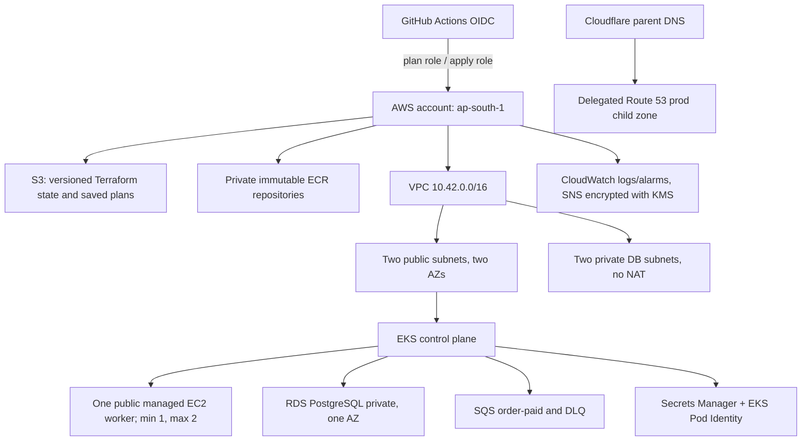

# 2. AWS and Terraform handbook: account to infrastructure

## Contents

- [Start here: cloud infrastructure from first principles](#start-here-cloud-infrastructure-from-first-principles)
- [2.1 Architecture at a glance](#21-architecture-at-a-glance)
- [2.2 AWS services and why they are here](#22-aws-services-and-why-they-are-here)
- [2.3 Network and availability concepts](#23-network-and-availability-concepts)
- [2.4 Terraform layout and code tour](#24-terraform-layout-and-code-tour)
- [2.5 IAM in plain language](#25-iam-in-plain-language)
- [2.6 Safe access and setup sequence](#26-safe-access-and-setup-sequence)
- [2.7 First-time bootstrap: identity, local state, then remote state](#27-first-time-bootstrap-identity-local-state-then-remote-state)
- [2.8 GitHub Actions and IAM activation checklist](#28-github-actions-and-iam-activation-checklist)
- [2.9 Useful read-only and operational commands](#29-useful-read-only-and-operational-commands)
- [2.10 State, backups and recovery](#210-state-backups-and-recovery)
- [2.11 Cost and production tradeoffs](#211-cost-and-production-tradeoffs)
- [2.12 Teardown principles](#212-teardown-principles)
- [2.13 Terraform code reading: how the graph is built](#213-terraform-code-reading-how-the-graph-is-built)
- [2.14 Network module: trace a packet](#214-network-module-trace-a-packet)
- [2.15 EKS module: cluster, node and add-on roles](#215-eks-module-cluster-node-and-add-on-roles)
- [2.16 Data module: durable versus disposable state](#216-data-module-durable-versus-disposable-state)
- [2.17 Saved plans, locks and partial operations](#217-saved-plans-locks-and-partial-operations)
- [2.18 Rebuild the lab safely: operator checklist](#218-rebuild-the-lab-safely-operator-checklist)
- [2.19 IAM policy deep dive: why each condition exists](#219-iam-policy-deep-dive-why-each-condition-exists)
- [2.20 Bootstrap Terraform code: ownership by file](#220-bootstrap-terraform-code-ownership-by-file)
- [2.21 Session Terraform code: inspect variables and outputs before a plan](#221-session-terraform-code-inspect-variables-and-outputs-before-a-plan)
- [2.22 AWS console versus command-line evidence](#222-aws-console-versus-command-line-evidence)
- [2.23 Terraform tests: what they prove and what they cannot](#223-terraform-tests-what-they-prove-and-what-they-cannot)
- [Guided simulation: provision, recover and account for resources](#guided-simulation-provision-recover-and-account-for-resources)

This is a guided tour of the AWS design encoded by the repository. Read it before enabling the infrastructure workflow. Cloud resources cost money, and Terraform can delete them; understand the identity, state and plan before using any mutating command.

## Start here: cloud infrastructure from first principles

A server is a computer running software. In AWS you rent virtual computers (EC2) and managed services. A managed service transfers some operating work to AWS; it does not remove your responsibility for access, configuration, application data, backups or cost. EKS manages the Kubernetes control plane; you still choose worker capacity and configure workloads. RDS manages database hosting; you still choose database access and recovery policy.

An **account** is an AWS ownership and security boundary. A **region** is a geographic deployment area, such as Mumbai. An **Availability Zone** is an isolated location within a region. Two subnets in two AZs do not create two copies of your app: replicas and placement must actually use those locations.

### Address, route, permission: three separate gates

An IP address locates a network interface. A route tells a packet where to go. A security group permits or blocks network traffic. IAM authorizes AWS API operations. None replaces the others. A database may be reachable over TCP but reject its SQL credentials. A user may call `DescribeCluster` in AWS but have no authorization to list Kubernetes pods.

A CIDR such as `10.42.0.0/16` describes an address range. `/16` fixes the first 16 address bits. A `/24` is a smaller range inside it; `/32` describes one IPv4 address. In this project, `/32` operator allowlists constrain who can reach the public EKS API endpoint. Avoid memorizing the numbers without understanding which traffic they constrain.

### Worked example: safely changing node size

Suppose the worker is too small. Editing `instance_type` expresses new intent; it does not resize a running pod or magically update AWS. Terraform plan compares configuration, recorded state and provider reads. Inspect whether the change updates or replaces the managed node group/launch resources. Review disruption, temporary overlapping capacity, quotas and cost. Apply approval authorizes that saved plan. After apply, verify node readiness and workload scheduling. A successful AWS operation alone does not prove the application recovered.

Terraform state maps an address such as `module.eks.aws_eks_cluster.this` to an AWS object. It is neither a database backup nor a snapshot of all AWS resources. Git remembers configuration, state remembers ownership mappings, and database backups preserve business data. Recreating infrastructure from Git does not recover deleted orders.

### Learn to distinguish the layers

| Layer | Example failure | Evidence to inspect |
|---|---|---|
| Authentication | Expired MFA/role credentials | `aws sts get-caller-identity` |
| AWS authorization | AccessDenied on CreateNodegroup | Caller role policies, boundary, denied API |
| Network reachability | Kubernetes API connection times out | Endpoint CIDR allowlist, current public IP, connectivity |
| Kubernetes authorization | Forbidden when listing pods | EKS access entry/policy and Kubernetes authorization |
| Scheduling | Pod remains Pending | Pod events, node capacity, quota, volume topology |
| Application dependency | Ready process cannot query DB | DB reachability, TLS, app credential and logs |

Use sections 2.13–2.16 to learn the Terraform language and actual modules, then 2.19 for IAM evaluation. The setup chapters are operational procedures; do not run them merely to understand the concepts.


## 2.1 Architecture at a glance



The architecture has two Terraform roots with separate purposes. **Bootstrap** resources create the durable foundation: remote state bucket, budget, OIDC provider/roles, ECR, IAM permission boundaries and optional DNS delegation. **Session** resources create the spend-heavy temporary learning environment: VPC, EKS, worker, RDS, SQS, secrets and alarms. Session teardown should preserve bootstrap state and registries.

At the last confirmed AWS snapshot (31 October 2026; not re-inventoried on 1 November), a protected destroy partially removed session infrastructure: 51 resources were reported destroyed, including EKS, node group, RDS, VPC, queues and monitoring volumes; it stopped while deleting eight workload roles because the AWS apply policy lacked a narrow list-instance-profiles permission. PR #37 merged the code fix, but the AWS-side apply policy update plus a new reviewed destroy plan were still pending at that snapshot. The old saved destroy plan must not be reused. The exact live inventory is unknown here; do not assume all remaining resources or charges are gone. Root Route 53 remains delegated from Cloudflare; retained ECR digests/state are expected. `INFRA_ENABLED=false`.

## 2.2 AWS services and why they are here

| AWS service | Job in this lab | Important operational idea |
|---|---|---|
| IAM + STS | Human/workflow/workload identities and temporary role sessions | A role trust policy says who may assume it; a permission policy says what it may do. Both must allow an operation. |
| GitHub OIDC provider | Lets GitHub Actions exchange a signed job token for short-lived AWS credentials | Trust is restricted to repository, branch and named GitHub Environment. No stored AWS access keys. |
| S3 | Terraform backend and versioned saved plans | State contains sensitive identifiers and sometimes secret-derived values. Keep private, encrypted, versioned, locked and least-privilege. |
| ECR | Four private repositories for frontend/catalogue/cart/orders | Immutable source tag plus digest; scan/sign the exact tested image. Retained images can incur storage charges. |
| VPC, subnets, IGW, routes, security groups | Network isolation and controlled paths | Public worker subnet avoids NAT cost in this lab; RDS stays private. This is not the usual hardened production worker placement. |
| EKS, EC2 managed node group | Kubernetes control plane and replaceable worker capacity | EKS control plane has an hourly charge; one worker/AZ is not HA. EKS access entries govern Kubernetes API access. |
| RDS PostgreSQL | Durable account/order data | Encrypted, private, one AZ, short automated backup retention; the current session teardown intentionally skips final snapshot. Take/verify manual backup first. |
| SQS + DLQ | Asynchronous order receipt processing and failed-message isolation | Visibility timeout, retry count, idempotent consumer and alarmed queue age matter. |
| Secrets Manager | Runtime and DB master credentials | Never place secret values in Git or output them to shell logs. Rotation is a separate operational exercise. |
| EBS + CSI | Persistent disks for monitoring/Redis | A PVC causes a separately billed EBS volume; delete PVCs before deleting the cluster/CSI controller. |
| CloudWatch + SNS + KMS | Short-retention EKS audit logs and queue notifications | SNS email needs confirmation. KMS keys and API/log usage may cost money. |
| Route 53 + ACM + ALB controller | Optional delegated DNS and HTTPS ingress | These are configured/planned, not currently live; no active ALB/cert/shop DNS is claimed. |
| AWS Budgets | Spending alerts | Alerts are delayed and never stop resources. Billing data is not an exact real-time meter. |

## 2.3 Network and availability concepts

The VPC module uses `10.42.0.0/16`, two public subnets spread across two Availability Zones, and two database subnets. Public subnets route to an Internet Gateway. Database subnets inherit the VPC main route table, which has only the VPC-local route: no public IP route and no NAT. Database security group accepts TCP 5432 only from the EKS cluster security group.

The worker node is in the first public subnet and receives a public address. No SSH ingress is created; administrative traffic uses the Kubernetes API with an operator IP allowlist. The EKS public API endpoint is also restricted to operator CIDRs. The ALB controller can provision public ingress resources when enabled. This network profile saves NAT gateway charges but exposes worker nodes to public addressing; a common production pattern places workers in private subnets and budgets for controlled outbound access.

EKS needs subnets in at least two AZs, but this does **not** make the data or workload highly available. The node group has one desired/minimum node and maximum two, and pins the worker to one subnet. RDS is single-AZ. Multi-AZ architecture adds cost but protects against an AZ failure. HPA scales pod replicas, not EC2 nodes; no autoscaler is installed. `maxUnavailable=1` on a one-node group is a replacement/update setting, not extra capacity. The EKS node group supports desired 1–2 only when manually changed or a node scaler is added.

## 2.4 Terraform layout and code tour

Terraform is declarative: files describe desired resources, the provider compares them with state and AWS, and a **plan** previews operations. `apply` changes infrastructure. Terraform state maps resource addresses to real cloud identifiers; it is not disposable cache. S3 backend locking prevents concurrent state writers. Provider lock files pin plugin versions and checksums.

### Bootstrap root: `infrastructure/bootstrap/`

- `versions.tf`, `.terraform.lock.hcl`: Terraform/provider constraints and exact provider selections.
- `backend.tf`: bootstrap starts with local state and supports S3 after the state bucket exists. The migration is an explicit operation.
- `main.tf`: private S3 state bucket with versioning, public-access block, owner-enforced ACLs, encryption, TLS-only bucket policy and `prevent_destroy`.
- `budget.tf`: budget thresholds and email notification target. Budget alerts are not a hard limit.
- `registry.tf`: ECR repositories, image tag mutability/scanning/lifecycle settings and publisher identity/boundary.
- `plan-identity.tf`: OIDC trust for named `infrastructure-plan` environment; read/describe permissions and narrowly scoped saved-plan object access. It cannot mutate session infra.
- `apply-identity.tf`, `apply-services.tf`: OIDC trust for protected `infrastructure-apply`; split managed policies for AWS service domains; permissions to manage session resources and exact IAM roles while constrained by boundaries. Narrow fix for `iam:ListInstanceProfilesForRole` exists in merged code; the AWS-side policy must be brought up to date.
- `workload-boundaries.tf`, `workload-boundary-policies.json`: maximum permission ceilings for cluster/node/CNI/storage/ingress/publisher/worker/secrets roles. A boundary does not grant permission by itself; an identity policy must also grant the action. JSON snapshots of AWS managed policy documents are review aids and can become stale; compare with current AWS docs before updating.
- `access.tf`: optional MFA-protected human bootstrap role. This is a constrained setup role, not a root-account replacement.
- `dns.tf`: retained Route 53 zones/delegation and required tagging/records. Cloudflare is still the parent authority; avoid creating an unrelated duplicate root zone.
- `outputs.tf`, `variables.tf`, `production.auto.tfvars`, `bootstrap.example.tfvars`, `tests/`: public outputs, validated inputs, selected lab profile, example input and policy/contract tests.

### Session root and modules

- `infrastructure/session/main.tf` composes `network`, `eks` and `data`. This is the root for temporary cluster resources.
- `session/variables.tf` and `session.example.tfvars` define account, region, operator CIDRs, node size/AZs, notifications and optional backup snapshot. `session.auto.tfvars.json` is generated from GitHub secret at runtime, removed on runner exit, and must never be committed.
- `session/https.tf` describes optional ACM certificate/validation resources. Terraform code defines narrowly scoped ACM permissions, but the AWS-side `commerce-aws-apply-dns` policy update has not been confirmed; there is no live certificate/ALB claim. Domain/TLS activation needs the reviewed policy applied, DNS validation and route setup.
- `session/moved.tf` preserves resource addresses when code was modularized, preventing Terraform from replacing unchanged objects simply because the file path changed.
- `modules/network/`: VPC, subnets, route tables, IGW, tags and outputs.
- `modules/eks/`: cluster, restricted access entry, node/cluster/CNI/storage roles, permissions boundaries, addons, node launch template, encrypted gp3 root disk, IMDSv2 and cluster log group. Logs retain three days.
- `modules/data/`: RDS, DB security, SQS queues and redrive policy, Secrets Manager values, EKS Pod Identity roles/associations, KMS/SNS/CloudWatch alarms.
- `modules/eks/ingress.tf` and `session/policies/load-balancer.json`: permissions and trust for AWS Load Balancer Controller. Kubernetes creates ALB resources; Terraform owns the IAM prerequisites, not the controller-created ALB itself.

## 2.5 IAM in plain language

An IAM **principal** is a user, role or AWS service. A **trust policy** controls who can assume a role. A **permissions policy** grants allowed actions on resources. An **explicit deny** or permissions boundary can still block those actions. `iam:PassRole` lets a caller pass a role to a named AWS service; it is sensitive and therefore limited to exact roles/service names.

The identity chain is:

1. Developer authenticates to GitHub/AWS with their human identity and MFA as configured.
2. GitHub's OIDC token has repository/ref/environment claims. `sts:AssumeRoleWithWebIdentity` trusts only the exact expected claims.
3. Plan job assumes `commerce-aws-plan`; apply job after environment approval assumes `commerce-aws-apply`; image publisher assumes the narrowly scoped ECR role.
4. In Kubernetes, EKS Pod Identity maps a namespace/service account to a workload role. The SQS publisher can send; worker can receive/delete/change visibility; External Secrets can read only named runtime/master secrets.
5. EKS control plane/node/CNI/EBS CSI/controller roles are distinct because each component needs different AWS operations.

**Least privilege** means grant only required actions on the smallest resource scope. `Resource: "*"` may be unavoidable for some AWS `Describe` APIs, but write actions should be scoped. **Permissions boundary** is a maximum ceiling, not an allow-list in place of the role policy. **Separation of duties** means plan and apply identities differ and apply awaits a protected independent approval.

### Role and policy matrix

The code defines these distinct identities. Names are from the default `commerce-aws` profile; session roles may be absent after teardown.

| Role/identity | Trusted caller | Effective purpose and boundary |
|---|---|---|
| `commerce-aws-bootstrap` | One named human IAM user, with MFA present | Optional foundation setup only. ReadOnlyAccess plus tightly scoped writes to the state bucket, ECR, budget, GitHub OIDC and publisher role; cannot create EKS/RDS or rewrite its own access. Initial IAM objects require administrator setup/import. |
| `commerce-aws-plan` | GitHub OIDC for this repo's `infrastructure-plan` environment on main | AWS describe/read calls, runtime-secret metadata/value refresh where needed, S3 state read/lock and saved-plan write. Cannot apply or write Terraform state. |
| `commerce-aws-apply` | GitHub OIDC for this repo's protected `infrastructure-apply` environment on main | Executes the reviewed saved plan. Seven attached customer-managed policies divide IAM, network, cluster, data, DNS/certificate, state and read/preflight permissions. It cannot rewrite its own trust/policies or the boundary policies. |
| `commerce-aws-publisher` | GitHub OIDC for this repo's protected `registry-release` environment | ECR auth token plus layer/image upload/read actions only on four `commerce-aws/*` repositories; capped by `commerce-aws-publisher-boundary`. |
| `commerce-aws-cluster` | `eks.amazonaws.com` | EKS control-plane operations via AWS managed `AmazonEKSClusterPolicy`, capped by `cluster-boundary`. |
| `commerce-aws-node` | `ec2.amazonaws.com` | Worker registration and ECR pull (`AmazonEKSWorkerNodePolicy`, `AmazonEC2ContainerRegistryPullOnly`), capped by `node-boundary`. |
| `commerce-aws-cni` | EKS Pod Identity for the cluster | VPC CNI networking actions (`AmazonEKS_CNI_Policy`), capped by `cni-boundary`. |
| `commerce-aws-storage` | EKS Pod Identity for the cluster | EBS CSI volume operations (`AmazonEBSCSIDriverPolicy`), capped by `storage-boundary`. |
| `commerce-aws-ingress` | EKS Pod Identity in `kube-system` | AWS Load Balancer Controller policy for ALB lifecycle, capped by `ingress-boundary`. Only needed when ingress is enabled. |
| `commerce-aws-session-publisher` | EKS Pod Identity in namespace `commerce`, service account `commerce-publisher` | `sqs:SendMessage` to the single order-paid queue, capped by `session-publisher-boundary`. |
| `commerce-aws-session-worker` | EKS Pod Identity in namespace `commerce`, service account `commerce-worker` | `sqs:ReceiveMessage`, `DeleteMessage`, `ChangeMessageVisibility` on that queue, capped by `session-worker-boundary`. |
| `commerce-aws-secrets` | EKS Pod Identity in `external-secrets`, service account `external-secrets` | `GetSecretValue`/`DescribeSecret` on the runtime secret and RDS master secret only, capped by `secrets-boundary`. |
| AWS service-linked roles | Created/used by named AWS services | AWS-managed service plumbing (EKS, node groups, RDS, autoscaling, load balancing). These are not the app's workload roles and can outlive a session. |

Most permissions boundaries are maximums only. The role's attached/inline policy must also allow the action, and its trust must allow the caller. The EKS Pod Identity trust condition checks the exact cluster ARN, then the association binds role to namespace/service account. Kubernetes service-account names are therefore security-sensitive configuration.

`commerce-aws-apply-*` policies are generated in `apply-services.tf`; the policy suffix does not mean a separate role. Their resources are constrained by account, region, project names/tags, exact IAM role ARNs and `iam:PassedToService` conditions. Some AWS list/describe APIs require `Resource:"*"`; write permissions are more tightly scoped. `iam:ListInstanceProfilesForRole` is read-only and scoped to the eight session roles, added because the Terraform provider checks for attached instance profiles before deleting a role.

## 2.6 Safe access and setup sequence

Prerequisites: AWS account with MFA enabled on the root identity and a non-root operator identity/role; GitHub access to this repository and its Environments/Secrets/Variables; Terraform version pinned by the repo; AWS CLI; Git; and an approved budget/email. Do not paste access keys/MFA codes into chat. Prefer SSO/assume-role or MFA-protected role sessions; do not create a permanent IAM access key for CI.

1. **Inventory first.** Confirm account ID and region, inspect existing resources and billing. This project shares an account; never delete unrelated resources.
2. **Configure a local named profile** using your organization's approved MFA/SSO process. `scripts/inventory.py` is read-only and confirms account before it inventories. Do not write credentials into repository files.
3. **Review the bootstrap configuration** and current GitHub OIDC trust/permissions. Bootstrap manages retained state, ECR and identities; understand the account impact before its apply.
4. **Plan bootstrap and inspect every change.** Follow section 2.7 for local state, scoped identity imports, initial foundation apply and migration. Never create a second bucket/zone to “fix” an unknown existing one.
5. **Set GitHub Actions variables/secrets** for plan/apply/release roles, state bucket and session vars. Restrict GitHub Environment reviewers. Keep account/region allowlists accurate.
6. **Session infrastructure uses the protected workflow** from main: select `plan`, inspect its full plan summary, then choose `apply` only after review. Apply consumes the saved, versioned plan after protected environment approval. Do not use local `terraform apply` as a shortcut.
7. Verify account, cluster, nodes, database, tags, alarms and costs before installing Kubernetes platform components.

A fresh bootstrap or restoration should be done from repository instructions and Terraform outputs, not from stale identifiers in this guide. The last confirmed snapshot's session resources were partially destroyed and AWS inventory/billing have not been refreshed in this documentation update.

## 2.7 First-time bootstrap: identity, local state, then remote state

Bootstrap is more complicated than a normal session because Terraform cannot put its own state in an S3 bucket that does not exist yet. This one-time sequence creates a tightly scoped state/ECR foundation, then migrates the local state to S3. The source is `infrastructure/bootstrap/`; review its current variables, account identity and plan before following these first-run examples. Existing permissions, role ARNs and hosted zones may differ by account. Never use root credentials for routine Terraform or CI.

### Human identity prerequisite

Use the non-root MFA-enabled operator identity and approved profile. The prior lab used an observer profile for read-only inventory and a separate MFA-assumed `commerce-aws-bootstrap` role for scoped foundation changes. If your account now uses IAM Identity Center, use its profile instead. Authenticate and verify account before any action:

```bash
aws sts get-caller-identity --profile YOUR_READONLY_PROFILE
aws ec2 describe-availability-zones --region ap-south-1 --profile YOUR_READONLY_PROFILE
```

The optional `infrastructure/bootstrap/access.tf` path creates an MFA trust role, but its initial trust/boundary/inline policy must be provisioned by an administrator and then imported: a read-only observer cannot grant itself access. Do not create manual IAM objects from memory; first inspect the exact current `bootstrap_access_documents` values from a Terraform plan and compare names, trust, tags and JSON against current code. Root is not needed for routine AWS CLI commands; only an administrator with authority over IAM setup is needed for that one-time controlled provisioning.

For an already provisioned scoped role, configure a separate CLI role profile using `source_profile`, exact role ARN, MFA device ARN and 3600-second duration. A Terraform `credential_process` can consume the cached role session without printing credentials. Never redirect credentials to a file or send them in chat. If the current local environment does not contain the profile or CLI executable, stop and repair local setup; do not invent a path such as `.work/bin/aws`.

### Initialize and migrate the bootstrap backend

The bootstrap backend is initially local. Confirm the repository is clean and `.gitignore` excludes private variables/state. Use a private var-file, not a committed `terraform.tfvars`:

```bash
mkdir -p .work
cp infrastructure/bootstrap/bootstrap.example.tfvars .work/bootstrap.tfvars
# Edit .work/bootstrap.tfvars locally: account, region, unique bucket, email, DNS choices.
# If this is the first ever run, temporarily move the S3 backend declaration.
mv infrastructure/bootstrap/backend.tf .work/bootstrap-backend.tf
terraform -chdir=infrastructure/bootstrap init -input=false
terraform -chdir=infrastructure/bootstrap fmt -check
terraform -chdir=infrastructure/bootstrap validate
terraform -chdir=infrastructure/bootstrap plan -var-file=../../.work/bootstrap.tfvars -out=../../.work/bootstrap.tfplan
```

If this optional bootstrap role is not yet present, set the exact non-root user's ARN in the private var-file. Review the plan's `bootstrap_access_documents` output; it provides the expected trust JSON, inline write policy, publisher boundary, descriptions and tags. An administrator creates the customer-managed policy `commerce-aws-publisher-boundary`, role `commerce-aws-bootstrap` with that MFA trust and one-hour maximum session, its `ReadOnlyAccess` attachment, and inline policy `bootstrap-resources`. Then import these already-created IAM objects before applying any foundation changes:

```bash
terraform -chdir=infrastructure/bootstrap import -var-file=../../.work/bootstrap.tfvars \
  'aws_iam_policy.publisher_boundary[0]' \
  'arn:aws:iam::ACCOUNT:policy/commerce-aws-publisher-boundary'
terraform -chdir=infrastructure/bootstrap import -var-file=../../.work/bootstrap.tfvars \
  'aws_iam_role.bootstrap[0]' commerce-aws-bootstrap
terraform -chdir=infrastructure/bootstrap import -var-file=../../.work/bootstrap.tfvars \
  'aws_iam_role_policy_attachment.bootstrap_read[0]' \
  'commerce-aws-bootstrap/arn:aws:iam::aws:policy/ReadOnlyAccess'
terraform -chdir=infrastructure/bootstrap import -var-file=../../.work/bootstrap.tfvars \
  'aws_iam_role_policy.bootstrap_write[0]' 'commerce-aws-bootstrap:bootstrap-resources'
terraform -chdir=infrastructure/bootstrap plan -var-file=../../.work/bootstrap.tfvars
```

Stop if Terraform proposes rewriting imported IAM objects; reconcile their exact trust, policies, descriptions and tags first. The optional bootstrap role does not have EKS/RDS provisioning rights. Root/administrator console setup is a one-time access bootstrap, and the objects are tracked in Terraform state before the foundation is applied.

Inspect the plan, especially public hosted zones, budgets, IAM, ECR and `prevent_destroy`. Apply only the saved, reviewed bootstrap plan with the approved scoped identity:

```bash
# Imports changed state: generate a fresh plan, inspect it, then apply that file.
terraform -chdir=infrastructure/bootstrap plan -var-file=../../.work/bootstrap.tfvars -out=../../.work/bootstrap.tfplan
terraform -chdir=infrastructure/bootstrap show ../../.work/bootstrap.tfplan
terraform -chdir=infrastructure/bootstrap apply ../../.work/bootstrap.tfplan
terraform -chdir=infrastructure/bootstrap output
```

After the state bucket exists, restore the backend configuration and migrate state. Migration is interactive here so you can inspect and confirm the destination; disabling input can prevent the confirmation. See the [Terraform init reference](https://developer.hashicorp.com/terraform/cli/commands/init). Keep the local state backup encrypted until remote state is verified; then securely remove local state copies. Do not commit any `.tfstate`, plan or vars file.

```bash
mv .work/bootstrap-backend.tf infrastructure/bootstrap/backend.tf
terraform -chdir=infrastructure/bootstrap init -migrate-state -input=true \
  -backend-config='bucket=YOUR_STATE_BUCKET' \
  -backend-config='key=bootstrap/terraform.tfstate' \
  -backend-config='region=ap-south-1' \
  -backend-config='encrypt=true' \
  -backend-config='use_lockfile=true'
terraform -chdir=infrastructure/bootstrap state list
terraform -chdir=infrastructure/bootstrap plan -var-file=../../.work/bootstrap.tfvars
```

If the foundation already exists, do not repeat the initial apply or choose a new bucket/zone. Configure the backend to the existing bucket/key and inspect state. A duplicated state bucket or DNS zone is not a safe recovery method.

## 2.8 GitHub Actions and IAM activation checklist

The workflows expect GitHub repository/environment variables and secrets; Terraform code alone cannot activate GitHub settings. Configure only after AWS identity resources are provisioned and tracked. Current values are account-specific; get role ARNs from Terraform outputs and validate OIDC trust subject against the actual GitHub repository identity.

Repository variables include `AWS_ACCOUNT_ID`, `AWS_REGION`, `TF_STATE_BUCKET`, `AWS_RELEASE_ROLE_ARN`, `AWS_PLAN_ROLE_ARN`, `AWS_APPLY_ROLE_ARN`, `DELIVERY_ENABLED` and `INFRA_ENABLED`. Keep delivery/infrastructure flags `false` until each relevant role and its boundaries are reviewed. `RELEASE_APP_ID` is a variable; `RELEASE_APP_PRIVATE_KEY` belongs in the protected `release-proposal` Environment secret. `SESSION_TFVARS_JSON` belongs in `infrastructure-plan` environment secrets and must match `session.example.tfvars`. Do not print secrets in workflow logs. Limit the GitHub App installation to this repository and only required Contents/PR permissions.

Create/verify these GitHub Environments: `release-proposal`, `registry-release`, `infrastructure-plan`, `infrastructure-apply`. Restrict deployment branches to `main`; require an independent reviewer for apply and prevent self-review where the plan supports it. Required check names/rules are repository settings: configure `Required checks` as the gate after verifying its actual check run name. An Actions YAML file does not enable branch protection by itself.

The OIDC provider must trust GitHub's `sts.amazonaws.com` audience and exact repository/environment subject. The plan trust should only match the plan Environment; apply trust only the apply Environment and main ref. Publisher trust is separate and only grants ECR publishing. Do not attach `AdministratorAccess`, store static AWS keys in GitHub, or grant CI permissions to modify its own role trust/policies.

The bootstrap apply role has separate managed policies for IAM, network, cluster, data, DNS/certificate, state and read APIs. `workload-boundaries.tf` defines eight maximum-permission policies; the apply role must require the matching boundary when creating each role. Existing role permissions from the AWS console must be reconciled with Terraform before enabling infrastructure. A code change merged in PR #37 permits `iam:ListInstanceProfilesForRole` scoped to those eight role ARNs, but that change is not effective in AWS until the managed policy is updated through its owner and then a fresh plan is reviewed.

## 2.9 Useful read-only and operational commands

First verify the caller; if this returns the wrong account, stop:

```bash
aws sts get-caller-identity --profile YOUR_PROFILE
aws configure list --profile YOUR_PROFILE
aws ec2 describe-regions --region ap-south-1 --profile YOUR_PROFILE
```

Read-only project inventory (script writes a timestamped private JSON report under ignored `.work/`):

```bash
python3 scripts/inventory.py --profile YOUR_PROFILE --account YOUR_12_DIGIT_ACCOUNT_ID
```

Cloud resource spot checks (all are read-only):

```bash
aws eks list-clusters --region ap-south-1 --profile YOUR_PROFILE
aws rds describe-db-instances --region ap-south-1 --profile YOUR_PROFILE --query 'DBInstances[].{id:DBInstanceIdentifier,status:DBInstanceStatus,az:AvailabilityZone}'
aws ec2 describe-instances --region ap-south-1 --profile YOUR_PROFILE --filters Name=tag:Project,Values=commerce-aws --query 'Reservations[].Instances[].{id:InstanceId,state:State.Name,type:InstanceType,az:Placement.AvailabilityZone}'
aws elbv2 describe-load-balancers --region ap-south-1 --profile YOUR_PROFILE --query 'LoadBalancers[].{name:LoadBalancerName,state:State.Code,vpc:VpcId}'
aws ec2 describe-volumes --region ap-south-1 --profile YOUR_PROFILE --filters Name=tag:Project,Values=commerce-aws --query 'Volumes[].{id:VolumeId,state:State,gb:Size,az:AvailabilityZone}'
aws sqs list-queues --region ap-south-1 --profile YOUR_PROFILE
```

For cost, the Billing console/Cost Explorer and AWS Budgets are the source of truth; resource listing is not a bill. AWS inventory commands can return incomplete results if permissions are denied. A missing item from a partial inventory is not evidence it does not exist.

Terraform inspection in CI is preferred. Local static validation without AWS mutation is safe but does not prove a live plan:

```bash
terraform fmt -check -recursive infrastructure
for root in bootstrap session; do
  terraform -chdir="infrastructure/$root" init -backend=false -input=false -lockfile=readonly
  terraform -chdir="infrastructure/$root" validate -no-color
  terraform -chdir="infrastructure/$root" test -no-color
 done
```

For live session operations, use Actions > AWS infrastructure and the exact saved-plan workflow. With authenticated GitHub CLI, dispatching a `plan` is also possible:

```bash
gh workflow run infrastructure.yml --ref main -f operation=plan
gh run list --workflow infrastructure.yml --limit 5
gh run watch RUN_ID
# After reviewing the plan and satisfying the protected environment:
gh workflow run infrastructure.yml --ref main -f operation=apply
# Destruction additionally requires the exact confirmation input and a fresh reviewed plan:
gh workflow run infrastructure.yml --ref main -f operation=destroy -f 'confirmation=destroy commerce-aws'
```

An `apply`/`destroy` dispatch does not bypass the protected GitHub Environment approval. The workflow plans first, saves that exact plan in private versioned S3, checks its version and checksum, then waits for the apply reviewer. Read `docs/01-CI-CD.md` before running `plan`, `verify`, `apply` or `destroy`. Destroy is irreversible for resources configured with no final snapshot; make and restore-test the backup first.

## 2.10 State, backups and recovery

Terraform state is the control ledger connecting Terraform addresses to AWS object IDs. Losing it can orphan resources; corrupting it can cause replacement or deletion. The S3 bucket has versioning/encryption and the backend uses an S3 lock file. Never manually edit or delete state objects/versions to solve a lock. Inspect state only in a secure shell because state can contain sensitive values. `terraform state list` is useful only with the correct backend and identity.

RDS automated backups are configured for one day, but session destroy explicitly sets `skip_final_snapshot=true`. That choice makes teardown cheap and destructive. A retained manual snapshot is a separate billable resource. Before destroying a database: create a manual snapshot, wait until `available`, document its ID, and test restore when feasible. Restoring requires the session Terraform input `existing_backup_snapshot` and a fresh plan. Current lab's RDS data was deleted without a final/manual snapshot; treat it as lost.

Partial apply/destroy is a normal failure mode. Do not rerun an old saved plan after source or infrastructure changed. Diagnose the exact denied API, update the narrow policy through its Terraform owner, confirm the AWS managed policy matches source, create a fresh plan, and review all remaining changes. This is the current situation with `iam:ListInstanceProfilesForRole`.

## 2.11 Cost and production tradeoffs

No fixed daily/hourly estimate should be copied from an old snapshot. Prices, tax, free-tier eligibility and account credits change. The principal spend items are EKS control plane, EC2 node, RDS instance/storage, ALB and public IPv4 if created, EBS PVCs, KMS/SNS requests, logs, snapshots, data transfer and retained ECR images. Two AZ subnet objects themselves are not an extra compute charge; NAT gateways, load balancers and EKS control plane are.

This project chooses one worker, one RDS AZ, short retention and no NAT to fit a lab. Normal production commonly adds multiple accounts/environments, private nodes, multiple worker replicas/AZs, Multi-AZ database, backup retention/restore drills, policy-as-code, centralized logs, on-call ownership and disaster-recovery objectives. Learn the mechanisms here, then explicitly identify which reliability guarantees this lab omits.

## 2.12 Teardown principles

1. Stop ingress and application traffic; capture DB backup if needed.
2. Delete Kubernetes Ingress and PVC-backed services while controllers/CSI still run. Check ALBs, target groups and EBS volumes.
3. Run the protected Terraform destroy plan, inspect every deletion and approve the exact saved plan. A preflight blocks if controller-owned ALBs or project CSI volumes remain.
4. Confirm absence with a fresh AWS inventory and billing after delay. Retain bootstrap S3 state, ECR, budget and intentionally retained DNS unless explicitly cleaning them up in a separate reviewed change.
5. If a destroy fails, do not assume zero cost; inspect state and inventory, fix only the denied operation, then plan again.

Never use broad `aws ... delete` commands or `terraform destroy -auto-approve` for cleanup. There is no universal safe “delete every tagged thing” command in an account shared with other work.

## 2.13 Terraform code reading: how the graph is built

Terraform is not executing each `.tf` file top-to-bottom. It loads all `.tf` files in a root directory, evaluates variables/locals, then builds a dependency graph from references. If a resource uses another resource's attribute, Terraform infers an ordering edge. `depends_on` adds an explicit edge where a meaningful dependency is not visible in an expression.

Example from `session/main.tf`:

```hcl
module "network" { source = "../modules/network" ... }
module "eks" {
  source            = "../modules/eks"
  public_subnet_ids = module.network.public_subnet_ids
}
module "data" {
  source                    = "../modules/data"
  vpc_id                    = module.network.vpc_id
  cluster_security_group_id = module.eks.cluster_security_group_id
}
```

The references make the graph: network first; EKS consumes subnets; data consumes network and EKS outputs. Terraform can create independent nodes in parallel. Destroy reverses dependency order where graph edges establish it. Kubernetes-created ALBs/volumes are outside the Terraform graph, which is why a separate preflight is necessary before destroying the cluster.

### Terraform language pieces seen in this repo

- `variable`: an input contract. `type`, `default`, `validation` and `description` explain the expected value and reject unsafe inputs before provider calls. Example: operator CIDRs must be explicit IPv4 `/32`, not `0.0.0.0/0`.
- `local`: a named expression reused within a root/module. It can compose ARNs and policy JSON, but it is not stored as a separately managed AWS resource.
- `resource`: a cloud object Terraform manages. Its address is `<type>.<local_name>` (or includes `[0]`/`["key"]` for `count`/`for_each`). Never confuse the Terraform local name with the AWS physical name.
- `data`: reads an object managed elsewhere or AWS metadata, such as the latest compatible PostgreSQL engine version. Data sources do not create the looked-up object.
- `module`: a reusable child configuration. Root inputs flow into it; outputs flow back to the caller. This gives ownership boundaries and reusable units.
- `output`: a value exposed after apply for scripts/operators. IDs/ARNs are not secret payloads, but state/output files can still contain sensitive data.
- `count` and `for_each`: make conditional or repeated instances. `count = 0` means absent; changing a list index can shift addresses. `for_each` keyed by stable names is usually easier to understand for role/repository sets.
- `jsonencode`: builds valid JSON policies from Terraform expressions, avoiding hand-built JSON string escaping.
- `lifecycle.prevent_destroy`: blocks Terraform from planning a destroy for a protected resource. It is a guardrail, not a backup; state removal or console deletion can still cause problems.
- `precondition`: fails planning/apply when a resource condition is violated, such as an IAM policy exceeding AWS's size limit.
- `moved` block: tells Terraform a resource address changed during refactoring so it can preserve the same remote object instead of destroying/recreating it.
- Provider `default_tags`: adds standard ownership tags to compatible AWS resources. Some AWS child resources do not inherit them, so the code adds launch-template tag specifications explicitly.

Use `terraform state list` only with the correct initialized backend and profile. A plan's `+`, `~`, `-`, and `-/+` mean create, in-place update, destroy, and destroy-then-recreate. Treat `-/+` as a potentially disruptive replacement. Plan output does not show every downstream service-created child resource.

## 2.14 Network module: trace a packet

`modules/network/main.tf` creates a `10.42.0.0/16` VPC with DNS support/hostnames, an Internet Gateway, two public subnets and two DB subnets. `cidrsubnet(vpc, 8, n)` borrows eight bits from the `/16`, creating `/24` subnets. The public subnets get indexes 0 and 1; DB subnets indexes 10 and 11. AZ order is an input contract: index 0 is the chosen worker/RDS AZ.

The Internet Gateway attaches to the VPC and is referenced by a route; it does not make every subnet public by itself. The public route table has `0.0.0.0/0 → IGW` and is associated with the public subnets. The module does not create or explicitly associate separate database route tables; the DB subnets therefore use the VPC main route table, whose only configured route is the VPC-local route. There is no NAT Gateway. The Terraform provider default tags the VPC/subnets; Kubernetes subnet discovery tags `kubernetes.io/role/elb=1` tell the ALB controller these are public load-balancer subnets.

Packet examples:

- **Operator → EKS API:** a human's public IPv4 must match `operator_cidrs`; TLS/API authentication then maps the IAM role through the EKS access entry and cluster access policy. No SSH port is exposed.
- **Internet → app:** if enabled, DNS resolves to an ALB. ALB listeners enforce HTTP-to-HTTPS redirect and certificate, target-type `ip` routes to pod IPs; security groups and Kubernetes NetworkPolicy then control the path. Currently ingress is disabled and no ALB is claimed live.
- **Pod → RDS:** pod/node network path reaches the private database subnet over the VPC local route. RDS security group admits TCP/5432 only when the source security group matches the EKS cluster SG. The DB has no public address.
- **Pod → AWS API:** EKS Pod Identity agent endpoint is allowed by the commerce egress NetworkPolicy; the service account receives temporary role credentials through the agent, not the EC2 instance profile.
- **Pod → external service:** egress allows TCP/443 globally. This makes outbound HTTPS possible without NAT in this public-node design; it is a broad destination rule and would need tighter egress policy in a more restrictive service.

A public subnet is defined by its route to an Internet Gateway, not just the subnet name. A public IP makes a worker addressable, but the security group/API rules still decide what traffic is allowed. Private nodes with NAT or VPC endpoints are a common production improvement; this repo avoids NAT's hourly/data charges for learning.

## 2.15 EKS module: cluster, node and add-on roles

`modules/eks/main.tf` builds several separate identities:

1. The EKS **cluster role** trusts `eks.amazonaws.com` and receives `AmazonEKSClusterPolicy`; EKS uses it to manage cluster-integrated AWS resources. The boundary limits the maximum actions.
2. The **node role** trusts EC2 and receives worker-node plus ECR pull-only managed policies; EC2 instances use it. It is not the same role as the EKS control plane.
3. The **CNI role** trusts the Pod Identity service, has the CNI managed policy and is associated with `aws-node`. It keeps networking permissions away from the broad node role.
4. The **EBS CSI role** trusts Pod Identity and grants the CSI controller volume actions; only the `ebs-csi-controller-sa` uses it.
5. The optional **ingress controller role** is separately associated with its controller ServiceAccount in `kube-system`.

`aws_eks_cluster` selects authentication mode `API` and disables bootstrap admin permissions for the cluster creator. Terraform creates an access entry for the exact operator IAM role and associates `AmazonEKSClusterAdminPolicy` at cluster scope. AWS IAM authentication answers “who is this principal?”; the EKS access policy supplies Kubernetes API authorization. A valid AWS session without this mapping can still get `Unauthorized` from `kubectl`.

The public Kubernetes API endpoint is enabled but CIDR-restricted to operator `/32` addresses; private access is also on. Changing ISP/VPN changes the public IP and may require a reviewed Terraform variable update. Do not solve this by opening `0.0.0.0/0`.

The managed node group is On-Demand, desired/min 1, max 2, one subnet, and `max_unavailable=1`. Its launch template sets 30 GiB encrypted gp3 root storage, deletion on instance termination, explicit instance/volume/network-interface tags, and IMDSv2 tokens required with hop limit 1. EKS control-plane logs enabled are API, audit and authenticator; retention is three days.

Add-on order matters. Pod Identity agent must exist before Pod Identity associations work. VPC CNI uses prefix delegation/network policy config and its scoped role; `kube-proxy` supplies service routing; CoreDNS starts after nodes; EBS CSI requires its role association and controller. `depends_on` encodes prerequisites the provider cannot infer from a simple attribute reference.

One worker is a single failure domain. A node group max of two is only a ceiling: it does not automatically create a second worker. HPA changes Deployment replicas; no Cluster Autoscaler/Karpenter changes node count. A rollout with `maxSurge: 1` may require spare CPU/memory to start the replacement before removing the old pod. This lab is intentionally not multi-AZ application HA.

## 2.16 Data module: durable versus disposable state

- **RDS subnet group:** names the two private database subnets so the managed service has subnet placement options.
- **RDS security group:** accepts only PostgreSQL TCP 5432 from the cluster security group. There is no public DB rule.
- **Engine/parameter group:** selects a PostgreSQL 17 compatible engine version and enables `rds.force_ssl`; applying that parameter may require reboot.
- **DB instance:** `db.t4g.micro`, gp3 encrypted 20 GiB with autoscaling ceiling 25 GiB, single-AZ, private, one-day automated backup retention, managed master password. `snapshot_identifier` optionally restores an existing manual snapshot. `skip_final_snapshot=true` and `delete_automated_backups=true` make session teardown destructive.
- **Runtime secret:** random session and application DB passwords plus connection values are written to Secrets Manager. A generated secret string can appear in Terraform state, which is another reason to protect state and backend access.
- **SQS:** the paid queue enables long polling and a 60-second visibility timeout. Five failed receives redrive to a 14-day DLQ; a redrive allow policy limits which source queue can use it. Queue-side encryption is SQS-managed.
- **Pod Identity:** queue policies are minimal. Publisher sends; worker receives/deletes/changes visibility. The `secrets` role can read the exact runtime and RDS master secrets. Service account and namespace names must agree with Helm.
- **Notifications:** customer-managed KMS key encrypts SNS; key rotation is enabled and deletion has a waiting period. SNS policy permits only matching CloudWatch alarms from this account. Email subscription sends a confirmation message; Terraform cannot click the user's email confirmation.

A database password in Secrets Manager and a Secret ARN in Git are different things: the ARN is an identifier; secret payload is sensitive. Keep both Terraform state and Kubernetes Secret access restricted. Secret rotation must update consumers safely; changing a stored value does not automatically restart a process that read an environment variable at startup.

## 2.17 Saved plans, locks and partial operations

The infrastructure workflow has a deliberate handoff:

1. The plan runner checks out a commit, initializes S3 with `session/terraform.tfstate`, obtains short-lived plan-role credentials and creates a binary plan.
2. Terraform state locking prevents a second writer from planning/applying against the same state at the same time. The lock object is not the state itself.
3. Workflow uploads the binary plan to `plans/<run-id>/<attempt>.tfplan` with server-side encryption and receives the S3 object version ID. It calculates a SHA-256 checksum and exposes only key/version/checksum as job outputs.
4. Protected apply starts separately, assumes apply role, initializes the same backend, downloads the **specific object version**, verifies checksum and checks workload roles have exact boundaries.
5. `terraform apply <saved-plan>` executes that reviewed decision. It does not silently recalculate against new configuration. If state has changed or the plan is stale, Terraform should reject it; create a new plan and review again.
6. Temporary plan file and generated tfvars are removed by shell traps. S3 lifecycle deletes plan versions after one day; state is retained/versioned.

A partial AWS operation can leave real resources even when the GitHub run fails. Terraform state records completed provider actions, but eventual consistency and denied cleanup calls can leave objects behind. After failure, capture the error, inspect CloudTrail and state, run a fresh plan, and inventory controller-owned or IAM objects. Never assume “job failed” means “nothing happened” or blindly rerun destroy.

## 2.18 Rebuild the lab safely: operator checklist

Use this order when a future session is intentionally provisioned:

1. Confirm main contains the reviewed infrastructure and application code; verify GitHub Environments and IAM OIDC trust are correct.
2. Confirm the expected AWS account ID, Mumbai region and active MFA/role session. Take the before-inventory with `scripts/inventory.py` and note its errors/limitations.
3. Confirm the bootstrap bucket and state object exist; verify Terraform state backend and lock path. Confirm the eight workload boundary policies and seven apply policies match Terraform; update any missing AWS policy only through the controlled IAM owner process.
4. Check the budget recipient, email confirmation, current prices and service-region availability. Ensure billing alerts are not mistaken for a spending cap.
5. Run the infrastructure workflow `plan`; read all actions. Unexpected recreation, unrelated DNS changes, broad IAM writes or missing tags are stop conditions.
6. Request protected apply approval only after the plan matches intent. Wait for EKS/RDS readiness, confirm output identifiers and access entry, then run a fresh inventory.
7. Prepare platform values from outputs; submit generated non-secret configuration in a PR. Only then run Argo bootstrap. Make sure monitoring and CSI controllers are healthy before workloads create PVCs.
8. After app release PR merge, observe Argo status, Deployment rollout, HPA metrics, database connectivity, queue processing and user flow. Record a baseline.
9. Before ending the session, stop public ingress, take/verify any required manual DB snapshot, run ordered Argo cleanup, inspect ALB/target groups/EBS, then execute a fresh saved destroy plan.
10. Inventory again and compare before/after reports. Inspect retained bootstrap resources and Billing/Cost Explorer after charges post. Keep state, ECR, zones, KMS deletion windows and snapshots intentionally.

This checklist is a learning practice, not a guarantee that AWS policy behavior or service quotas are validated offline. A live dry-run/test in the intended account remains a prerequisite before calling an IAM workflow operational.

## 2.19 IAM policy deep dive: why each condition exists

An IAM statement is a tuple: `Effect` (`Allow` or `Deny`), `Action` (API permissions), `Resource` (ARNs), and optional `Condition`. AWS first evaluates identity/resource/trust policies and then applies explicit denies, permission boundaries, session policies and organization controls. An allow in one document does not override an explicit deny or a missing condition.

Here is a conceptual example from the policy style used in this project (not a copy/paste policy):

```json
{
  "Effect": "Allow",
  "Action": ["sqs:SendMessage"],
  "Resource": "arn:aws:sqs:ap-south-1:ACCOUNT:commerce-aws-order-paid"
}
```

This does not allow receiving/deleting messages or sending to any queue. The publisher's identity policy and boundary both need to allow `SendMessage`; a queue policy could still deny it. This is smaller and easier to reason about than granting `sqs:*` on `*`.

### Trust statements versus permission statements

`assume_role_policy` on an IAM role is a **trust/resource policy**. It names a principal (for example GitHub OIDC, `eks.amazonaws.com`, `ec2.amazonaws.com`, or `pods.eks.amazonaws.com`) and the STS action allowed to assume the role. An attached managed policy or `aws_iam_role_policy` is a **permission policy**. It lists what an assumed session can do.

For GitHub roles, `apply-identity.tf`/`registry.tf` check claims such as:

- `aud == sts.amazonaws.com`: the token is intended for AWS STS.
- `sub == repo:<numeric-owner-and-repo-identity>:environment:<named-environment>`: only the correct repository/environment subject can assume it.
- apply additionally checks `ref == refs/heads/main`.

GitHub Environment names are identity inputs because they appear in the OIDC subject. Renaming/removing an Environment can stop assumption; broadening the subject to all branches would let unreviewed code request that role. GitHub-side reviewers gate the job; AWS-side trust restricts who the job is. Both are required.

For Pod Identity, trust accepts `pods.eks.amazonaws.com` and requires the request tag `eks-cluster-arn` to equal this cluster ARN. Terraform's `aws_eks_pod_identity_association` then binds role ARN to namespace/service account. An unrelated cluster cannot reuse the role just by creating a service account with the same name.

### The plan role

`plan-identity.tf` grants discovery APIs needed by Terraform providers, state `GetObject`, state lock `Get/Put/Delete`, and saved plan `PutObject`. It may read the runtime secret metadata/value because Terraform refreshes the secret resource. It does not have `PutObject` on the Terraform state object or any session-resource create/update/delete action. The plan is therefore reviewable but cannot provision. The S3 bucket resource and object ARNs differ: `ListBucket` applies to the bucket ARN and is prefix-limited; `GetObject`/`PutObject` apply to object ARNs.

### The apply role

`apply-identity.tf` constructs role-level operations: create the exact session roles with required permissions boundary; attach only approved AWS managed policy ARNs; put inline policies only on publisher/worker/secrets/ingress roles; pass cluster/node roles only to EKS/EC2 and Pod Identity roles only to `pods.eks.amazonaws.com`; create only named service-linked roles; and inspect/list instance profiles only for the exact eight roles. This is why an IAM permission failure must be diagnosed against the specific role ARN/API instead of fixed with `iam:*`.

`apply-services.tf` divides permissions into seven documents because IAM managed policies have size limits and separate domains:

- **`iam`:** create/delete/tag/attach narrowly named roles, apply the required boundaries, pass roles only to specific AWS services, create listed service-linked roles. No write access to the apply role's own trust/permissions or the boundary policies.
- **`network`:** VPC/subnet/IGW/route/security group/launch template and worker `RunInstances` permissions. New resources must carry project request tags; changes to existing resources require project resource tags. `RunInstances` is split across launch template, AMI/subnet/security group and created instance/volume/interface because AWS authorizes each resource type separately. Tagging is required at launch.
- **`cluster`:** EKS cluster/node-group/add-on/access-entry/Pod Identity association CRUD for the fixed `commerce-aws` names and region.
- **`data`:** exact RDS identifiers/subnet/parameter group, queue names, runtime secret name pattern, project KMS keys, SNS topic, CloudWatch alarm and EKS log group operations. Some KMS create APIs require `Resource:"*"`, constrained by request-region and project request tags.
- **`dns`:** request only `shop.prod.narx.space` DNS-validated RSA-2048 cert with expected request tags; manage only tagged project certificates; change only the ACM validation CNAME under `_*.shop.prod.narx.space` and A/AAAA alias for exact shop name in exact hosted zone. The source permission exists, but the live AWS managed policy is not confirmed updated.
- **`state`:** backend lock/state operations and reading versioned saved plans required to apply; object prefix and bucket names are restricted.
- **`read`:** reuses plan discovery statements plus load balancer describe needed by destroy preflight; reads can be broader than writes because AWS APIs do not always support resource scoping.

A policy can be syntactically valid and still not be sufficient: AWS APIs sometimes check dependent actions, resource types and request tags in ways that are only visible during a real create/update/delete. Policy tests and IAM simulation are helpful but do not prove an end-to-end plan. This is why actual environment activation needs a low-risk reviewed trial and CloudTrail inspection.

## 2.20 Bootstrap Terraform code: ownership by file

- `versions.tf` pins Terraform and AWS/Cloudflare provider ranges, sets AWS `allowed_account_ids`, and adds baseline tags. Cloudflare's token is supplied through provider environment configuration only when Terraform must update parent DNS records.
- `backend.tf` declares S3 but leaves bucket/key/region to `terraform init -backend-config`. The bootstrap state key and session state key must remain distinct.
- `main.tf` makes the state bucket deliberately hard to expose: S3 public access block, owner-enforced ownership, AES256 server-side encryption, bucket policy denying insecure transport and versioning. `prevent_destroy` protects the bucket from an ordinary plan. Versioning enables recovery from object overwrite but is not a separate backup account.
- `budget.tf` creates an account-wide monthly USD budget (default `$8`) with actual 50%/80% and forecast 100% alerts. It includes taxes, excludes credits/refunds in the current code, and notifies by email. This value is not the user's INR target and cannot stop charges; the account can incur more before the alert arrives.
- `registry.tf` creates four repositories under `commerce-aws/`, immutable tags, scan-on-push and AES256 encryption. `force_delete=false` and `prevent_destroy` keep images/repositories from being silently removed. The publisher role's OIDC trust is environment-scoped; `ecr:GetAuthorizationToken` is a global action, while layer/image actions are restricted to the four repo ARNs. A one-day lifecycle is configured for sensitive saved plans, not necessarily all image retention.
- `dns.tf` can retain a Route 53 `narx.space` zone and, when enabled, a `prod.narx.space` zone and four NS records in Cloudflare. Creating a hosted zone alone does not make it authoritative. Cloudflare remains parent authority and its API token is an external secret input; existing mail/Tunnel records must not be overwritten. Both zones use `prevent_destroy`.
- `workload-boundaries.tf` creates managed permission boundaries from AWS policy snapshots and narrowly authored app policies. Policy snapshots are point-in-time review artifacts; upstream AWS managed policies may change. Refresh them only with a reviewed compatibility/security change.
- `access.tf` is optional human setup, not application identity. Its MFA trust requires a specific user ARN. The boundary/write statements deliberately omit session provisioning operations.
- `plan-identity.tf`, `apply-identity.tf`, `apply-services.tf` create the machine access split described above. `outputs.tf` exposes role ARNs, bucket names, ECR URLs and DNS identifiers—not secret payloads.

## 2.21 Session Terraform code: inspect variables and outputs before a plan

`session.example.tfvars` documents the inputs required by the root. Review each value:

- `account_id` is validated as exactly 12 digits and the provider enforces that account (`allowed_account_ids`). This catches accidentally using a personal/default profile.
- `region` defaults to Mumbai. Changing region affects every regional ARN and service availability; the bootstrap state bucket/backend can remain in its selected region.
- `name` is fixed to `commerce-aws` because IAM policy boundaries are intentionally hard-coded to this project's resource prefix.
- `availability_zones` must contain exactly two distinct AZs. Their order matters: node group and DB use the first; second provides subnet-group and EKS API subnet topology, not a second worker.
- `operator_cidrs` requires one or more IPv4 `/32`s. Public IP changes can break API access; update through reviewed Terraform, not a wide-open CIDR.
- `operator_role_arn` must be a persistent IAM role ARN, not an STS assumed-role session ARN. EKS access entry associates a role identity.
- `kubernetes_version` and `instance_type` have defaults but must be checked against current AWS support/availability and budget before provisioning.
- `existing_backup_snapshot` is optional; when set, RDS is restored from that manual snapshot. Verify snapshot region, availability and account ownership first.
- `budget_email` feeds budget/notification configuration; confirming SNS email still requires a human click.

`session/outputs.tf` gives cluster/account/region/VPC, database identifier, runtime/master secret ARNs and queue URLs. Scripts consume these outputs to avoid hand-copying identifiers. Outputs are metadata; avoid `terraform output -json` in a public/logged context, and never query secret payloads through outputs.

## 2.22 AWS console versus command-line evidence

Console status and CLI status are views into the same AWS control plane. A console message like “Unauthorized” for Kubernetes resources may mean the console's current IAM principal has no EKS access entry/policy; it does not mean the cluster is absent. Conversely, `aws eks list-clusters` showing a name does not prove nodes or workloads exist.

Use a sequence that separates authentication, authorization and resource existence:

```bash
# 1. Which AWS identity and account did this profile select?
aws sts get-caller-identity --profile YOUR_PROFILE
# 2. Does the cluster control-plane object exist?
aws eks describe-cluster --name commerce-aws --region ap-south-1 --profile YOUR_PROFILE
# 3. Does the caller have a valid EKS API context?
aws eks update-kubeconfig --name commerce-aws --region ap-south-1 --profile YOUR_PROFILE --alias commerce-aws
kubectl --context commerce-aws get nodes
# 4. Does managed node group exist and what is its health?
aws eks describe-nodegroup --cluster-name commerce-aws --nodegroup-name session --region ap-south-1 --profile YOUR_PROFILE
```

If step 1 fails, resolve CLI login/profile/MFA. If step 2 says not found, do not proceed to kubeconfig. If `kubectl` returns Unauthorized, verify the IAM role ARN in the EKS access entry and associated policy. If nodes are absent/not ready, inspect node group health and subnet/role prerequisites. This layered diagnosis avoids confusing “AWS credentials”, “EKS authorization”, “cluster exists”, and “workloads healthy” as one problem.

## 2.23 Terraform tests: what they prove and what they cannot

Terraform's native `terraform test` files use `mock_provider`/`mock_resource` so they can inspect planned configuration without creating AWS resources. This makes them fast and safe for pull requests, but it means they do not validate live AWS IAM evaluation, quota, eventual consistency, account organization policies or actual service availability.

- `bootstrap/tests/security.tftest.hcl` checks that eight boundaries exist and fit IAM policy size, separates SQS publisher/worker actions, retains versioned state, protects ECR repositories, and scopes ECR publisher trust to the GitHub Environment.
- `bootstrap/tests/access.tftest.hcl` verifies the optional human role is a one-hour MFA-only trust, rejects root/other-account users, checks explicit actions/resources, and ensures bootstrap cannot create EC2/EKS/RDS or edit its own/boundary access.
- `bootstrap/tests/plan-identity.tftest.hcl` checks OIDC audience/environment/ref claims and asserts the plan role does not create resources or overwrite Terraform state.
- `bootstrap/tests/apply.tftest.hcl` checks apply trust, mandatory workload boundaries, protected identities, scoped EC2 RunInstances/tag conditions, narrow runtime secret reads and DNS/certificate names/record types.
- `session/tests/security.tftest.hcl` exercises EKS/data child modules with mock outputs and checks node metadata/tagging/API access/CNI settings, DB encryption/private/single-AZ profile, workload boundaries, and queue/notification identity expectations.

These tests are executable policy documentation. Read each `assert` as a sentence: it encodes a security invariant that a refactor must preserve. When an assertion fails, determine whether the intended design changed or the implementation regressed; do not delete an assertion merely to make CI green.

The separate `terraform validate` checks configuration/provider schema. `terraform fmt -check` checks formatting. `terraform plan` queries a live account and compares it with state. A mocked test can pass while the live AWS call is denied; a plan may pass while apply later fails due to a service condition. They test different layers and all are useful.

## Guided simulation: provision, recover and account for resources

**These are teaching scenarios, not live AWS findings.** They can be completed without provisioning. Predict each next step before reading the answer.

### Situation 1: a plan unexpectedly replaces the database

You intended to enlarge a worker, but the plan includes:

```text
Illustrative plan summary:
  managed worker configuration: change
  database: replacement required
  application runtime secret: change
```

**Your decision:** approve because the change request mentioned capacity?

**Answer:** stop the apply review. Locate the exact database attribute marked as forcing replacement. Compare the planned inputs with the intended change, including snapshot identifier, database identity and module addresses. A module refactor without the correct moved-address mapping can also look like deletion/recreation. Determine the actual cause from the plan; never assume it is harmless merely because the database contents are absent from the diff.

**Why:** Terraform preserves the desired infrastructure configuration, not your business records. Database replacement can require restore/migration, downtime and extra temporary capacity. The current session configuration skips a final snapshot on destroy. Review backups and data migration explicitly before approving such a plan.

**Verification before approval:** the regenerated plan matches the intended worker-only change, or the expanded DB change has an approved recovery/migration procedure. After changing configuration or state, generate a fresh saved plan. Approval must correspond to that file and source revision.

### Situation 2: AWS login works but Kubernetes access fails

Illustrative observations:

```text
sts get-caller-identity: expected account and operator role
eks describe-cluster: ACTIVE
kubectl get nodes: Unauthorized
```

**Your decision:** create a new AWS access key or open the EKS endpoint to the whole internet?

**Answer:** neither addresses the observed authorization failure. The caller has an AWS identity and can describe the cluster. Check the kubeconfig's cluster endpoint and AWS profile, then compare the persistent IAM role ARN with the EKS access entry and associated policy. An STS session ARN is not the persistent role ARN the Terraform input expects. The principal used in the browser console may also differ from the terminal role.

If the error were instead a connection timeout, investigate endpoint reachability, operator public IP and the `/32` allowlist first. If it were `Forbidden` naming a Kubernetes resource/action, investigate Kubernetes authorization for that action. Error classification prevents random changes to unrelated layers.

### Situation 3: destroy fails after deleting most infrastructure

Illustrative log:

```text
EKS: destroyed
RDS: destroyed
VPC: destroyed
IAM role cleanup: AccessDenied for iam:ListInstanceProfilesForRole
Workflow result: FAILURE
```

**Your decision:** does FAILURE imply AWS rolled everything back?

**Answer:** no. Terraform applies a sequence of provider operations; a later failure does not undo successful deletions. Consult updated state, exact error and AWS inventory. The denied list operation may be a prerequisite the provider performs before deleting an IAM role. A narrowly scoped permission update can be appropriate, but it must come through the owner of that policy. The apply role should not grant itself new privileges.

**Recovery:** bring the approved IAM policy into effect, obtain fresh credentials if required, then generate and review a new destroy plan against updated state. Do not reuse the earlier saved plan. Inventory remaining resources independently, including controller-owned ALBs, volumes, interfaces, snapshots and retained foundation objects. Permission-denied inventory checks mean “unknown,” not “absent.”

### Situation 4: recreate the infrastructure tomorrow

The desired configuration remains in Git, Terraform backend state remains in S3, and ECR retains the application images. The database was deleted and no usable backup exists.

**Predict what returns:** infrastructure can be provisioned again; image references can be reused if still present and compatible; platform controllers can be installed from reviewed configuration. **What does not return:** deleted users/orders, deleted monitoring history or other data without a backup.

New resources can receive new identifiers. Generate environment/controller values from current Terraform outputs and review a PR updating old secret ARNs/VPC identifiers. Reusing last session's values can leave Argo pointing at deleted dependencies. Check the restore source separately from the infrastructure configuration.

### Build the ownership ledger on paper

| Object | Desired-state owner | Runtime creator | Teardown evidence |
|---|---|---|---|
| VPC/EKS/RDS | Session Terraform | AWS providers/services | Fresh state/plan and AWS resource queries |
| Application pods | Git/Argo + Kubernetes | Kubernetes controllers | Namespace/workload inspection |
| ALB and target groups | Git Ingress + ALB controller | AWS Load Balancer Controller | Ingress gone and AWS load balancer/target group inventory |
| PVC disks | Git/PVC/StorageClass + CSI | EBS CSI | PVC cleanup plus EBS inventory |
| State bucket/ECR/DNS foundation | Bootstrap Terraform | AWS providers | Intentionally retained inventory and cost review |
| Manual recovery snapshot | Explicit backup runbook/operator | RDS snapshot operation | Snapshot ID, owner, retention and deletion decision |

A resource not directly listed in Terraform state can still be deliberately controller-managed. Track its owner and cleanup mechanism. A manual backup must also appear in your ledger even if Terraform did not create it.

### Reader deliverable

Prepare a session plan with: expected account/region; source commit; proposed creates/updates/deletes; budget observation method; backup decision; resource owners; expected teardown leftovers; and next-day reconstruction steps. Explain why each item is needed. This demonstrates planning skill before spending money.
