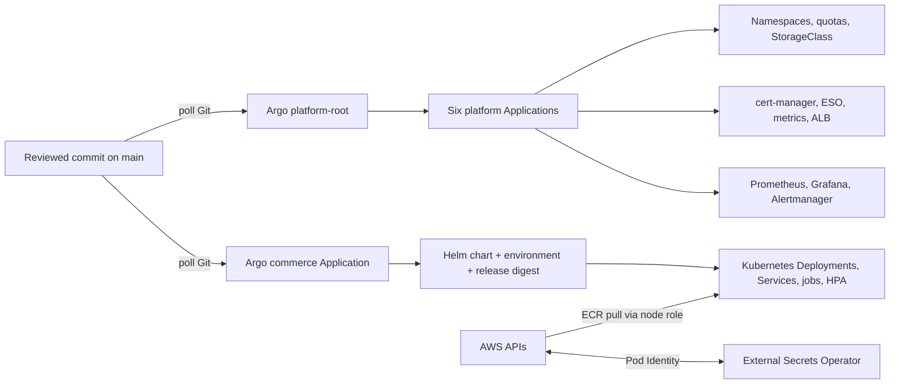

# 3. Argo CD handbook: Kubernetes desired state and GitOps

## Contents

- [Start here: what Kubernetes and Argo actually do](#start-here-what-kubernetes-and-argo-actually-do)
- [3.1 GitOps in plain language](#31-gitops-in-plain-language)
- [3.2 Ownership architecture](#32-ownership-architecture)
- [3.3 The YAML map](#33-the-yaml-map)
- [3.4 Bootstrap: why one manual step exists](#34-bootstrap-why-one-manual-step-exists)
- [3.5 Daily operation commands](#35-daily-operation-commands)
- [3.6 Promotion, rollback and drift](#36-promotion-rollback-and-drift)
- [3.7 Ordered teardown](#37-ordered-teardown)
- [3.8 How Helm fits in](#38-how-helm-fits-in)
- [3.9 Read an Argo CD Application as a contract](#39-read-an-argo-cd-application-as-a-contract)
- [3.10 Read the platform root and six child apps](#310-read-the-platform-root-and-six-child-apps)
- [3.11 Helm chart source tour: rendered workload behavior](#311-helm-chart-source-tour-rendered-workload-behavior)
- [3.12 Render locally and understand the output](#312-render-locally-and-understand-the-output)
- [3.13 Interpret Argo status precisely](#313-interpret-argo-status-precisely)
- [3.14 Safe hands-on Argo practice](#314-safe-hands-on-argo-practice)
- [Guided simulation: investigate a stalled rollout](#guided-simulation-investigate-a-stalled-rollout)

Argo CD is the Kubernetes delivery controller in this project. This guide explains what it watches, which YAML files define it, how the first controller is installed, and how to operate and remove it safely.

## Start here: what Kubernetes and Argo actually do

A **container image** is the packaged program. A **container** is a running instance of it. A **Pod** is Kubernetes' scheduling unit containing one or more containers that share a network identity and volumes. A Pod can be replaced, so clients should not depend on its IP.

A **Deployment** maintains a desired number of interchangeable pods through ReplicaSets. A **Service** provides a stable address and selects pods by labels. An **Ingress** describes HTTP routing; an ingress controller implements it. A **namespace** groups namespaced objects. It is useful for policy and organization, but does not automatically isolate network traffic or grant separate AWS accounts.

Argo adds a reconciliation loop above Kubernetes: it renders Git configuration and submits the desired objects. Kubernetes controllers then maintain pods and endpoints. The AWS load-balancer controller and EBS CSI controller manage relevant AWS resources. Several controllers cooperate; there is no single command whose success proves all these layers are healthy.

### Worked example: one pod becomes two

A Deployment requests one frontend replica. Kubernetes schedules a pod onto a node; the kubelet pulls its image and starts it. Startup probes protect slow initialization; readiness determines whether the pod should receive service traffic; liveness can restart a stuck container. When HPA requests two replicas, the Deployment controller creates another pod. The scheduler still needs enough node capacity. If it cannot place the pod, it remains Pending: HPA did its part, but it did not buy another EC2 worker.

Readiness is not liveness. A process can be alive yet temporarily unable to serve requests. A liveness probe that restarts every pod during a shared database outage can worsen recovery. Probe paths must reflect what the application actually checks; do not infer dependency coverage just from a path named `ready`.

### Requests, limits and rollout headroom

A CPU request of `50m` means 0.05 CPU for scheduling. Memory `64Mi` means 64 mebibytes. Requests help the scheduler allocate capacity; limits restrict runtime consumption. A memory limit breach may terminate a container with OOMKilled. CPU limits may throttle execution. These settings are engineering choices, not a guarantee of application performance.

With one replica and `maxSurge: 1`, Kubernetes may temporarily run two pods during an update. `maxUnavailable: 0` keeps the old ready pod until the replacement becomes ready. The node and namespace quota must fit that overlap. If the new pod cannot schedule, the rollout stalls even when the old application remains available.

| Object | Desired responsibility | Inspect it with |
|---|---|---|
| Deployment | Maintain/roll out replicas | `kubectl --context commerce-aws -n commerce get deploy` |
| Pod | Run containers on a node | `kubectl --context commerce-aws -n commerce get pods` |
| Service | Stable discovery and label-selected backends | `kubectl --context commerce-aws -n commerce get svc` |
| PVC | Request persistent storage | `kubectl --context commerce-aws -n commerce get pvc` |
| HPA | Adjust replica count from metrics | `kubectl --context commerce-aws -n commerce get hpa` |
| Argo Application | Reconcile rendered Git configuration | `kubectl --context commerce-aws -n argocd get applications` |

Commands require the recreated project cluster. Read section 3.11 beside the actual templates, then practice rendering before making cluster changes.


## 3.1 GitOps in plain language

Kubernetes has a live state: Deployments, Services, Secrets, Pods, and so on. Git contains the intended state. **GitOps** means a controller continuously compares the two and applies approved Git changes. This reverses the usual “CI runs kubectl apply” model: CI proposes a change in Git; Argo CD, running inside the cluster, reconciles it.

Argo reports two useful dimensions:

- **Sync status**: does the live object match the manifest rendered from the selected Git revision? `Synced` or `OutOfSync`.
- **Health status**: are the Kubernetes objects healthy/ready? `Healthy`, `Progressing`, `Degraded`, etc.

A deployment is not complete just because a PR merged. Check that Argo observed the desired commit, synchronized it, and the workloads became ready. A manual edit with `kubectl` is drift; Argo may revert it because self-healing is enabled.

## 3.2 Ownership architecture



Terraform owns AWS primitives and IAM: VPC/EKS, node group, RDS, queues, secrets, ECR, Pod Identity role associations and IAM permissions. Argo owns Kubernetes manifests and Helm releases. Kubernetes controllers own their resulting objects: for example, the AWS Load Balancer Controller creates an ALB from a Kubernetes Ingress, while EBS CSI creates an EBS volume for a PVC. Do not make Terraform and Argo both authoritative for the same object.

**A running lab has not been confirmed.** `deploy/environment.yaml` sets `enabled:false` and ingress disabled. The last confirmed destroy removed EKS and monitoring volumes but left eight workload IAM roles after a permission error; AWS has not been re-inventoried for this documentation update. The environment file still contains former runtime/database secret ARNs, and `deploy/platform/ingress-values.yaml` contains the former VPC ID. After recreating AWS resources, run `scripts/platform.sh configure`, inspect the generated identifiers, update them through a PR, and only then install Argo. Commands below are for a recreated project cluster and should not be run against a different kube context.

## 3.3 The YAML map

| File | What it declares |
|---|---|
| `deploy/platform-root.yaml` | Privileged `platform` AppProject and parent Application which watches `deploy/platform/apps`. The root has no deletion finalizer intentionally, so ordered teardown can remove the parent without cascading. |
| `deploy/platform/apps/applications.yaml` | Six child Applications: baseline, cert-manager, external-secrets, metrics-server, AWS Load Balancer Controller, kube-prometheus-stack. Sync waves order early dependencies; child finalizers clean owned objects. |
| `deploy/platform/resources/baseline.yaml` | Encrypted gp3 StorageClass, restricted `commerce` namespace, ResourceQuota and monitoring namespace. |
| `deploy/platform/argo-values.yaml` | Pinned Argo chart runtime settings, resource requests, service exposure/administration settings. Admin UI remains internal/port-forwarded. |
| `deploy/platform/versions.env` | Pinned bootstrap Argo Helm chart version and chart repository. |
| `deploy/platform/ingress-values.yaml` | AWS controller cluster/region/VPC and tags. Must match current Terraform outputs before install. |
| `deploy/platform/monitoring-values.yaml` | Prometheus/Grafana/Alertmanager storage, resource, retention and Slack configuration. |
| `deploy/argocd.yaml` | Commerce AppProject and Application. Uses `deploy/chart`, `deploy/environment.yaml`, and `deploy/release.json`; auto-sync, prune, self-heal and safe retry. |
| `deploy/chart/Chart.yaml`, `values.yaml`, `templates/*` | Helm package for commerce services, secret references, bootstrap job, Redis, network policies, monitoring endpoints, workloads/HPA and optional Ingress. |
| `deploy/environment.yaml` | Environment-specific enablement, AWS region, ingress setting and secret ARNs. Currently disabled; contains identifiers, not secret values. |
| `deploy/release.json` | Reviewed immutable ECR image references (digest form) and source commit. The image references are retained; they do not prove the images are currently running. |

An **Application** tells Argo where configuration lives (`source`) and where it may deploy (`destination`). An **AppProject** constrains allowed source repositories, destinations and Kubernetes cluster-scoped resources. This is a security boundary: without it, a platform config change can target a much wider part of the cluster.

### Sync behavior

The platform and commerce Applications enable automated sync with `prune:true`, `selfHeal:true`, `allowEmpty:false`. Prune removes resources deleted from Git; self-heal reverts live drift; `allowEmpty:false` prevents an empty render from deleting the whole application. `ServerSideApply=true` asks Kubernetes to track field ownership; `PruneLast=true` removes obsolete objects after replacement resources. Commerce ignores replicas for frontend/catalogue Deployments because an HPA owns that field.

Finalizers are deletion hooks. Child Applications have resource finalizers so deleting a child also removes its managed Kubernetes resources. The root deliberately has no such finalizer so teardown can stop the root first, then remove dependencies in a controlled order.

**No ApplicationSet exists in this repository.** There is one commerce Application and a parent with six child Applications. App-of-apps is used for platform components; it should not be described as an ApplicationSet-based multi-environment fleet.

## 3.4 Bootstrap: why one manual step exists

A controller cannot install itself before it exists. Terraform creates the EKS cluster and IAM prerequisites; `scripts/platform.sh install` installs the pinned Argo Helm chart once, then applies `deploy/platform-root.yaml`. From then on Argo takes ownership of the platform Applications and commerce Application. This is a normal bootstrap exception: after the first controller exists, Git becomes the source of truth.

Prerequisites: a real, running project cluster; matching AWS profile and account; current session Terraform outputs; `aws`, `kubectl`, `helm`, `terraform`, `jq`, Python/YAML dependencies; current generated ingress settings committed through review; and Slack/Grafana secrets entered locally using the helper. Do not continue if no EKS cluster exists or `kubectl` points to another cluster.

```bash
# From repository root. Prepare only downloads the pinned Argo chart; it creates no AWS/Kubernetes resources.
bash scripts/platform.sh prepare

# Configure kube context from current Terraform outputs, then check identity/context.
export AWS_PROFILE=YOUR_PROFILE
aws sts get-caller-identity
aws eks update-kubeconfig --name commerce-aws --region ap-south-1 --alias commerce-aws
kubectl config current-context
kubectl --context commerce-aws get nodes

# Generate reviewed non-secret environment/controller configuration after Terraform exists.
bash scripts/platform.sh configure
# Inspect .work/environment.generated.json and .work/platform-ingress.generated.json.
# Submit desired values via a reviewed repository change before install.

# Only after prerequisites and the reviewed config change are present:
bash scripts/platform.sh install
```

`configure` writes non-secret generated JSON into ignored `.work/`; it does not create resources. `install` checks account, cluster, VPC and values; waits for nodes; seeds Grafana and Slack secrets if missing; installs Argo; applies the platform root; waits for six platform Applications to be Synced/Healthy; then applies the commerce Application. Actual workload readiness and customer journey require separate checks.

The bootstrap script downloads a pinned chart archive. Pinning avoids silently installing a newer controller version. A version update should be an intentional reviewed change, with compatibility notes and an upgrade/rollback plan.

## 3.5 Daily operation commands

Always specify `--context commerce-aws` to avoid accidentally changing a laptop or unrelated cluster.

```bash
kubectl --context commerce-aws get applications -n argocd
kubectl --context commerce-aws get applications -n argocd -o wide
kubectl --context commerce-aws describe application commerce -n argocd
kubectl --context commerce-aws get pods -A
kubectl --context commerce-aws get events -A --sort-by=.lastTimestamp
```

The Argo CLI may be installed separately; Kubernetes commands work without it. For UI access, use a local port-forward, not a public admin endpoint:

```bash
kubectl --context commerce-aws -n argocd port-forward svc/argocd-server 8080:443
# Browse https://localhost:8080 in a local browser.
```

For Grafana, when monitoring is installed:

```bash
kubectl --context commerce-aws -n monitoring port-forward svc/monitoring-grafana 3000:80
```

The exact generated Service name can vary by Helm release; inspect `kubectl get svc -n monitoring` first. Use the seeded admin secret through the approved local secret workflow; do not print or commit it.

Useful diagnosis:

```bash
kubectl --context commerce-aws -n argocd get application commerce -o yaml
kubectl --context commerce-aws -n argocd logs statefulset/argocd-application-controller --tail=200
kubectl --context commerce-aws -n argocd logs deploy/argocd-repo-server --tail=200
kubectl --context commerce-aws -n commerce get deploy,rs,pods,svc,ingress,hpa
kubectl --context commerce-aws -n commerce describe pod POD_NAME
kubectl --context commerce-aws -n commerce logs deploy/commerce-orders --all-containers --tail=200
```

Read the Application `conditions` and comparison error. Common causes include invalid YAML/Helm values, inaccessible Git/chart repository, missing CRD, bad secret ARN/Pod Identity, image pull denial, insufficient quota, unready database, or an image digest that does not exist. `OutOfSync` is a comparison result, not automatically an outage; inspect the diff and intended source revision before syncing. Do not “fix” it with arbitrary `kubectl edit` when Git is supposed to own the object.

## 3.6 Promotion, rollback and drift

Normal deployment: merge source PR → CI tests/scans/builds → publisher writes digest → release bot opens PR updating `deploy/release.json` → human reviews release evidence and diff → merge → Argo detects the new main revision → Helm renders digest references → Kubernetes rolls Deployments → check pods, readiness, metrics and customer flow.

Rollback should normally be another reviewed Git commit/PR restoring a previously known-good digest or configuration. Reconciliation then restores that desired version. A manual imperative rollout undo creates drift and may be overwritten. For an incident, restore service first using the approved emergency process, then immediately reconcile Git to the actual intended state and record the change.

Argo is not a complete progressive-delivery controller here. There is no configured blue/green or canary rollout, no AppSet environment fleet, and no proof of automated health-analysis rollback. Kubernetes Deployment rolling updates plus readiness probes/HPA are the current application deployment mechanism.

## 3.7 Ordered teardown

Do not delete EKS first. Controllers must still exist to delete AWS ALBs and CSI volumes they created.

```bash
# Verify context/cluster and capture needed DB backup first.
kubectl --context commerce-aws get nodes
kubectl --context commerce-aws get ingress,pvc -A

# Script requires a deliberate confirmation variable.
CONFIRM_DESTROY='destroy commerce-aws' bash scripts/platform.sh teardown
```

The script deletes the parent without cascading; disables automated sync on children; deletes commerce resources/namespace; removes monitoring and PVCs while CSI is live; removes remaining platform Applications; uninstalls Argo last. Then inspect ALBs, target groups, volumes and ENIs and run the protected Terraform destroy plan. If an Application is stuck terminating, inspect finalizers and controller health; do not blindly remove finalizers, because that can orphan cloud resources.

At the current snapshot, the last run already removed monitoring PVCs and EKS; do not run teardown against an assumed cluster. First inventory actual AWS/Kubernetes resources and confirm the kube context.

## 3.8 How Helm fits in

Helm is a package manager and template renderer for Kubernetes. A chart combines defaults (`values.yaml`) with environment overrides and produces Kubernetes manifests. Argo CD invokes Helm rendering from the repo; Helm is not maintaining a separate imperative release state for the commerce app. The bootstrap Argo chart is installed with Helm once because Argo cannot reconcile itself before installation.

Use local rendering for review:

```bash
helm lint deploy/chart
helm template commerce deploy/chart \
  --namespace commerce \
  -f deploy/environment.yaml \
  -f deploy/release.json
python3 scripts/check_chart.py
```

Rendering is not deployment. Validation should catch API/schema errors; only Argo reconciliation against the correct cluster changes live objects.

## 3.9 Read an Argo CD Application as a contract

Take the `commerce` Application in `deploy/argocd.yaml`. Its fields answer five questions:

```yaml
spec:
  project: commerce
  source:
    repoURL: https://github.com/Narx-Space-Prod/commerce-aws.git
    targetRevision: main
    path: deploy/chart
    helm:
      valueFiles: [../environment.yaml, ../release.json]
  destination:
    server: https://kubernetes.default.svc
    namespace: commerce
```

- `project` is the policy envelope: allowed repositories, destinations and resource kinds.
- `repoURL` identifies the Git source. `targetRevision: main` means Argo follows the protected branch's current commit; a tagged revision would pin it differently.
- `path` selects the Helm chart directory. It is not a URL to a live cluster.
- `valueFiles` are relative to the chart source path. Helm combines chart defaults (`deploy/chart/values.yaml`) with the listed files in order; later values override earlier keys. The environment file overrides environment settings, and release JSON supplies image digests.
- `destination.server` points to the local Kubernetes API from inside the cluster. `namespace` scopes namespaced resources; cluster-scoped resources need explicit AppProject permission.

`ignoreDifferences` for frontend/catalogue replica counts handles Kubernetes HPA ownership: Argo should compare all other Deployment fields but not overwrite the replica field the HPA changes. `RespectIgnoreDifferences=true` makes sync honor those declared ignore rules.

`syncPolicy.automated.prune` deletes formerly managed objects removed from render. `selfHeal` repairs live drift. `allowEmpty:false` blocks a chart that suddenly renders nothing. `ServerSideApply=true` uses Kubernetes server-side apply field managers, useful for large/manifold resources but requiring care when two managers own the same field. `PruneLast=true` removes stale resources after applying desired ones. Retry backoff limits repeated API attempts; it does not fix permanent configuration errors.

The app chart's `.Values.enabled` gate is a second safety layer. When false, templates render no commerce objects. The current environment uses false, and the CI render check asserts the disabled chart is empty. When true, `workloads.yaml` additionally refuses missing image names or mutable tags.

## 3.10 Read the platform root and six child apps

`platform-root.yaml` has two documents separated by `---`:

1. **AppProject `platform`:** allowlists the commerce Git repository and upstream chart repositories, a short list of destination namespaces, and cluster-scoped resource kinds required by controllers. Namespace resources within approved destinations are allowed. This makes platform installation privileged but constrained.
2. **Application `platform-root`:** watches `deploy/platform/apps` in the commerce Git repo. It has automated prune/self-heal but deliberately no resource finalizer. It creates child Application objects; child Applications manage their own platform Helm charts/resources.

`applications.yaml` has six Applications. It uses sync-wave annotations to order dependencies:

- `platform-baseline`, wave `-20`: StorageClass, namespaces, pod-security labels, quota. Early namespace/storage foundation.
- `platform-cert-manager`, wave `-10`: certificate controller and CRDs. Must exist before chart components that consume certificate-related CRDs/webhooks.
- `platform-external-secrets`: installs External Secrets Operator, destination `external-secrets`; commerce ExternalSecret resources cannot reconcile until its CRDs/controller exist.
- `platform-metrics-server`: supplies Kubernetes resource metrics for `kubectl top` and HPA CPU metrics, destination `kube-system`.
- `platform-ingress`: AWS Load Balancer Controller, `kube-system`. This controller watches Ingress and creates ALB resources; IAM role/POD identity is Terraform-owned.
- `platform-monitoring`: kube-prometheus-stack in `monitoring`, which installs CRDs like ServiceMonitor/PrometheusRule and provisions PVCs.

A sync wave is ordering metadata on Argo resources. It does not guarantee that an external cloud dependency is ready; the bootstrap script additionally waits for child Applications to report Synced/Healthy and for the required CRDs to be Established before applying commerce.

The controller charts are pinned at versions in the YAML. Monitoring and ingress use **multi-source Applications**: the Helm chart comes from an upstream chart repo while `$values/...` comes from the Git repo named by `ref: values`. This avoids copying vendor charts into the application repo while keeping values reviewed in Git. When changing a chart version, review upstream breaking changes, CRDs, values schema, resource requests and rollback behavior.

The `ignoreDifferences` blocks for controller webhook CA bundles avoid Argo fighting a CA bundle injected by cert-manager/controller startup. They do not ignore the entire webhook resource. `SkipDryRunOnMissingResource=true` is used for CRD-first installs, where an API kind may not exist during an initial dry run; it should not be used indiscriminately because it can hide real schema mistakes.

## 3.11 Helm chart source tour: rendered workload behavior

`deploy/chart/Chart.yaml` names a Helm v2 application chart, not a Helm release. `values.yaml` supplies defaults. Templates are Go templates: `{{ ... }}` evaluates expressions; `{{- if ... }}` conditionally emits YAML; `range` loops over services; `required` and `fail` stop rendering when a critical value is invalid.

### `templates/workloads.yaml`

This template loops over six logical processes: frontend, catalogue, cart, orders API, publisher and worker. It resolves each `service.image` key into `release.images`, then regex-checks for an account-scoped private ECR URL containing `@sha256:<64 hex>`. This blocks `latest`, raw tags, foreign registries and malformed release records at render time.

For each process it emits a dedicated ServiceAccount, ClusterIP Service and Deployment. Pod and container security settings enforce non-root UID 10001, RuntimeDefault seccomp, no privilege escalation, read-only root filesystem, dropped Linux capabilities, bounded `/tmp`, startup/readiness/liveness probes, requests/limits and graceful termination. `automountServiceAccountToken:false` prevents a pod from receiving the default Kubernetes API token when it does not need Kubernetes API access.

A Deployment selector must exactly match pod labels; Kubernetes uses that selector to maintain the ReplicaSet. `revisionHistoryLimit:3` retains a few prior ReplicaSets. `progressDeadlineSeconds:300` reports a rollout that failed to progress. RollingUpdate `maxSurge:1, maxUnavailable:0` starts one extra pod before taking an old one away; it protects availability only if capacity/quota can fit the surge pod. A one-node cluster can be resource constrained, so watch Pending pods during rollout.

The HPA is emitted only for frontend and catalogue. It targets CPU utilization 70%, minimum one replica, maximum `autoscaling.maxReplicas` (two), with a five-minute scale-down stabilization window. It requires metrics-server and CPU requests (utilization is relative to requested CPU). An HPA does not add worker nodes; if no node capacity exists, extra replicas remain Pending.

### `templates/secrets.yaml` and `database-bootstrap.yaml`

The `SecretStore` identifies AWS Secrets Manager and region. `ExternalSecret` resources tell External Secrets Operator which remote ARN/property to fetch, how often to refresh, and which Kubernetes Secret it owns. Separate resources are used for runtime application values and the RDS master password. The source file has only ARNs, not payloads.

The database bootstrap template includes the RDS global CA bundle as a ConfigMap and a Sync hook Job. The SecretStore/ExternalSecret resources are ordered at wave `-2`; the hook Job is wave `-1`, so it is submitted later. That ordering alone does not prove External Secrets Operator has finished fetching values—the job's Secret references are the actual runtime dependency. The job uses a pinned PostgreSQL client image, a non-root user, TLS `verify-full`, `ON_ERROR_STOP`, bounded retries/time and a short deadline. It idempotently creates the `commerce_app` role if absent, resets its password from the app runtime secret, grants connect and schema privileges. App pods then use the restricted app user; only this setup job sees the master password. Hook deletion policy removes successful old jobs before the next creation and after success.

If the ExternalSecret cannot sync or is not ready before the hook starts, the bootstrap Job fails; this is safer than starting an app without its DB credential. Check the ExternalSecret conditions and target Secret, fix IAM/secret/identity first, then let Argo retry. Do not use `kubectl create secret` with a literal password as a shortcut.

### `templates/redis.yaml`

Redis is a single-replica StatefulSet with a stable service identity and one 1Gi gp3 PVC. Append-only persistence protects against pod restart while the volume remains. `--maxmemory 64mb --maxmemory-policy noeviction` makes memory behavior explicit; writes can fail at the memory limit rather than silently evicting session data. Redis stores cart/session data and is not the durable order/account database. The PVC provisions a separate EBS volume; persistent disk does not make Redis itself highly available.

### `templates/network.yaml`

The first NetworkPolicy selects all `app=commerce` pods and declares both ingress and egress policy types, so unmatched traffic is denied (assuming the cluster CNI enforces policy). It permits same-app pod traffic, monitoring scrape ingress, cluster DNS, VPC database TCP/5432, outbound HTTPS, and the EKS Pod Identity agent endpoint. The second rule allows VPC-originated traffic to frontend port 8080 for the ALB target health/data path.

NetworkPolicy is a pod-level control, not a substitute for VPC security groups, IAM, TLS or application authentication. DNS labels and destination CIDRs must correspond to actual service placement. Broad egress HTTPS is a known compromise for external endpoints; a hardened service could use controlled egress endpoints/proxies.

### `templates/ingress.yaml`

The template renders only if both app and ingress are enabled. It fails unless `publicOrigin` exactly equals `https://<ingress.host>` and a certificate ARN is supplied. ALB annotations request internet-facing scheme, pod-IP targets, HTTP and HTTPS listeners, HTTP-to-HTTPS redirect, TLS policy, health path and project tags. The rule routes host `/` to the frontend ClusterIP Service on port 80. Creating this Kubernetes object asks the controller to create AWS load balancer resources; it does not mean Terraform directly owns the ALB.

### `templates/monitoring.yaml`

It emits a ServiceMonitor and PrometheusRule only when app workloads are enabled. The ServiceMonitor selects `app=commerce` Services and scrapes the named `http` service port every 30 seconds. A relabel rule changes the metrics path for `orders`, `publisher` and `worker` from `/metrics` to Spring's `/actuator/prometheus` path. The `release: monitoring` label must match the monitoring chart's ServiceMonitor selector. The rule object has the same label convention so Prometheus Operator loads it.

## 3.12 Render locally and understand the output

Rendering uses chart defaults plus environment and release files. It does not connect to AWS or a cluster:

```bash
helm lint --strict deploy/chart -f deploy/environment.yaml -f deploy/release.json
helm template commerce deploy/chart --namespace commerce \
  -f deploy/environment.yaml -f deploy/release.json
```

Because current environment is disabled, expected output is empty. A safe enabled fixture is used by CI and `scripts/check_chart.py`; do not flip the real environment file merely to see output. You can use the example config and fake digest from the validator in a temporary file. Then inspect object kinds, names, labels/selectors, service target ports, probes, security contexts, image references and HPA target. `helm template` output is the concrete YAML Argo will submit after rendering; debugging the output is often easier than staring at template syntax.

A useful reading exercise: locate `.Values.enabled`, then search every template for its guard. Predict which objects appear for enabled app/no ingress, then enabled app/ingress. Verify CI's enabled fixture includes Ingress, NetworkPolicy, ExternalSecret, ServiceMonitor and HPA while the actual disabled render is empty.

## 3.13 Interpret Argo status precisely

- `Unknown`: Argo has not completed comparison/health evaluation or cannot read status.
- `OutOfSync`: rendered desired object differs from live object. Inspect the diff. Could be intended new release, HPA-owned replica count, manual drift, controller mutation or a failed prior sync.
- `Synced + Progressing`: desired manifests applied, but a Deployment/Job/LoadBalancer/CRD is not ready yet.
- `Synced + Healthy`: manifests match and supported health checks pass. It still does not prove login, payment, email, SQS delivery or full customer journey works.
- `Degraded`: one or more resources report health failure; inspect the exact resource and controller events.
- `ComparisonError`: Argo could not render/read desired state (repo credentials, YAML/Helm error, chart repo timeout, unknown API kind).
- `SyncFailed`: apply failed (admission, RBAC, quota, CRD or cloud controller dependency).

First find the exact revision and resource condition, then inspect controller logs/events. Avoid repeated Sync clicks if the root cause is a deterministic render/permission error. Fix desired configuration through a PR and allow the next reconciliation.

## 3.14 Safe hands-on Argo practice

When a disposable cluster is active:

1. Use `platform.sh prepare` and `configure`; explain why these steps do not create cluster resources.
2. Verify the current context endpoint equals `aws eks describe-cluster` output before install.
3. Install Argo, list the parent and six child Applications, and explain which controller manages each.
4. Make a harmless values change in a feature branch and render locally. Merge through PR, observe Argo's target revision/diff, and confirm health.
5. Manually change a noncritical managed label in a disposable namespace; observe self-heal. Do not edit IAM/Ingress/production resources as a drift demo.
6. Change a chart value in Git and observe auto-sync. Restore it with another commit to practice Git-based rollback.
7. Inspect PVCs and controller-created AWS resources before teardown. Run ordered cleanup only on the disposable cluster, then inventory cloud leftovers.

## Guided simulation: investigate a stalled rollout

**All output below is illustrative. Do not run destructive experiments against an unrelated cluster.** The scenario assumes a running project cluster and enabled commerce chart.

### Evidence round 1

```text
Argo commerce: Synced / Progressing
Frontend Deployment: desired 1, ready 1, updated 0
Old frontend pod: Running / Ready
New frontend pod: Pending
```

**Predict the next observation:** inspect the new pod's events with `kubectl --context commerce-aws -n commerce describe pod POD_NAME`. Do not delete the healthy old pod merely because the update is slow.

Suppose the event says:

```text
FailedScheduling: insufficient memory
```

**Explanation:** the rollout requests one surge pod and allows zero unavailable replicas. Keeping the old ready pod preserves traffic, but the node must fit both pods temporarily. Memory requests drive scheduling. The container memory limit is not a reservation of node capacity. A namespace quota could independently block admission; distinguish `exceeded quota` from scheduler `insufficient memory`.

**Fix choices:** use measured evidence to right-size requests if they are unnecessarily high, or add reviewed worker capacity for the rollout. Both are Git/Terraform-owned changes in this project. Reducing availability requirements trades capacity for interruption and needs a deliberate decision. Raising HPA's replica maximum does not create node memory.

**Recovery evidence:** the replacement becomes Running and Ready; the Deployment reports updated/available replicas; old replicas terminate; Argo becomes Healthy; app metrics and a synthetic request remain healthy.

### Evidence round 2: the pod starts but never becomes ready

New illustrative evidence:

```text
Pod: Running, Ready=False
Container restarts: 0
Readiness probe: HTTP 503
ExternalSecret commerce-runtime: provider access error
```

The process is running, so repeating image pulls or increasing scheduling capacity does not address this failure. Inspect ExternalSecret conditions in namespace `commerce`, then operator logs in namespace `external-secrets`. Check current secret ARN, account/region, Pod Identity association and IAM authorization. The operator's location and the custom resource's namespace are different.

If the secret never materialized, a container may instead show a configuration/startup error because its Secret key cannot be found. If the Secret exists but references a previous database, the process may run and fail readiness. Use the actual events/logs to select the branch of diagnosis; these outcomes are not interchangeable.

### Evidence round 3: someone manually fixes the live Deployment

An operator edits the live Deployment image. It works briefly, then returns to the Git-selected image.

**Explanation:** Argo self-heal sees the manual image as drift and reconciles Git. The durable fix is a reviewed desired-state change. During an emergency, any temporary controller suspension/manual action must be deliberate and recorded, followed by reconciliation of Git before normal automation resumes. Repeatedly fighting the controller makes the incident harder to understand.

### Reader deliverable

Draw this dependency chain and annotate where each failure can stop progress:

```text
Git revision → Helm render → Kubernetes admission → scheduling
→ image pull → container start → startup/readiness → Service endpoints
→ ALB target health → customer request
```

For each arrow, name one piece of evidence. Example: image pull failures appear in pod events; readiness governs eligible service endpoints; an ALB target-health problem can persist even when a pod is Ready. A successful earlier step does not establish the later ones.
