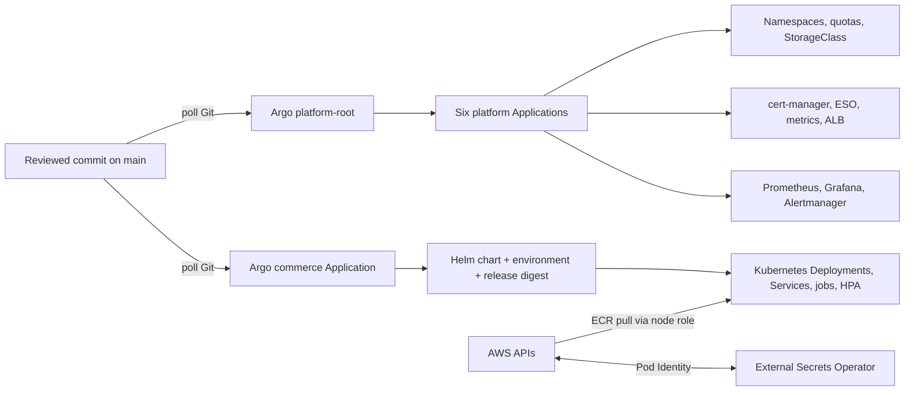

# 3. Argo CD handbook: Kubernetes desired state and GitOps

Argo CD is the Kubernetes delivery controller in this project. This guide explains what it watches, which YAML files define it, how the first controller is installed, and how to operate and remove it safely.

## 3.1 GitOps in plain language

Kubernetes has a live state: Deployments, Services, Secrets, Pods, and so on. Git contains the intended state. **GitOps** means a controller continuously compares the two and applies approved Git changes. This reverses the usual “CI runs kubectl apply” model: CI proposes a change in Git; Argo CD, running inside the cluster, reconciles it.

Argo reports two useful dimensions:

- **Sync status**: does the live object match the manifest rendered from the selected Git revision? `Synced` or `OutOfSync`.
- **Health status**: are the Kubernetes objects healthy/ready? `Healthy`, `Progressing`, `Degraded`, etc.

A deployment is not complete just because a PR merged. Check that Argo observed the desired commit, synchronized it, and the workloads became ready. A manual edit with `kubectl` is drift; Argo may revert it because self-healing is enabled.

## 3.2 Ownership architecture



Terraform owns AWS primitives and IAM: VPC/EKS, node group, RDS, queues, secrets, ECR, Pod Identity role associations and IAM permissions. Argo owns Kubernetes manifests and Helm releases. Kubernetes controllers own their resulting objects: for example, the AWS Load Balancer Controller creates an ALB from a Kubernetes Ingress, while EBS CSI creates an EBS volume for a PVC. Do not make Terraform and Argo both authoritative for the same object.

**The current lab is not live.** `deploy/environment.yaml` sets `enabled:false` and ingress disabled. The last destroy removed EKS and monitoring volumes but left eight workload IAM roles after a permission error. Argo commands below are for a future/recreated cluster and should not be run against a different kube context. Current AWS runtime inventory has not been refreshed.

## 3.3 The YAML map

| File | What it declares |
|---|---|
| `deploy/platform-root.yaml` | Privileged `platform` AppProject and parent Application which watches `deploy/platform/apps`. The root has no deletion finalizer intentionally, so ordered teardown can remove the parent without cascading. |
| `deploy/platform/apps/applications.yaml` | Six child Applications: baseline, cert-manager, external-secrets, metrics-server, AWS Load Balancer Controller, kube-prometheus-stack. Sync waves order early dependencies; child finalizers clean owned objects. |
| `deploy/platform/resources/baseline.yaml` | Encrypted gp3 StorageClass, restricted `commerce` namespace, ResourceQuota and monitoring namespace. |
| `deploy/platform/argo-values.yaml` | Pinned Argo chart runtime settings, resource requests, service exposure/administration settings. Admin UI remains internal/port-forwarded. |
| `deploy/platform/versions.env` | Pinned bootstrap Argo Helm chart version and chart repository. |
| `deploy/platform/ingress-values.yaml` | AWS controller cluster/region/VPC and tags. Must match current Terraform outputs before install. |
| `deploy/platform/monitoring-values.yaml` | Prometheus/Grafana/Alertmanager storage, resource, retention and Slack configuration. |
| `deploy/argocd.yaml` | Commerce AppProject and Application. Uses `deploy/chart`, `deploy/environment.yaml`, and `deploy/release.json`; auto-sync, prune, self-heal and safe retry. |
| `deploy/chart/Chart.yaml`, `values.yaml`, `templates/*` | Helm package for commerce services, secret references, bootstrap job, Redis, network policies, monitoring endpoints, workloads/HPA and optional Ingress. |
| `deploy/environment.yaml` | Environment-specific enablement, AWS region, ingress setting and secret ARNs. Currently disabled; contains identifiers, not secret values. |
| `deploy/release.json` | Reviewed immutable ECR image references (digest form) and source commit. The image references are retained; they do not prove the images are currently running. |

An **Application** tells Argo where configuration lives (`source`) and where it may deploy (`destination`). An **AppProject** constrains allowed source repositories, destinations and Kubernetes cluster-scoped resources. This is a security boundary: without it, a platform config change can target a much wider part of the cluster.

### Sync behavior

The platform and commerce Applications enable automated sync with `prune:true`, `selfHeal:true`, `allowEmpty:false`. Prune removes resources deleted from Git; self-heal reverts live drift; `allowEmpty:false` prevents an empty render from deleting the whole application. `ServerSideApply=true` asks Kubernetes to track field ownership; `PruneLast=true` removes obsolete objects after replacement resources. Commerce ignores replicas for frontend/catalogue Deployments because an HPA owns that field.

Finalizers are deletion hooks. Child Applications have resource finalizers so deleting a child also removes its managed Kubernetes resources. The root deliberately has no such finalizer so teardown can stop the root first, then remove dependencies in a controlled order.

**No ApplicationSet exists in this repository.** There is one commerce Application and a parent with six child Applications. App-of-apps is used for platform components; it should not be described as an ApplicationSet-based multi-environment fleet.

## 3.4 Bootstrap: why one manual step exists

A controller cannot install itself before it exists. Terraform creates the EKS cluster and IAM prerequisites; `scripts/platform.sh install` installs the pinned Argo Helm chart once, then applies `deploy/platform-root.yaml`. From then on Argo takes ownership of the platform Applications and commerce Application. This is a normal bootstrap exception: after the first controller exists, Git becomes the source of truth.

Prerequisites: a real, running project cluster; matching AWS profile and account; current session Terraform outputs; `aws`, `kubectl`, `helm`, `terraform`, `jq`, Python/YAML dependencies; current generated ingress settings committed through review; and Slack/Grafana secrets entered locally using the helper. Do not continue if no EKS cluster exists or `kubectl` points to another cluster.

```bash
# From repository root. Prepare only downloads the pinned Argo chart; it creates no AWS/Kubernetes resources.
bash scripts/platform.sh prepare

# Configure kube context from current Terraform outputs, then check identity/context.
aws sts get-caller-identity --profile YOUR_PROFILE
aws eks update-kubeconfig --name commerce-aws --region ap-south-1 --alias commerce-aws
kubectl config current-context
kubectl --context commerce-aws get nodes

# Generate reviewed non-secret environment/controller configuration after Terraform exists.
bash scripts/platform.sh configure
# Inspect .work/environment.generated.json and .work/platform-ingress.generated.json.
# Submit desired values via a reviewed repository change before install.

# Only after prerequisites and the reviewed config change are present:
bash scripts/platform.sh install
```

`configure` writes non-secret generated JSON into ignored `.work/`; it does not create resources. `install` checks account, cluster, VPC and values; waits for nodes; seeds Grafana and Slack secrets if missing; installs Argo; applies the platform root; waits for six platform Applications to be Synced/Healthy; then applies the commerce Application. Actual workload readiness and customer journey require separate checks.

The bootstrap script downloads a pinned chart archive. Pinning avoids silently installing a newer controller version. A version update should be an intentional reviewed change, with compatibility notes and an upgrade/rollback plan.

## 3.5 Daily operation commands

Always specify `--context commerce-aws` to avoid accidentally changing a laptop or unrelated cluster.

```bash
kubectl --context commerce-aws get applications -n argocd
kubectl --context commerce-aws get applications -n argocd -o wide
kubectl --context commerce-aws describe application commerce -n argocd
kubectl --context commerce-aws get pods -A
kubectl --context commerce-aws get events -A --sort-by=.lastTimestamp
```

The Argo CLI may be installed separately; Kubernetes commands work without it. For UI access, use a local port-forward, not a public admin endpoint:

```bash
kubectl --context commerce-aws -n argocd port-forward svc/argocd-server 8080:443
# Browse https://localhost:8080 in a local browser.
```

For Grafana, when monitoring is installed:

```bash
kubectl --context commerce-aws -n monitoring port-forward svc/monitoring-grafana 3000:80
```

The exact generated Service name can vary by Helm release; inspect `kubectl get svc -n monitoring` first. Use the seeded admin secret through the approved local secret workflow; do not print or commit it.

Useful diagnosis:

```bash
kubectl --context commerce-aws -n argocd get application commerce -o yaml
kubectl --context commerce-aws -n argocd logs deploy/argocd-application-controller --tail=200
kubectl --context commerce-aws -n argocd logs deploy/argocd-repo-server --tail=200
kubectl --context commerce-aws -n commerce get deploy,rs,pods,svc,ingress,hpa
kubectl --context commerce-aws -n commerce describe pod POD_NAME
kubectl --context commerce-aws -n commerce logs deploy/commerce-orders --all-containers --tail=200
```

Read the Application `conditions` and comparison error. Common causes include invalid YAML/Helm values, inaccessible Git/chart repository, missing CRD, bad secret ARN/Pod Identity, image pull denial, insufficient quota, unready database, or an image digest that does not exist. `OutOfSync` is a comparison result, not automatically an outage; inspect the diff and intended source revision before syncing. Do not “fix” it with arbitrary `kubectl edit` when Git is supposed to own the object.

## 3.6 Promotion, rollback and drift

Normal deployment: merge source PR → CI tests/scans/builds → publisher writes digest → release bot opens PR updating `deploy/release.json` → human reviews release evidence and diff → merge → Argo detects the new main revision → Helm renders digest references → Kubernetes rolls Deployments → check pods, readiness, metrics and customer flow.

Rollback should normally be another reviewed Git commit/PR restoring a previously known-good digest or configuration. Reconciliation then restores that desired version. A manual imperative rollout undo creates drift and may be overwritten. For an incident, restore service first using the approved emergency process, then immediately reconcile Git to the actual intended state and record the change.

Argo is not a complete progressive-delivery controller here. There is no configured blue/green or canary rollout, no AppSet environment fleet, and no proof of automated health-analysis rollback. Kubernetes Deployment rolling updates plus readiness probes/HPA are the current application deployment mechanism.

## 3.7 Ordered teardown

Do not delete EKS first. Controllers must still exist to delete AWS ALBs and CSI volumes they created.

```bash
# Verify context/cluster and capture needed DB backup first.
kubectl --context commerce-aws get nodes
kubectl --context commerce-aws get ingress,pvc -A

# Script requires a deliberate confirmation variable.
CONFIRM_DESTROY='destroy commerce-aws' bash scripts/platform.sh teardown
```

The script deletes the parent without cascading; disables automated sync on children; deletes commerce resources/namespace; removes monitoring and PVCs while CSI is live; removes remaining platform Applications; uninstalls Argo last. Then inspect ALBs, target groups, volumes and ENIs and run the protected Terraform destroy plan. If an Application is stuck terminating, inspect finalizers and controller health; do not blindly remove finalizers, because that can orphan cloud resources.

At the current snapshot, the last run already removed monitoring PVCs and EKS; do not run teardown against an assumed cluster. First inventory actual AWS/Kubernetes resources and confirm the kube context.

## 3.8 How Helm fits in

Helm is a package manager and template renderer for Kubernetes. A chart combines defaults (`values.yaml`) with environment overrides and produces Kubernetes manifests. Argo CD invokes Helm rendering from the repo; Helm is not maintaining a separate imperative release state for the commerce app. The bootstrap Argo chart is installed with Helm once because Argo cannot reconcile itself before installation.

Use local rendering for review:

```bash
helm lint deploy/chart
helm template commerce deploy/chart \
  --namespace commerce \
  -f deploy/environment.yaml \
  -f deploy/release.json
python3 scripts/check_chart.py
```

Rendering is not deployment. Validation should catch API/schema errors; only Argo reconciliation against the correct cluster changes live objects.
